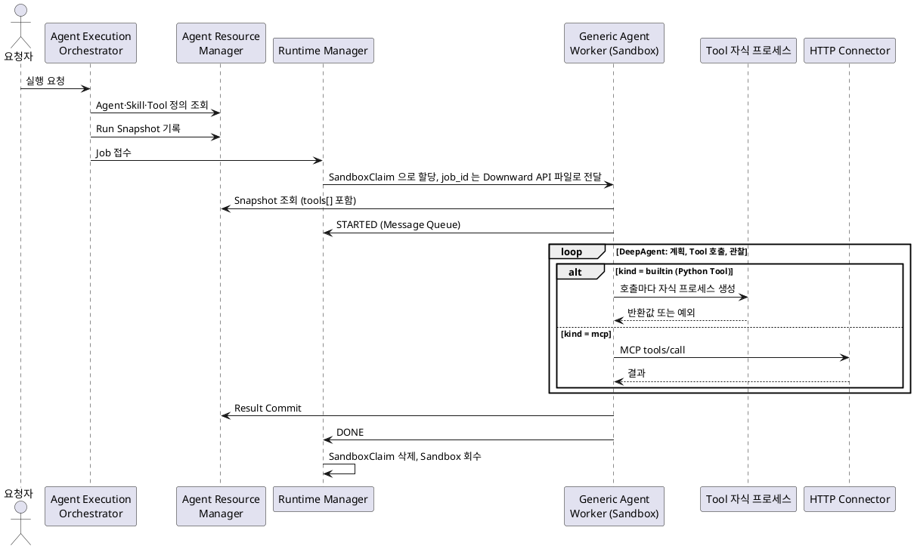
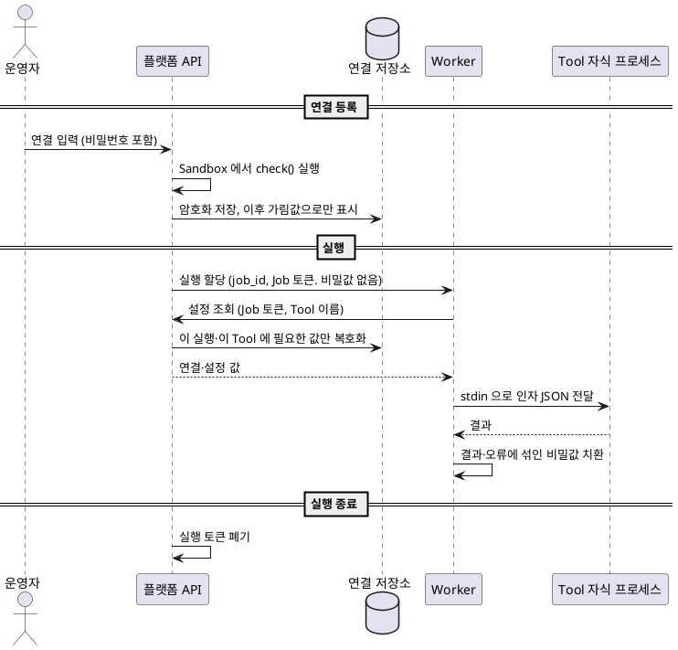

# Tool Dev Guides

| 항목      | 값                                                    |
| --------- | ----------------------------------------------------- |
| 문서 상태 | 초안                                                  |
| 작성일    | 2026-10-14                                            |
| 대상      | Generic Agent 에 Python Tool 을 만들어 붙이는 개발자  |
| 근거      | Governance 1.1.0, Python Tool 작성 가이드(2026-09-28) |

## 1. 개요

Governance 문서, Python Tool 작성 가이드를 참고하여 `Graphio Agent Tool` 개발 가이드를 작성하였다.
문서마다 서술이 다르거나 정해지지 않은 항목은 현재 10장 확인 필요 사항에 모았다.

### 1.1. 핵심 요약

1. Python Tool 은 Sandbox 이미지(`gaf-generic-agent`)에 들어 있는 Python 함수다. 실행 중에 코드를 내려받지 않는다.
2. Tool 호출마다 Worker 와 분리된 자식 프로세스가 새로 뜬다. 호출 사이에 상태를 남길 수 없다.
3. 입력은 등록한 JSON Schema 대로 키워드 인자로 받고, 결과는 JSON 으로 바꿀 수 있는 반환값으로만 돌려준다.
4. 실패는 예외로 알린다. 그 호출만 오류가 되고 Agent 실행은 계속된다. 오류 메시지는 모델에 그대로 전달될 수 있다.
5. 모델에 보이는 것은 Tool 이름(`remote_tool`), 설명(`description`), 입력 규격(`input_schema`) 세 가지다.
6. 이번 릴리스는 자격(비밀번호·토큰·API Key)이 필요한 기능을 금지한다. 메일 발송 Tool 은 예외로 허용됐다(2026-10-14).
7. 셸 실행, 동적 import, 임시 디렉터리 밖 파일 쓰기, 비밀값 하드코딩은 금지다.
8. 외부 네트워크는 기본으로 쓰지 않는다. 필요하면 등록할 때 `host:port` 를 신고한다.
9. 정의는 실행 시작 전에 Run Snapshot 으로 고정된다. 실행 중에 정의가 바뀌어도 진행 중인 실행에는 반영되지 않는다.
10. 실행 기록의 마스킹 규칙은 아직 없다. Tool 입력·결과·오류에 민감정보가 들어가면 그대로 남을 수 있다.

## 2. 플랫폼 구조

### 2.1. 구성요소

Graphio Agent Framework(GAF) MVP 는 질문 한 건을 받아 Agent 가 답을 만들어 돌려주는 실행 계층이다[[11]](#ref-11).
구성요소별 책임은 다음과 같다[[18]](#ref-18).

| 구성요소                     | 저장소                         | Tool 과의 관계                                                            |
| ---------------------------- | ------------------------------ | ------------------------------------------------------------------------- |
| Agent Execution Orchestrator | `agent-execution-orchestrator` | Tool 정의를 읽어 Run Snapshot 에 고정한다. Tool 을 고르거나 부르지 않는다 |
| Runtime Manager              | `runtime-manager`              | Sandbox 할당과 Job 상태만 다룬다. Tool 과 Snapshot 을 알지 못한다         |
| Agent Resource Manager       | `agent-resource-manager`       | Tool 정의 저장·조회, Snapshot 전달. Tool 호출은 대행하지 않는다           |
| Generic Agent (Worker)       | `generic-agent`                | Sandbox 안 유일한 실행 주체. `mcp` Tool 호출, Python Tool 실행            |
| HTTP Connector               | `connector`                    | `mcp` Tool 호출을 받아 외부 API·외부 MCP 서버로 전달하고 호출을 기록      |
| Event Broker                 | `agent-framework-storage`      | 진행 이벤트(`tool.started` 등)를 나르는 Redis Streams. 비영속             |
| AI Gateway                   | 저장소 없음                    | 모델 호출 중개. MVP 는 Worker 가 LiteLLM 을 직접 부른다[[55]](#ref-55)    |
| agent-sandbox Controller     | 외부 제품 v1.0.4               | SandboxWarmPool·SandboxClaim 으로 Sandbox Pod 를 할당·회수[[22]](#ref-22) |

### 2.2. 실행 흐름

요청 하나가 처리되는 흐름이다[[12]](#ref-12).



- 정의는 Orchestrator 가 실행 시작 전에 읽어 Snapshot 에 고정한다. 실행 중에는 아무도 Registry 를 읽지 않는다[[31]](#ref-31).
- 진행 이벤트는 Worker 가 Event Broker 로 발행하고, Orchestrator 가 SSE 로 요청자에게 중계한다[[18]](#ref-18).
- 완료 판정은 Result Commit 저장으로만 한다. 이벤트 발행 성공이나 SSE 로 받은 문자열은 근거가 아니다[[14]](#ref-14).

### 2.3. Sandbox 가 갖는 것과 갖지 않는 것

원칙은 "환경변수·파일·Snapshot 어디에도 자격을 넣지 않는다"이다[[20]](#ref-20).

| 구분          | 내용                                                                                  |
| ------------- | ------------------------------------------------------------------------------------- |
| 갖지 않음     | DB 접속 문자열, 파일 저장소 자격, Kubernetes API 자격, 모델 서빙 자격, MCP 서버 자격  |
| 갖는 자격     | Job 범위 단기 토큰 하나. 각 API 가 요청의 Job 범위를 다시 검증한다                    |
| 상시 예외     | Message Queue 접속 정보. 공통 Event Queue 하나로 범위를 제한한다                      |
| MVP 한정 예외 | Event Broker 쓰기 계정, LiteLLM 호출 키. 발행 Proxy·AI Gateway 전환 때 재검토         |
| 자격 아님     | MCP 연결 주소. `GENERIC_AGENT_MCP_URL`(host)과 Snapshot `endpoint_ref`(경로)를 합친다 |

MVP 예외 자격은 Secret `gaf-generic-agent-secret` 에서 Worker 환경 변수로 주입된다[[55]](#ref-55)[[63]](#ref-63).
Tool 코드가 이 값에 닿을 수 있는 경로는 7.4 에서 다룬다.

### 2.4. 용어

| 용어           | 뜻                                                                                              |
| -------------- | ----------------------------------------------------------------------------------------------- |
| Tool           | Agent 가 정해진 입력을 전달해 동작을 요청하고 결과를 받는 호출 인터페이스[[47]](#ref-47)        |
| Tool Schema    | Tool 호출 데이터의 구조·자료형·필수 항목·제약 명세. 실행 코드나 권한 자체는 아님[[47]](#ref-47) |
| Tool Call      | Tool 을 지정하고 인자를 넘겨 실행을 요청하는 것. 요청 생성과 처리 단계는 구분[[47]](#ref-47)    |
| Tool Result    | Tool 호출의 반환 정보. 텍스트, 구조화 데이터, 파일 참조, 오류 등[[47]](#ref-47)                 |
| Credential     | 비밀번호, API Key, 접근 토큰, 인증서 등 인증 관련 정보[[49]](#ref-49)                           |
| Artifact       | 작업 수행으로 생성되어 이후 조회·사용할 수 있는 산출물[[50]](#ref-50)                           |
| HTTP Connector | Sandbox 안 Agent 에게 외부 API 제공 서버와의 인터페이스를 주는 Connector[[48]](#ref-48)         |
| Job            | 질문 한 건을 처리하는 실행 한 번. `job_id` 로 식별하며 재실행은 새 Job[[11]](#ref-11)           |
| Run Snapshot   | 실행 구성(지침·Skill·Tool·모델)을 시작 직전에 고정한 것[[11]](#ref-11)                          |
| Generic Agent  | Sandbox Pod 안에서 Agent 를 실행하는 프로세스. Pod 당 하나[[11]](#ref-11)                       |
| DeepAgent      | Worker 안의 실행 루프 라이브러리. 계획, Tool 호출, 관찰을 반복[[11]](#ref-11)                   |

이 문서의 "연결(Connection)"은 여러 Agent 가 재사용하는 서버·계정 설정 묶음을 뜻한다(7.2). Governance 에 정의된 용어는 아니다.

## 3. Tool 종류와 실행 경로

### 3.1. kind 네 가지

`registry.tool_def.kind` 는 네 값을 갖는다[[42]](#ref-42). MVP 에서 실행하는 것은 `builtin` 과 `mcp` 다[[28]](#ref-28).

| kind      | 뜻                              | MVP 실행 | 실행 주체                                                      | 정의에 채우는 필드                              |
| --------- | ------------------------------- | -------- | -------------------------------------------------------------- | ----------------------------------------------- |
| `builtin` | Sandbox 이미지에 든 Python Tool | O        | Worker 가 Sandbox 안에서 직접 실행                             | `impl`                                          |
| `mcp`     | MCP 서버 호출                   | O        | Worker 가 HTTP Connector 에 MCP `tools/call`                   | `endpoint_ref`, `remote_tool`                   |
| `http`    | 외부 HTTP API 호출              | X        | S-02 에 싣지 않음. 외부 API 는 HTTP Connector 가 MCP 로 감싼다 | `http_url`, `http_method`, `auth_ref`, `limits` |
| `code`    | 코드형 Tool (Code Interpreter)  | X        | 다음 단계. Snapshot 에 있으면 실행 시점에 `tool_error`         | `source`, `source_hash`, `entry`, `limits`      |

저장소 문서는 `builtin` 을 "MVP 에서는 등록만 받고 실행하지 않는다"로 적었다[[42]](#ref-42).
계약 정본인 API 문서는 "MVP 에서 실행한다"로 명시하므로 이 문서는 API 문서를 따른다[[28]](#ref-28)[[34]](#ref-34)(10장 2번).

### 3.2. 공통 Python Tool 과 등록형 builtin Tool

Python Tool 은 문서에서 두 갈래로 서술된다[[13]](#ref-13)[[4]](#ref-4).

| 구분             | 공통 Python Tool                                         | 등록형 `builtin` Tool                        |
| ---------------- | -------------------------------------------------------- | -------------------------------------------- |
| 예               | `markdown_writer`, `markdown_to_docx`, `markdown_to_pdf` | 가이드 예시 `tools.weather:run`              |
| 코드 위치        | `generic-agent` 저장소 `default_tools`, Sandbox 이미지   | Sandbox 이미지 (저장소·폴더는 따로 안내)     |
| Registry 등록    | 하지 않음                                                | `tool_def` 에 `kind=builtin`, `impl` 로 등록 |
| 노출 대상        | Snapshot 과 상관없이 모든 Agent                          | Agent 정의 `tool_ids` 에 포함된 Agent        |
| 이벤트 `tool_id` | `common:<노출 이름>`                                     | Snapshot Tool 식별자 (UUID)                  |

**등록형 builtin 조회 방식.** Snapshot 의 `builtin` 항목에는 아직 `impl` 이 없다.
Worker 는 `remote_tool` 로 이미지 안 등록표에서 Tool 을 찾고, `version` 을 그 Tool 의 판과 비교한다[[28]](#ref-28).
등록 시점에 이미지의 구현 목록과 대조하는 곳이 없어, 없는 구현을 가리키는 Tool 도 등록되고 호출 시점에야 드러난다[[16]](#ref-16).
새 Tool 을 어느 갈래로 낼지, 코드를 어느 저장소에 둘지는 확인 필요다(10장 3번, 4번).

### 3.3. 모델에 노출되는 형태

Worker 는 Snapshot `tools[]` 항목마다 대리 Tool 하나를 만들어 DeepAgent 에 넘긴다[[29]](#ref-29). 원문 코드를 줄이면 다음과 같다.

```python
def build_tool(spec, mcp, builtins, events) -> StructuredTool:
    async def call(**kwargs):
        events.emit("tool.started", tool_id=spec["tool_id"], step_kind="tool_call")
        if spec["kind"] == "mcp":
            result = await mcp.call(spec["endpoint_ref"], spec["remote_tool"], kwargs)
        elif spec["kind"] == "builtin":
            result = await builtins.run(spec["remote_tool"], spec["version"], kwargs)
        else:  # code: MVP 범위 밖
            result = {"tool_error": "code_tool_not_supported"}
        events.emit("tool.completed", tool_id=spec["tool_id"],
                    phase="failed" if "tool_error" in result else "succeeded")
        return result

    return StructuredTool.from_function(
        coroutine=call, name=spec["remote_tool"],
        description=spec["description"], args_schema=spec["input_schema"])
```

- 모델에 노출하는 이름은 `kind` 와 상관없이 `remote_tool` 이다. 등록하는 `name` 은 사람이 읽는 표시 이름이다[[26]](#ref-26).
- `description` 은 모델이 Tool 을 언제, 어떻게 쓸지 판단하는 거의 유일한 문안이다. 제약과 재시도 규칙을 여기에 쓴다(8.4).
- `input_schema` 가 그대로 `args_schema` 가 된다. 모델이 채울 항목만 넣는다(7.2).
- 결과 dict 에 `tool_error` 키가 있으면 `phase=failed` 로 판정한다. 정상 결과에는 `tool_error` 키를 쓰지 않는다(추정, 10장 7번).

### 3.4. 외부 시스템 연동 경로

- `mcp` Tool 은 Worker 가 HTTP Connector 에 직접 연결한다. 주소는 `GENERIC_AGENT_MCP_URL`(host)과 `endpoint_ref`(경로)를 합친 하나다[[28]](#ref-28).
- HTTP Connector 는 허용 도메인과 응답 크기 상한 밖의 요청을 전달하지 않는다[[18]](#ref-18).
- HTTP Connector 는 호출을 `operation_key` 로 `runtime.tool_operation` 에 기록한다[[37]](#ref-37).
  상태는 PENDING, SUCCEEDED, FAILED 이고, 성공 여부를 확인하지 못하면 UNKNOWN 이다. UNKNOWN 은 자동으로 다시 부르지 않는다[[30]](#ref-30).
- `builtin` 호출은 Sandbox 안에서 끝나 `tool_operation` 에 남지 않는다. 부작용 있는 Python Tool 의 멱등 기록 주체는 미결이다[[30]](#ref-30)[[34]](#ref-34).
- MCP 서버 자격은 아직 받지 않는다. MCP 인증 방식은 미결이다[[20]](#ref-20)[[34]](#ref-34).

외부 API 를 부르는 기능은 Python Tool 로 직접 만들기 전에, HTTP Connector 가 MCP Tool 로 제공하는 경로가 맞는지 먼저 검토한다.
아키텍처는 Sandbox 에서 임의 외부 주소로 직접 연결하는 경로를 두지 않는 방향이다[[21]](#ref-21)(5.2).

## 4. Python Tool 작성 규칙

Python Tool 작성 가이드의 내용이다. 가이드는 코드를 둘 저장소와 폴더를 따로 안내한다고 적었다[[1]](#ref-1).

### 4.1. 실행 환경과 버전

가이드가 정한 실행 환경이다[[2]](#ref-2).

| 항목                                      | 버전                     |
| ----------------------------------------- | ------------------------ |
| Python                                    | 3.11 (`~=3.11.0`)        |
| 패키지 관리                               | uv                       |
| 베이스 이미지                             | `python:3.11-slim`       |
| deepagents (실행 루프)                    | 0.7.18                   |
| langgraph                                 | 1.2.12                   |
| langchain / langchain-core                | 1.4.2 / 1.6.5            |
| langchain-openai (LiteLLM 경유 모델 호출) | 1.6.6                    |
| langchain-mcp-adapters / mcp              | 0.3.2 / 1.30.0           |
| pydantic / jsonschema / httpx             | 2.13.5 / 4.26.0 / 0.28.1 |
| 테스트                                    | pytest 9.1               |

`python:3.11-slim` 에는 MTA·`sendmail` 같은 시스템 바이너리가 없다. 셸 실행도 금지이므로 기능은 순수 Python 으로 구현한다[[70]](#ref-70).
이미지에 실제로 설치된 패키지 목록은 `generic-agent` 저장소의 `pyproject.toml`·`uv.lock` 으로 확인한다(10장 16번).

### 4.2. 실행 방식

가이드 1장의 실행 방식이다[[3]](#ref-3).

- 코드는 Sandbox 이미지에 미리 들어 있다. 실행 중에 외부에서 코드를 내려받지 않는다.
- Agent 가 Tool 을 호출하면 Worker 와 분리된 자식 프로세스가 호출마다 새로 뜬다. 그 프로세스가 지정한 함수를 부르고 반환값을 돌려준다.
- 터미널이나 셸(bash)로 실행하지 않는다. 모델이 셸 명령을 쓰는 Tool 도 노출하지 않는다.
- 자식 프로세스에는 Worker 의 자격(토큰, 메시지 큐·Redis 접속 정보)이 전달되지 않는다.

호출마다 프로세스가 새로 뜨므로 커넥션 풀, 토큰 캐시, 전역 캐시처럼 호출 사이에 이어지는 상태를 쓸 수 없다.
같은 이유로 비동기로 얻는 이점이 크지 않다. 쓰는 라이브러리가 동기 API 면 `def` 로 충분하다[[72]](#ref-72).

### 4.3. 파일 구성과 진입점

가이드 2~4장의 규칙이다[[4]](#ref-4).

- Tool 하나는 모듈(`.py` 파일) 하나로 충분하다. 보조 모듈로 나눠도 되지만 모두 이미지 안에서 import 할 수 있어야 한다.
- 외부 패키지가 필요하면 이미지에 함께 설치되어야 한다. 등록할 때 필요한 패키지와 버전을 알린다.
- 함수 이름은 자유이며 기본 이름은 없다. 등록할 때 `impl` 에 `모듈경로:함수이름` 으로 적고, `kind` 는 `builtin` 이다.
- `impl` 형식이 틀렸거나 함수가 없으면 실행이 시작되지 않는다(준비 실패).
- `def` 와 `async def` 모두 쓸 수 있다. 비동기 함수는 끝날 때까지 기다린 뒤 반환값을 받는다.

### 4.4. 입력과 출력

**입력.** 인자는 등록한 입력 규격(JSON Schema)대로 키워드 인자로 들어온다. 함수 매개변수 이름은 규격의 속성 이름과 같게 맞춘다.
인자가 규격에 맞지 않으면 함수를 부르지 않고 그 호출만 오류로 끝난다[[5]](#ref-5).

**출력.** 반환값은 JSON 으로 바꿀 수 있는 값(`dict`, `list`, `str`, 숫자, `bool`, `None`)이어야 한다.
결과는 반환값으로만 돌려준다. 파일이나 표준 출력으로 결과를 남기지 않는다[[5]](#ref-5).
반환값은 모델 문맥에 들어가므로 필요한 필드만 돌려주는 것을 권장한다.

### 4.5. 버전

- 모듈 안에 `TOOL_VERSION` 을 문자열로 둔다. 이 값이 없거나 등록한 버전과 다르면 실행이 시작되지 않는다(준비 실패)[[6]](#ref-6).
- 코드를 바꾸면 `TOOL_VERSION` 과 등록 버전을 함께 올린다[[6]](#ref-6).

**버전 표기 주의.** 가이드 예시는 `TOOL_VERSION = "1.0.0"` 이다[[6]](#ref-6).
Registry 버전 규칙은 `"1"`, `"2"` 처럼 1부터 증가하는 정수 문자열이고 semver 를 쓰지 않는다[[43]](#ref-43).
Worker 는 Snapshot 의 `version` 을 이미지 등록표 Tool 의 판과 비교하므로[[28]](#ref-28), 두 표기가 다르면 준비 실패가 날 수 있다.
어느 표기를 쓸지 확인 필요다(10장 1번).

### 4.6. 파일 쓰기와 네트워크

가이드 7~8장의 규칙이다[[7]](#ref-7).

- 파일은 호출마다 만들어지는 임시 디렉터리에만 쓴다. 경로는 환경 변수로 알려 주며, 변수 이름은 아직 정하지 않았다.
- 임시 디렉터리는 호출이 끝나면 지워진다. 호출 사이에 파일을 남겨 두고 다시 쓸 수 없다.
- 외부 네트워크는 기본으로 쓰지 않는다. 꼭 필요하면 등록할 때 목적지(`host:port`)를 신고한다. 신고한 목적지만 허용 목록에 올라간다.

실제 Sandbox 네트워크 정책은 문서마다 서술이 달라 5.2 에 정리했다.

### 4.7. 오류와 제한 시간

가이드 9장의 규칙이다[[8]](#ref-8).

- 예외를 던지면 그 호출만 오류로 처리되고 Agent 실행은 계속된다.
- 호출 제한 시간(`timeout_seconds`)을 넘기면 자식 프로세스를 강제로 끝내고 그 호출만 오류로 처리한다. 미지정 시 기본값은 미정이다.
- 오류 메시지는 모델에 그대로 전달될 수 있다. 개인정보, 토큰, 내부 주소를 넣지 않는다.

강제 종료되면 Tool 은 정리 코드를 실행할 기회가 없다. 외부에 부작용을 내는 Tool 은 시간 초과를 "결과 불명"으로 다뤄야 한다(8.3).
`timeout_seconds` 는 Tool 안의 소켓·HTTP 타임아웃보다 넉넉하게 잡는다. 메일 발송 Tool 은 소켓 타임아웃 10초의 3배인 30초로 정했다[[74]](#ref-74).

### 4.8. 금지 사항

가이드 10장의 금지 사항이다[[9]](#ref-9).

| 금지                                       | 이유                                         |
| ------------------------------------------ | -------------------------------------------- |
| 자격(토큰·비밀번호·API Key)이 필요한 기능  | 이번 릴리스는 자격이 필요 없는 기능만 다룬다 |
| 코드 안에 비밀값 하드코딩                  | 보안 위험                                    |
| 셸 명령 실행(`subprocess`, `os.system` 등) | 셸 실행 경로를 열지 않는다                   |
| 실행 중 코드 내려받기, 동적 import         | Snapshot 에 지정한 코드만 실행한다           |
| 호출 사이에 상태 유지(전역 캐시 등)        | 호출마다 새 프로세스에서 실행된다            |
| 임시 디렉터리 밖에 파일 쓰기               | 호출 뒤 정리 대상이 아니다                   |

자격이 꼭 필요한 Tool 은 착수 전에 예외 여부를 결정받고 기록으로 남긴다.
메일 발송 Tool 은 2026-10-14 에 메일 발송 자격만 예외로 허용받았다[[70]](#ref-70). 자격을 다루는 방식은 7장을 본다.

### 4.9. 예시

가이드 11장의 예시다[[10]](#ref-10).

```python
"""날씨 조회 예시 Tool — impl: tools.weather:run"""

TOOL_VERSION = "1.0.0"

async def run(city: str, unit: str = "C") -> dict:
    if not city.strip():
        raise ValueError("city 가 비어 있습니다")
    # 실제 조회 로직 — 외부 호출이 필요하면 목적지를 등록 때 신고한다
    return {"city": city, "temp": 21, "unit": unit}
```

등록할 입력 규격은 다음과 같다.

```json
{
  "type": "object",
  "properties": {
    "city": { "type": "string", "description": "도시 이름" },
    "unit": { "type": "string", "enum": ["C", "F"], "default": "C" }
  },
  "required": ["city"]
}
```

### 4.10. 등록 항목

가이드의 등록 항목[[4]](#ref-4)과 `registry.tool_def` 열[[42]](#ref-42)을 맞춰 보면 등록할 때 정할 값은 다음과 같다.
정의를 Registry 에 넣는 도구·화면은 아직 정해지지 않았다[[17]](#ref-17).

| 항목            | `tool_def` 열     | 내용                                             |
| --------------- | ----------------- | ------------------------------------------------ |
| 표시 이름       | `name`            | 사람이 읽는 이름. 모델 노출 이름이 아님          |
| 모델 노출 이름  | `remote_tool`     | 모델이 부르는 이름. `builtin` 등록표 조회 키     |
| 설명            | `description`     | 모델에 보이는 사용 설명 (8.4)                    |
| 입력 규격       | `input_schema`    | JSON Schema. 모델이 채우는 항목만                |
| 종류            | `kind`            | `builtin`                                        |
| 진입점          | `impl`            | `모듈경로:함수이름`                              |
| 버전            | `version`         | 모듈 `TOOL_VERSION` 과 같은 값 (표기는 10장 1번) |
| 제한 시간       | `timeout_seconds` | 모든 종류에서 필수                               |
| 네트워크 목적지 | 열 없음           | `host:port` 목록. 신고 방식은 확인 필요          |
| 외부 패키지     | 열 없음           | 이름과 버전. 이미지 빌드에 반영                  |

`tool_id` 는 등록자가 정하지 않고 등록 도구가 UUIDv7 로 발급한다. 버전이 바뀌어도 같은 값을 유지한다[[35]](#ref-35).

## 5. 실행 환경 (Sandbox)

### 5.1. Pod 사양

배포 매니페스트 기준이다.

| 항목                | 값                                                                                      |
| ------------------- | --------------------------------------------------------------------------------------- |
| 이미지              | `gaf-generic-agent` (컨테이너 이름 `worker`)[[62]](#ref-62)                             |
| 할당 방식           | SandboxWarmPool 이 Ready Sandbox 5개를 미리 띄우고 Job 마다 하나를 할당[[65]](#ref-65)  |
| 수명                | Job 마다 새로 할당하고 끝나면 지운다. Job 사이에 재사용하지 않는다[[11]](#ref-11)       |
| 실행 사용자         | `runAsNonRoot`, uid·gid 10001, `allowPrivilegeEscalation: false`[[62]](#ref-62)         |
| 자원                | CPU 요청 100m, 상한 4 / 메모리 요청 2Gi, 상한 4Gi[[62]](#ref-62)                        |
| ServiceAccount 토큰 | 마운트하지 않음. Kubernetes API 를 부를 수 없다[[62]](#ref-62)                          |
| 인바운드            | 열지 않음. `job_id` 는 Downward API 파일 `/etc/podinfo/job-id` 로 받는다[[21]](#ref-21) |
| 쓰기 가능 경로      | `/tmp`, `/var/lib/generic-agent` (둘 다 emptyDir, `sizeLimit` 없음)[[64]](#ref-64)      |
| 공유 볼륨           | 없음. 산출 파일 볼륨은 Agent Resource Manager 만 마운트[[64]](#ref-64)                  |
| 실행 시간 한도      | Runtime Manager 기본 600, 상한 3600 (단위는 초로 추정)[[66]](#ref-66)                   |

- Tool 이 Worker 와 같은 컨테이너에서 돈다면 Tool 의 메모리도 4Gi 상한에 포함된다. 큰 데이터를 한 번에 메모리에 올리지 않는다(추정).
- `readOnlyRootFilesystem`, capabilities drop, seccomp 설정은 없다. connector·Agent Resource Manager 에는 있어 의도된 차이인지 확인 필요다.

### 5.2. 네트워크

문서마다 서술이 다르다.

| 출처                                 | 서술                                                                             |
| ------------------------------------ | -------------------------------------------------------------------------------- |
| Governance 아키텍처[[21]](#ref-21)   | 아웃바운드는 승인 목적지(MQ, 발행 Proxy, ARM, HTTP Connector, AI Gateway, DNS)만 |
| Python Tool 작성 가이드[[7]](#ref-7) | 기본으로 외부 네트워크를 쓰지 않는다. 신고한 `host:port` 만 허용 목록에 올라간다 |
| Sandbox 매니페스트[[61]](#ref-61)    | `ingress: []`, `egress: [{}]`. 수신 차단, 송신 전체 허용으로 해석된다            |
| 메일 Tool 설계[[70]](#ref-70)        | Sandbox 에서 외부 네트워크 통신이 가능했다 (2026-10-14 확인)                     |

지금은 송신이 열려 있는 것으로 보이지만, 설계 의도는 승인된 목적지만 허용하는 것이다. NetworkPolicy 와 망 통제 단계는 Agent Sandbox 상세 문서가 정한다[[21]](#ref-21).
열린 송신에 기대지 말고, 외부 목적지가 필요하면 등록 때 신고한다. 신고 절차가 실제로 강제되는지는 확인 필요다(10장 5번).

### 5.3. 환경 변수와 비밀값

SandboxTemplate 이 Worker 에 넣는 환경 변수 중 Tool 개발자가 알아야 할 것이다[[63]](#ref-63)[[57]](#ref-57). 값은 적지 않는다.

| 변수                                                | 내용                                                         |
| --------------------------------------------------- | ------------------------------------------------------------ |
| `AGENT_RESOURCE_MANAGER_URL`, `RUNTIME_MANAGER_URL` | Worker 가 부르는 플랫폼 API 주소                             |
| `GENERIC_AGENT_MCP_URL`                             | HTTP Connector 주소 (MCP host)                               |
| `GENERIC_AGENT_JOB_TOKEN_FILE`                      | Job 범위 토큰 파일 경로 (`/var/lib/generic-agent/job-token`) |
| `RABBITMQ_URL`                                      | 비밀값. 상태 Event 발행용                                    |
| `EVENT_BROKER_USERNAME`, `EVENT_BROKER_PASSWORD`    | 비밀값. MVP 한정 예외                                        |
| `GENERIC_AGENT_LITELLM_API_KEY`                     | 비밀값. MVP 한정 예외                                        |

가이드는 "자식 프로세스에 Worker 의 자격이 전달되지 않는다"고 한다[[3]](#ref-3).
그러나 같은 컨테이너·같은 UID 에서는 Tool 프로세스가 Worker 의 `/proc/<pid>/environ` 과 같은 컨테이너의 토큰 파일을 읽을 수 있다(7.4).
Tool 코드는 환경 변수 전체를 로그나 결과로 내보내지 않는다. `os.environ` 을 덤프하는 디버그 코드도 남기지 않는다.

### 5.4. 코드 반영과 배포

Python Tool 코드는 Sandbox 이미지에 들어가므로, Tool 을 추가하거나 바꾸면 `gaf-generic-agent` 이미지를 다시 빌드해 배포해야 한다[[3]](#ref-3).

- 이미지 태그는 `<버전>-RC<YYYYMMDD>.<회차>-<커밋 7자리>` 형식이다. `latest` 같은 움직이는 태그는 금지이고, 올린 태그는 덮어쓰지 않는다[[56]](#ref-56).
  Run Snapshot 이 `image_digest` 를 고정하기 때문이다.
- 빌드는 `linux/amd64` 고정, 숫자 uid 실행, lock 파일 고정 설치(`uv sync --frozen`)가 조건이다. dirty 상태로는 푸시하지 않는다[[58]](#ref-58).
- 빌드 파일과 배포 요청서는 배포 빌드 스킬이 만든다. 빌드·푸시는 사람이 한다[[60]](#ref-60).
- WarmPool Sandbox 는 생성될 때 템플릿을 복사한다. 템플릿만 바꾸면 기존 Sandbox 는 옛 이미지로 Job 을 처리한다[[59]](#ref-59).
  `sandbox-template-redeploy.sh` 로 미할당 Sandbox 를 교체한다. 실행 중인 Job 의 Sandbox 는 옛 사양으로 끝까지 돈다.

## 6. 데이터와 기록

### 6.1. Tool 정의 저장

정의는 `registry.tool_def` 에 저장한다. 기본 키는 `(tool_id, version)` 이다[[42]](#ref-42).

- 정의를 바꿀 때는 새 버전 행을 추가한다. 기존 행은 고치거나 지우지 않고 `status` 로 중지한다. 과거 실행이 참조한 버전을 보존하기 위해서다[[43]](#ref-43).
- `status` 는 `draft`, `published`, `disabled` 다. 사용 중인 최신 버전은 `published` 중 `version` 을 정수로 바꿔 가장 큰 행이다[[43]](#ref-43).
- Agent 는 `agent_def.tool_ids` 로 Tool 을 가리키고 버전은 담지 않는다[[41]](#ref-41). 새 버전을 published 하면 다음 실행부터 쓰인다(추정).
- 정의 캐시의 사용 여부 상태는 30초 동안 유지된다[[44]](#ref-44). Tool 을 중지해도 최대 30초까지 이전 상태로 실행이 시작될 수 있다(추정).
- `auth_ref` 는 자격증명의 이름만 담고 값은 담지 않는다[[42]](#ref-42).
- 정의는 실행 이력이 참조하므로 1,095일 이상 보존한다[[45]](#ref-45).

### 6.2. Snapshot 고정과 크기 한도

- Orchestrator 가 실행 시작 전에 정의를 읽어 Snapshot 에 고정한다. 실행 중에는 정의를 다시 읽지 않는다[[31]](#ref-31).
- Sandbox 가 받는 Tool 항목은 아홉 가지다. `impl`, `limits` 등은 Snapshot 행에만 있고 Sandbox 에 싣지 않는다[[26]](#ref-26).
  `tool_id`, `version`, `name`, `description`, `input_schema`, `kind`, `timeout_seconds`, `endpoint_ref`, `remote_tool` 이다.

| 대상                           | 상한                   | 검사 시점     |
| ------------------------------ | ---------------------- | ------------- |
| Tool 정의 합계 (Snapshot 하나) | 32 KiB[[32]](#ref-32)  | Snapshot 조립 |
| Snapshot 문서                  | 256 KiB[[32]](#ref-32) | Snapshot 조립 |
| API 요청 본문                  | 256 KiB[[23]](#ref-23) | 요청 수신     |
| 이벤트 하나                    | 64 KiB[[23]](#ref-23)  | 발행          |

`description` 과 `input_schema` 가 길면 Tool 정의 합계 상한에 걸린다. 한 Agent 에 붙을 Tool 수를 생각해 간결하게 쓴다.

### 6.3. 실행 중 남는 기록

보존 기간은 저장소 문서 기준이다[[45]](#ref-45).

| 기록                                           | Tool 관련 내용                                                                  | 보존                                        |
| ---------------------------------------------- | ------------------------------------------------------------------------------- | ------------------------------------------- |
| 진행 이벤트 (`tool.started`, `tool.completed`) | `tool_id`, `step_kind`, `phase`, `duration_ms`. 인자·결과는 없음[[25]](#ref-25) | 10,000건·8 MiB·120초 중 먼저[[40]](#ref-40) |
| 결과 (`runtime_result`)                        | `usage.tool_calls`, 종료 사유 (`limit_tool_calls` 등)[[33]](#ref-33)            | 365일                                       |
| 실행 이력 (`run_history`)                      | 사용한 Tool 버전 `[{tool_id, version}]`. 마스킹 규칙 미정[[38]](#ref-38)        | 1,095일                                     |
| Checkpoint                                     | 그래프 상태 직렬화본. Tool 호출 메시지 포함 가능 (추정)[[39]](#ref-39)          | 24시간                                      |
| 대화 (`message`)                               | 사용자 질문과 최종 답변만. Tool 호출 기록은 없음[[19]](#ref-19)                 | 180일                                       |
| `tool_operation`                               | HTTP Connector 경유 호출의 멱등 기록. `builtin` 은 남지 않음[[37]](#ref-37)     | Job 종료 후 30일                            |
| Pod 로그 (gaf-monitor, 임시)                   | Sandbox Pod 로그 수집 (추정)[[68]](#ref-68)                                     | 7일                                         |

- Tool 호출 단위의 입력·출력을 남기는 위치는 정해지지 않았다. `run_history` 의 `generic_agent` phase 가 미정이다[[46]](#ref-46).
- 마스킹 규칙이 정해지기 전에는 민감 정보가 기록에 그대로 남을 수 있다[[15]](#ref-15). 결과·오류에 비밀값·개인정보를 넣지 않는 것이 현재 유일한 방어선이다.
- Agent 에는 `max_tool_calls` 한도가 있다. 넘으면 실행이 `STOPPED`(`limit_tool_calls`)로 끝난다[[33]](#ref-33).

### 6.4. 산출 파일

Sandbox 가 파일을 결과로 남기려면 Agent Resource Manager 에 두 단계로 올린다[[27]](#ref-27).

1. `POST /internal/v1/jobs/{job_id}/artifacts` 에 `name`, `media_type` 을 보내 `artifact_id` 를 받는다.
2. `PUT /internal/v1/jobs/{job_id}/artifacts/{artifact_id}/content` 로 본문을 올린다. 성공하면 `AVAILABLE` 이 된다.

- 업로드를 마친 파일만 결과에 담긴다. 같은 `artifact_id` 로 다시 올리면 `409 artifact_conflict` 다[[27]](#ref-27).
- 배포 설정의 파일 크기 상한은 10 MiB(`ARM_ARTIFACT_MAX_BYTES`)다[[67]](#ref-67). 인증은 Job 범위 토큰으로 한다[[27]](#ref-27).
- 업로드를 Tool 이 직접 하는지 Worker 가 하는지는 서술이 없다. 가이드는 "결과는 반환값으로만"이라고 하므로 확인 필요다(10장 13번).

## 7. 설정과 비밀값

메일 발송 Tool 을 사례로 조사한 내용이다[[80]](#ref-80)[[86]](#ref-86). 자격이 필요한 Tool 전반에 적용되지만, 플랫폼 구현은 대부분 확인 필요다.

### 7.1. 현재 플랫폼 상태

- 가이드는 이번 릴리스에서 자격이 필요한 기능을 금지한다[[9]](#ref-9). 메일 발송 Tool 은 2026-10-14 에 예외로 허용받았다[[70]](#ref-70).
- Tool 정의에는 설정 스키마, 설정값 주입, 자격 전달 항목이 없다. Tool 입력은 `input_schema` 하나뿐이다[[42]](#ref-42)[[26]](#ref-26).
- `tool_def.auth_ref`, Snapshot `scope.secret_refs` 는 자격의 이름(참조)만 담는다. 값을 어디에 두고 어떻게 주입할지는 정해지지 않았다[[42]](#ref-42)[[36]](#ref-36).
- MCP 서버 인증 값을 Snapshot 필드로 더할 예정이지만, "Snapshot 에 자격을 넣지 않는다" 원칙과 부딪혀 범위가 미정이다[[34]](#ref-34).

### 7.2. 입력 갈래

조사한 플랫폼은 모두 "연결·자격 설정"과 "모델이 채우는 입력"을 따로 선언한다[[81]](#ref-81). 메일 발송 Tool 은 연결과 호출 두 갈래만 쓴다[[78]](#ref-78). 메일 Tool 문서는 연결 항목을 "설정 항목"이라 부른다.
Agent 마다 다른 값이 필요한 Tool 은 Agent 설정 갈래를 더한다.

| 갈래       | 입력하는 사람과 시점                       | 모델 노출 | 메일 Tool 예                                               |
| ---------- | ------------------------------------------ | --------- | ---------------------------------------------------------- |
| 연결       | 운영자, 연결 등록 시. 여러 Agent 가 재사용 | X         | `smtp_host`, `smtp_username`, `smtp_password`, `from_name` |
| Agent 설정 | 운영자, Agent 에 Tool 을 붙일 때           | X         | 없음. 발신자도 연결에 둔다                                 |
| 호출       | 모델, Tool 호출 시                         | O         | `to`, `subject`, `body`                                    |

- 메일 발송 Tool 은 발신 주소를 연결 계정(`smtp_username`)으로 고정한다. 계정과 다른 주소로 보내는 위장을 막기 위해서다.
- 함수는 갈래별 값을 합친 값을 키워드 인자로 받는다. 합치는 일은 플랫폼이 하므로 Tool 코드는 값의 출처와 무관하다.
- 갈래 구분은 함수가 아니라 등록 스키마로 표현한다.
- 호출 스키마에 `additionalProperties: false` 를 두면 모델이 설정 항목(예: `smtp_host`)을 넘겨 바꿔치기하는 것을 막는다.
  플랫폼이 호출 항목만 따로 검증할 때만 성립한다.
- 연결을 저장할 때 연결 테스트 함수(`check()`)로 접속·로그인까지만 확인한다. Dify `_validate_credentials`, Airbyte `check` 와 같은 역할이다.

| 사례      | 설정과 모델 입력의 분리                                  | 민감 항목 표시                      |
| --------- | -------------------------------------------------------- | ----------------------------------- |
| Dify      | provider 자격 / `form: form` / `form: llm`               | `type: secret-input`                |
| n8n       | credential / 노드 매개변수, `$fromAI()`                  | `typeOptions.password: true`        |
| LangChain | `ToolRuntime.context`, `InjectedToolArg` / `args_schema` | 없음 (`SecretStr` 사용)             |
| MCP       | 클라이언트 `env`·`headers` / `inputSchema`               | `password`, `sensitive`, `isSecret` |

### 7.3. 전달 방식 권장안

Sandbox 는 WarmPool 로 미리 떠 있으므로 Pod 생성 시점에 값을 넣는 방식(Pod env, Secret 볼륨, Vault Injector, SandboxClaim env)을 쓸 수 없다.
agent-sandbox 는 SandboxClaim 에 env 를 지정하면 WarmPool 을 건너뛰고 새 Pod 를 만든다[[83]](#ref-83).



권장안은 다음과 같다[[85]](#ref-85).

1. 웹 입력은 서버에서 즉시 암호화하고 write-only 로 다룬다. Agent 설정·메시지·LangGraph state 에는 `connection_id` 참조만 둔다.
2. Worker 가 Tool 호출 시점에 Job 범위 토큰으로 설정 조회 API 에서 그 Tool 의 값만 받는다. 조회 범위는 "이 실행, 이 Agent 에 붙은 Tool"이다.
3. 자식 프로세스에는 stdin 으로만 넘긴다. argv 는 `/proc/<pid>/cmdline` 으로 모든 프로세스에 보이고, 환경 변수는 손자 프로세스까지 상속된다.
4. 복호화한 값을 Redis 등에 캐시하지 않는다. Dify 는 복호화한 자격을 평문으로 24시간 캐시하는데, 따라 하지 않을 부분이다[[82]](#ref-82).
5. 값을 바꾸면 다음 호출부터 반영된다. 재배포·재시작이 필요 없다.

설정 조회 API 는 아직 없다. 실행 토큰은 기존 Job 범위 단기 토큰을 쓸 수 있는지 확인 필요다[[20]](#ref-20). 이 권장안은 플랫폼과 협의가 필요하다.

### 7.4. Sandbox 안의 노출

같은 컨테이너에서 같은 UID 로 도는 Tool 자식 프로세스는 Worker 를 상대로 다음을 할 수 있다[[84]](#ref-84).

| 대상                                         | 같은 UID 자식 프로세스의 접근       |
| -------------------------------------------- | ----------------------------------- |
| Worker 의 `/proc/<pid>/environ`              | 읽기 가능 (Worker 가 dumpable 이면) |
| Worker 의 `/proc/<pid>/mem`                  | 차단 (Yama `ptrace_scope=1`)        |
| Worker 가 읽는 파일 (Secret 볼륨, 토큰 파일) | 읽기 가능                           |
| 모든 프로세스의 `/proc/<pid>/cmdline`        | 읽기 가능                           |

현재 Worker 는 MVP 예외 자격(Event Broker 쓰기 계정, LiteLLM 키)을 환경 변수로 받는다[[55]](#ref-55). Tool 코드가 침해되면 이 값도 노출될 수 있다.
"자식 프로세스에 Worker 자격을 넘기지 않는다"는 원칙은 env 를 넘기지 않는 것만으로는 지켜지지 않는다. 플랫폼 대책 후보는 다음과 같다[[89]](#ref-89).

- Worker 가 자기 자격을 env 로 받지 않는다. 프로세스 안에서 지워도 `/proc/<pid>/environ` 에 초기값이 남는다.
- Worker 시작 직후 `prctl(PR_SET_DUMPABLE, 0)` 으로 같은 UID 의 `/proc` 접근을 막는다.
- 자식 프로세스의 `env=` 는 최소 화이트리스트로 두고 `multiprocessing` 의 `fork` 를 쓰지 않는다. 호출이 끝나면 프로세스 그룹을 종료한다.
- Tool 실행을 다른 UID 나 다른 컨테이너로 분리한다. 다른 컨테이너로 나눌 때 `shareProcessNamespace` 는 쓰지 않는다.

Tool 개발자가 할 수 있는 일은 비밀값을 필요한 범위에서만 쓰고, 결과·오류·로그에 남기지 않는 것이다.

### 7.5. 민감 항목 표시와 마스킹

- 설정 스키마의 비밀 필드에는 `format: password` 와 `writeOnly: true` 를 함께 단다. Pydantic `SecretStr` 이 만드는 조합이다[[81]](#ref-81).
- 둘 다 검증 키워드가 아니라 주석이다. 폼 렌더러는 `format: password` 를 보고 입력란을 가린다. 실제 가림·암호화는 플랫폼이 해야 한다.
- 저장된 비밀값은 조회 응답에서 가림값으로 바꾸고, 수정 요청에 가림값이 그대로 오면 기존 값을 유지한다(Dify, Airbyte, n8n 관례)[[81]](#ref-81).
- 기록 마스킹은 필드 표시 기반(스키마 표시를 보고 치환)을 기본으로, 값 기반(등록한 문자열을 모든 출력에서 치환)을 함께 쓰는 것을 권장한다[[87]](#ref-87).
- LangChain 은 `InjectedToolArg`·`ToolRuntime` 인자를 `on_tool_start` 기록에서 뺀다(langchain-core 1.0.2 이상)[[87]](#ref-87).
  `on_tool_end` 나 그래프 state 같은 다른 기록 경로에는 적용되지 않는다.

## 8. 설계 패턴

메일 발송 Tool 설계에서 정리한 것 중 다른 Tool 에도 쓸 수 있는 것이다[[69]](#ref-69).

### 8.1. 검증은 두 단계로

1. 플랫폼: 등록한 JSON Schema 로 타입, 길이, 개수, enum, 패턴을 검증한다. 위반하면 함수가 실행되지 않는다[[5]](#ref-5).
2. 함수: 스키마로 표현할 수 없는 규칙을 검증한다. 위반하면 외부 호출을 시도하지 않는다[[73]](#ref-73).

- `format: email` 같은 `format` 은 jsonschema 에서 FormatChecker 를 켜야 검증된다. 플랫폼 적용 여부가 확인되지 않았으므로 함수에서 다시 검증한다[[73]](#ref-73).
- 스키마는 통과하지만 의미상 틀린 입력(예: 공백뿐인 제목)은 함수에서 거른다.
- 헤더·URL 처럼 외부 프로토콜에 들어가는 값에는 CR/LF 같은 제어 문자를 막아 인젝션을 방지한다.

### 8.2. 오류 코드 설계

- 오류를 "모델이 입력을 고쳐 다시 부를 수 있는 것"과 "설정 문제라 모델이 고칠 수 없는 것"으로 나눈다[[73]](#ref-73).
- 예외 메시지는 `[코드] 한국어 설명` 형식으로 쓴다. 외부 서버 응답 원문, 비밀번호, 계정, 호스트를 넣지 않는다[[74]](#ref-74).
  원인 구분에 필요한 표준 코드(예: SMTP 확장 상태 코드)만 붙인다.
- 실제로 새는 경로는 오류 직렬화다. 외부 서비스 오류 응답이 요청 헤더를 되울리면 키가 섞인다. 메시지는 보존하되 자격 값은 걸러 낸다[[51]](#ref-51).
- 원래 예외는 `raise ... from None` 으로 체인을 끊는다. 플랫폼이 traceback 을 모델에 전달하는지는 확인 필요다(10장 14번).
- 라이브러리 예외 타입이 여러 단계에서 같게 나오면, 예외 타입이 아니라 어느 단계에서 났는지로 코드를 정한다[[74]](#ref-74).

메일 발송 Tool 의 오류 코드다[[79]](#ref-79). 다른 Tool 은 이 구분을 참고해 정한다.

| 코드                | 조건                                | 재시도            |
| ------------------- | ----------------------------------- | ----------------- |
| `CONFIG_ERROR`      | 설정 항목 규칙 위반 (접속 전)       | 불가. 설정 수정   |
| `INVALID_INPUT`     | 호출 항목 규칙 위반 (접속 전)       | 입력 수정 후 가능 |
| `CONNECTION_FAILED` | 접속·TLS 실패, 타임아웃 (로그인 전) | 1회 가능          |
| `AUTH_FAILED`       | 로그인 실패                         | 불가. 설정 수정   |
| `SEND_REJECTED`     | 서버가 요청을 거부                  | 불가              |
| `DELIVERY_UNKNOWN`  | 전송 도중 연결 끊김·타임아웃        | 금지 (중복 위험)  |

### 8.3. 부작용이 있는 Tool 과 재시도

호출 사이에 상태가 없으므로 Tool 은 같은 호출의 중복을 스스로 막을 수 없다[[88]](#ref-88). 외부에 부작용을 내는 Tool 은 다음 규칙을 둔다[[74]](#ref-74).

- 이미 일어난 부작용을 오류로 보고하지 않는다. 오류로 보고하면 Agent 가 재시도해 중복이 생긴다.
- 일부만 성공했으면 성공으로 반환하고, 실패한 대상을 결과에 담는다(예: 메일 Tool 의 `refused`).
- 부작용이 끝난 뒤의 정리 단계 오류(예: 연결 종료 실패)는 무시한다.
- 부작용이 일어났는지 모르는 경우는 별도 코드로 알리고 재시도를 금지한다. 플랫폼 시간 초과로 강제 종료된 경우도 같게 다룬다.
- 이 규칙을 Tool 설명 문안에 적어 모델에 알린다(8.4).

플랫폼 차원의 멱등 처리(호출 단위 멱등키 기록)는 `builtin` 에 아직 없다. HTTP Connector 경유 호출만 `tool_operation` 으로 기록된다[[30]](#ref-30).
취소나 시간 초과 뒤에도 이미 일어난 외부 부작용은 되돌리지 않는다[[24]](#ref-24).

### 8.4. Tool 설명 문안

모델이 Tool 을 이해하는 근거는 `description` 과 `input_schema` 안의 필드 설명뿐이다[[29]](#ref-29). 메일 발송 Tool 은 다음을 넣었다[[77]](#ref-77).

- 무엇을 하고 무엇을 받는지
- 모델이 지정할 수 없는 것 (서버, 발신자는 설정에 고정)
- 입력 형식 제약 (주소 형식, 첨부 불가)
- 결과 해석 (`refused` 의 의미)
- 재시도 규칙 (설정 오류, 결과 불명이면 다시 부르지 말고 사용자에게 알림)

```text
메일을 발송합니다. 받는 사람(to, cc, bcc), 제목, 본문을 받습니다.
- 메일 서버와 보내는 사람은 설정에 고정되어 있어 지정할 수 없습니다.
- 주소는 user@example.com 형식만 씁니다. 첨부 파일은 보낼 수 없습니다.
- 결과의 refused 에 있는 주소는 메일을 받지 못했습니다.
- CONFIG_ERROR, AUTH_FAILED 는 설정 문제입니다. 다시 호출하지 말고 사용자에게 알리세요.
- DELIVERY_UNKNOWN 이거나 시간 초과로 끝나면 이미 발송됐을 수 있습니다.
  다시 호출하지 말고 사용자에게 알리세요.
```

### 8.5. 안전 한도와 내부 정보

메일 발송 Tool 상세 설계에서 가져온 규칙이다[[75]](#ref-75).

- 소켓 타임아웃, 최대 수신자 수처럼 Tool 의 안전 한도는 입력이 아니라 코드 상수로 둔다. 모델이나 설정이 바꿀 수 없게 하기 위해서다.
- 설정으로 받는 호스트·포트도 허용 범위를 좁힌다(예: SMTP 포트 25·465·587·2525 만 허용). 오입력과 내부망 서비스 접속을 막는다.
- `socket.getfqdn()` 같은 기본값은 k8s Pod 이름을 외부로 보낼 수 있다. 외부로 나가는 식별자(Message-ID, EHLO 등)에 Pod 이름을 쓰지 않는다.
- TLS 는 `ssl.create_default_context()` 로 인증서를 검증하고, 평문으로 강등하지 않는다.

### 8.6. 외부 패키지

- 표준 라이브러리로 되는 일에 패키지를 넣지 않는다. 외부 의존성 추가는 사전 협의 대상이다[[52]](#ref-52).
- 도입을 제안할 때는 무엇을 대신하는지, 표준 라이브러리로 안 되는 이유, 유지 상태, 제거할 때 바뀌는 것을 적는다[[52]](#ref-52).
- 패키지는 Sandbox 이미지에 함께 설치되므로[[4]](#ref-4) 이미지 크기와 공급망 위험이 늘어난다. 이미지에 이미 있는 패키지(4.1)를 먼저 확인한다.
- 서명 계산(SigV4 등)이나 JWT 처럼 직접 구현하면 검증 부담이 큰 기능은 공식 SDK 사용을 기본으로 검토한다[[71]](#ref-71).

### 8.7. 테스트

가이드의 "정상 입력, 규격 위반 입력, 예외 상황"을 기준으로 구성한다[[10]](#ref-10).

- 단위 테스트는 외부 클라이언트(예: `smtplib.SMTP`)를 가짜 객체로 바꿔 서버 없이 실행한다[[76]](#ref-76).
- 통합 테스트는 로컬 가짜 서버로 실제 프로토콜 흐름을 확인한다. 실제 외부 서비스 검증은 별도 과제로 둔다[[76]](#ref-76).
- 모든 오류 케이스에서 예외 메시지에 비밀값·계정·호스트가 없는지 공통으로 검사한다.
  알아볼 수 있는 시험용 값을 심고 오류 경로를 지나게 한 뒤 직렬화 결과를 확인한다[[51]](#ref-51).
- 테스트 이름에 무엇을 보장하는지 적는다. 판정 로직에는 빈 입력, 하나, 여럿, 못 읽는 입력의 경계 테스트를 둔다[[53]](#ref-53).
- 테스트 고정물에는 실제 형식을 흉내 낸 비밀값도 넣지 않는다[[51]](#ref-51).

## 9. 개발 절차

### 9.1. 단계

Tool 하나를 만들어 배포하기까지의 순서다. 가이드의 점검표[[10]](#ref-10)와 배포 절차[[59]](#ref-59)를 기준으로 했다.

| 단계              | 할 일                                                                                | 볼 곳         |
| ----------------- | ------------------------------------------------------------------------------------ | ------------- |
| 1. 종류 결정      | 공통 Python Tool, 등록형 builtin, HTTP Connector 의 MCP Tool 중 무엇으로 낼지 정한다 | 3장           |
| 2. 자격 확인      | 자격이 필요하면 착수 전에 예외 결정을 받는다                                         | 4.8, 7장      |
| 3. 입출력 설계    | 모델이 채울 입력만 `input_schema` 로 정의하고, 결과 필드와 오류 코드를 정한다        | 4.4, 8.1, 8.2 |
| 4. 구현           | 모듈 하나, `TOOL_VERSION`, 진입점 함수를 만들고 금지 사항을 지킨다                   | 4.3~4.8, 8장  |
| 5. 로컬 시험      | 정상 입력, 규격 위반 입력, 예외 상황, 비밀값 비노출을 시험한다                       | 8.7           |
| 6. 등록 정보 준비 | 등록 항목과 Tool 설명 문안을 채운다                                                  | 4.10, 8.4     |
| 7. 이미지 반영    | `gaf-generic-agent` 이미지를 다시 빌드하고 웜풀을 교체한다                           | 5.4           |
| 8. 점검           | 등록 전 점검표를 확인한다                                                            | 9.2           |

### 9.2. 등록 전 점검표

가이드 12장의 점검표다[[10]](#ref-10).

- [ ] 모듈에 `TOOL_VERSION` 이 있고 등록 버전과 같다
- [ ] `impl` 이 `모듈경로:함수이름` 형식이고, 그 함수가 있다
- [ ] 함수 매개변수가 입력 규격의 속성 이름과 같다
- [ ] 반환값을 JSON 으로 바꿀 수 있다
- [ ] 자격·비밀값·셸 실행을 쓰지 않는다
- [ ] 파일은 임시 디렉터리에만 쓴다
- [ ] 외부 네트워크가 필요하면 목적지를 신고했다
- [ ] 필요한 외부 패키지와 버전을 알렸다
- [ ] 정상 입력, 규격 위반 입력, 예외 상황을 로컬에서 시험했다

이 가이드에서 더한 점검 항목이다.

- [ ] 오류 메시지와 결과에 비밀값·계정·내부 주소가 없는지 테스트로 확인했다 (8.2, 8.7)
- [ ] 부작용이 있는 Tool 이면 결과 불명과 재시도 규칙을 정하고 Tool 설명에 적었다 (8.3, 8.4)
- [ ] `description` 과 `input_schema` 가 Tool 정의 합계 상한(32 KiB)을 크게 차지하지 않는다 (6.2)

## 10. 확인 필요 사항

문서끼리 서술이 다르거나 아직 정해지지 않은 항목이다. 본문의 "10장 N번"은 아래 번호를 가리킨다.
"먼저"에 O 표시한 1, 3, 4, 6번은 Tool 을 처음 만들 때 바로 걸리므로 먼저 확인한다.
각 문서의 파일 위치는 11장에 있다.

### 10.1. 목록

| 번호 | 항목                  | 확인할 것                                         | 확인할 곳                 | 먼저 |
| ---- | --------------------- | ------------------------------------------------- | ------------------------- | ---- |
| 1    | 버전 표기             | `"1.0.0"` 과 정수 문자열 중 무엇을 쓰나           | 플랫폼                    | O    |
| 2    | `builtin` 실행 여부   | 저장소 문서를 "MVP 에서 실행"으로 고치나          | 저장소 문서 갱신          |      |
| 3    | Python Tool 등록 여부 | 새 Tool 을 Registry 에 등록하나                   | 플랫폼                    | O    |
| 4    | Tool 코드 위치        | 새 Tool 코드를 어느 저장소·폴더에 두나            | 플랫폼                    | O    |
| 5    | Sandbox 송신          | 외부 목적지 신고가 실제로 강제되나                | Agent Sandbox 상세 문서   |      |
| 6    | Tool 실행 위치        | 호출마다 별도 자식 프로세스로 실행하나            | `generic-agent`           | O    |
| 7    | 실패 신호             | 예외, `tool_error` 키, 결과 값 중 무엇으로 알리나 | 플랫폼                    |      |
| 8    | 임시 디렉터리 변수    | 경로를 알려 주는 환경 변수 이름은 무엇인가        | `generic-agent`           |      |
| 9    | `timeout_seconds`     | 비워 둘 수 있나, 기본값은 얼마인가                | 플랫폼                    |      |
| 10   | 설정·자격 전달        | 설정·자격 값을 어디에 두고 어떻게 넘기나          | 플랫폼                    |      |
| 11   | `builtin` 멱등 기록   | 부작용 있는 Python Tool 의 멱등 기록은 누가 하나  | 플랫폼                    |      |
| 12   | 이력 마스킹           | 실행 이력 마스킹 정책은 언제 정해지나             | 플랫폼                    |      |
| 13   | 산출 파일 업로드 주체 | Tool 과 Worker 중 누가 올리나                     | `generic-agent`           |      |
| 14   | 오류 traceback        | 모델에 traceback 까지 넘기나                      | `generic-agent`           |      |
| 15   | JSON Schema `format`  | 입력 검증에서 FormatChecker 를 켜나               | `generic-agent`           |      |
| 16   | 설치 패키지           | 이미지에 실제로 설치된 패키지는 무엇인가          | `generic-agent` `uv.lock` |      |
| 17   | 등록 주체             | Tool 정의를 누가, 어떤 도구로 등록하나            | 플랫폼                    |      |
| 18   | 테스트 파일 이름      | `*.test.py` 와 pytest 기본 패턴 중 무엇을 따르나  | 저장소 규칙               |      |

### 10.2. 항목별 내용

**1. 버전 표기.**

- Python Tool 작성 가이드 6장: 예시가 `TOOL_VERSION = "1.0.0"` 이다.
- 저장소 문서 §9.6 버전 규칙: `"1"`, `"2"` 처럼 1부터 올리는 정수 문자열이고 semver 는 쓰지 않는다.

Worker 는 Snapshot 의 `version` 을 이미지 안 Tool 의 판과 비교하므로, 표기가 어긋나면 준비 실패가 날 수 있다(4.5).

> 작성가이드에 따름 `TOOL_VERSION = "1.0.0"`

**2. `builtin` 실행 여부.**

- 저장소 문서 §9.3 `tool_def`: MVP 에서는 등록만 받고 실행하지 않는다.
- API 문서 §8 Tool 호출: MVP 에서 실행한다.

이 문서는 계약 정본인 API 문서를 따라 "실행한다"로 썼다(3.1). 저장소 문서의 서술을 갱신할지 확인한다.

**3. Python Tool 등록 여부.**

- 아키텍처 개요 §3.3: 공통 Python Tool 은 Registry 에 등록하지 않고 모든 Agent 에 노출한다.
- Python Tool 작성 가이드 2~4장: `impl`(`모듈경로:함수이름`)로 Registry 에 등록한다.

새 Tool 을 공통 Python Tool 과 등록형 `builtin` 중 어느 갈래로 내야 하는지 정해지지 않았다(3.2).

**4. Tool 코드 위치.**

- Python Tool 작성 가이드 서두: 코드를 둘 저장소와 폴더는 따로 안내한다.
- API 문서 §8 Tool 호출: 공통 Python Tool 코드는 `generic-agent` 저장소 `default_tools` 에 둔다.

새 Tool 코드를 `default_tools` 에 넣는지, 별도 위치가 있는지 안내가 없다.

**5. Sandbox 송신.**

- 아키텍처 구조 §2.2: 아웃바운드는 승인된 목적지만 허용한다.
- Python Tool 작성 가이드 7~8장: 등록 때 신고한 `host:port` 만 허용 목록에 올라간다.
- Sandbox 매니페스트 NetworkPolicy: `egress: [{}]` 로, 송신 전체 허용으로 해석된다.

지금은 송신이 열려 있는 것으로 보이지만 설계 의도는 승인 목적지만 허용하는 것이다.
신고 절차가 실제로 강제되는지 확인한다(5.2).

**6. Tool 실행 위치.**

- Python Tool 작성 가이드 1장: 호출마다 Worker 와 분리된 자식 프로세스가 새로 떠서 함수를 실행한다.
- 아키텍처 구조 §1.2: Worker 가 이미지에 든 구현을 직접 실행한다.

어느 쪽이냐에 따라 호출 사이 상태 공유 여부와 Worker 자격의 격리 수준이 달라진다(4.2, 7.4).

**7. 실패 신호.**

- Python Tool 작성 가이드 9장: 예외를 던지면 그 호출만 오류로 처리된다.
- API 문서 §8.1 예시 코드: 결과 dict 에 `tool_error` 키가 있으면 실패(`phase=failed`)로 판정한다.
- 스택 규약 "실패를 알리는 방법": 라이브러리 안에서는 예외 대신 성공·실패를 구분한 결과 값으로 반환한다.

Tool 이 실패를 어느 방식으로 알려야 하는지 정해지지 않았다(3.3, 8.2).

**8. 임시 디렉터리 변수.**
Python Tool 작성 가이드 7장은 호출마다 임시 디렉터리를 만들고 경로를 환경 변수로 알려 준다고 했다.
변수 이름은 구현 때 정한다고만 적혀 있어 실제 이름을 `generic-agent` 에서 확인해야 한다(4.6).

**9. `timeout_seconds`.**

- Python Tool 작성 가이드 9장: 미지정 시 기본값은 미정이다.
- 저장소 문서 §9.3 `tool_def`: `timeout_seconds` 는 `NOT NULL` 필수 열이다.

등록 때 반드시 넣어야 하는지, 비워 둘 수 있다면 기본값이 얼마인지 확인한다(4.7).

**10. 설정·자격 전달.**

- API 문서 §7.1 S-02: Snapshot `tools[]` 항목에 설정 스키마나 설정·자격 주입 항목이 없다.
- 저장소 문서 §9.3 `tool_def`: `auth_ref` 는 자격의 이름만 담고 값은 담지 않는다.

값을 어디에 두고 Tool 에 어떻게 넘길지 정해지지 않았다. 이 문서의 권장안은 7.3 에 있다.

**11. `builtin` 멱등 기록.** 멱등 기록(`tool_operation`)은 HTTP Connector 경유 호출에만 남는다.
부작용 있는 Python Tool 의 멱등 기록을 누가 할지는 API 문서 §13 미결 사항으로 남아 있다(8.3).

**12. 이력 마스킹.**
저장소 문서 §13 미결 사항에 따르면 마스킹 정책이 정해질 때까지 `mask_policy_version` 은 NULL 이다.
그동안 실행 이력에 민감 정보가 그대로 남을 수 있다.
결과·오류에 비밀값·개인정보를 넣지 않는 것이 현재 유일한 방어선이다(6.3).

**13. 산출 파일 업로드 주체.**

- API 문서 §7.5 S-06: 업로드 주체를 "Sandbox"로만 적었다.
- Python Tool 작성 가이드: 결과는 반환값으로만 돌려준다.

Tool 이 Agent Resource Manager 에 직접 올리는지, Worker 가 대신 올리는지 서술이 없다(6.4).

**14. 오류 traceback.** Python Tool 작성 가이드 9장은 오류 메시지가 모델에 그대로 전달될 수 있다고만 적었다.
traceback 까지 전달하는지는 서술이 없어, 지금은 원래 예외를 `raise ... from None` 으로 끊는다(8.2).

**15. JSON Schema `format`.** `format: email` 같은 키워드는 jsonschema 에서 FormatChecker 를 켜야 검증된다.
플랫폼 입력 검증이 이를 켜는지 서술이 없어, 지금은 Tool 함수에서 다시 검증한다(8.1).

**16. 설치 패키지.** Python Tool 작성 가이드 0장은 주요 패키지 버전만 적었다(4.1).
Sandbox 이미지에 실제로 설치된 전체 목록은 `generic-agent` 저장소의 `pyproject.toml`·`uv.lock` 으로 확인한다.

**17. 등록 주체.** Registry 에 Tool 정의를 저장하는 도구나 화면이 정해지지 않았다(아키텍처 개요 §7 미결 14).
개발자가 등록 항목(4.10)을 채운 뒤 누구에게 어떤 방식으로 넘기는지 확인한다.

**18. 테스트 파일 이름.**

- 스택 규약 "테스트 배치": `test/<대상과 같은 구조>/<파일>.test.<확장자>` 형식이다.
- pytest 기본 수집 패턴: `test_*.py`, `*_test.py` 다. `*.test.py` 는 기본 설정으로 수집되지 않는다.

Python Tool 에 저장소 규칙을 그대로 적용할지, pytest 수집 설정을 바꿀지 확인한다.

메일 발송 Tool 고유의 확인 필요 사항은 `docs/design.md` 8장과 `docs/tool-설정-전달-조사.md` 6장에 있다.

## 11. 참조

번호는 출처별로 묶어 매겼다. Governance 문서의 라인은 커밋 `fc7be25`(VERSION 1.1.0) 기준이며, 해당 절 제목 줄이나 해당 문장 줄을 가리킨다.
경로는 `graphio/agent/` 기준이고, 링크는 이 문서 위치 기준 상대 경로다. PDF 와 메일 발송 Tool 문서는 라인 대신 장·절로 적는다.

### 11.1. Python Tool 작성 가이드

- <a id="ref-1"></a>[1] Python Tool 작성 가이드 서두 (코드 저장소·폴더는 따로 안내)
  — [`tools/mail-tool/docs/IG-Python Tool 작성 가이드-141026-043559.pdf`](IG-Python%20Tool%20작성%20가이드-141026-043559.pdf)
- <a id="ref-2"></a>[2] Python Tool 작성 가이드 0장 환경
  — [`tools/mail-tool/docs/IG-Python Tool 작성 가이드-141026-043559.pdf`](IG-Python%20Tool%20작성%20가이드-141026-043559.pdf)
- <a id="ref-3"></a>[3] Python Tool 작성 가이드 1장 실행 방식 요약
  — [`tools/mail-tool/docs/IG-Python Tool 작성 가이드-141026-043559.pdf`](IG-Python%20Tool%20작성%20가이드-141026-043559.pdf)
- <a id="ref-4"></a>[4] Python Tool 작성 가이드 2~4장 파일 구성, 진입점, 동기·비동기
  — [`tools/mail-tool/docs/IG-Python Tool 작성 가이드-141026-043559.pdf`](IG-Python%20Tool%20작성%20가이드-141026-043559.pdf)
- <a id="ref-5"></a>[5] Python Tool 작성 가이드 5장 입력과 출력
  — [`tools/mail-tool/docs/IG-Python Tool 작성 가이드-141026-043559.pdf`](IG-Python%20Tool%20작성%20가이드-141026-043559.pdf)
- <a id="ref-6"></a>[6] Python Tool 작성 가이드 6장 버전
  — [`tools/mail-tool/docs/IG-Python Tool 작성 가이드-141026-043559.pdf`](IG-Python%20Tool%20작성%20가이드-141026-043559.pdf)
- <a id="ref-7"></a>[7] Python Tool 작성 가이드 7~8장 파일 쓰기, 네트워크
  — [`tools/mail-tool/docs/IG-Python Tool 작성 가이드-141026-043559.pdf`](IG-Python%20Tool%20작성%20가이드-141026-043559.pdf)
- <a id="ref-8"></a>[8] Python Tool 작성 가이드 9장 오류와 제한 시간
  — [`tools/mail-tool/docs/IG-Python Tool 작성 가이드-141026-043559.pdf`](IG-Python%20Tool%20작성%20가이드-141026-043559.pdf)
- <a id="ref-9"></a>[9] Python Tool 작성 가이드 10장 하면 안 되는 것
  — [`tools/mail-tool/docs/IG-Python Tool 작성 가이드-141026-043559.pdf`](IG-Python%20Tool%20작성%20가이드-141026-043559.pdf)
- <a id="ref-10"></a>[10] Python Tool 작성 가이드 11~12장 예시, 등록 전 점검표
  — [`tools/mail-tool/docs/IG-Python Tool 작성 가이드-141026-043559.pdf`](IG-Python%20Tool%20작성%20가이드-141026-043559.pdf)

### 11.2. Governance 아키텍처

- <a id="ref-11"></a>[11] 아키텍처 개요 §1 만드는 것 (용어)
  — [`governance/architecture/mvp/overview.md:10`](../../../governance/architecture/mvp/overview.md#L10)
- <a id="ref-12"></a>[12] 아키텍처 개요 §4 요청 하나의 생애
  — [`governance/architecture/mvp/overview.md:151`](../../../governance/architecture/mvp/overview.md#L151)
- <a id="ref-13"></a>[13] 아키텍처 개요 §3.3 Tool 정보 확보 (공통 Python Tool 예외)
  — [`governance/architecture/mvp/overview.md:115`](../../../governance/architecture/mvp/overview.md#L115)
- <a id="ref-14"></a>[14] 아키텍처 개요 §5.4 완료는 저장으로만 판정한다
  — [`governance/architecture/mvp/overview.md:228`](../../../governance/architecture/mvp/overview.md#L228)
- <a id="ref-15"></a>[15] 아키텍처 개요 §7 미결 6 이력의 마스킹 규칙
  — [`governance/architecture/mvp/overview.md:285`](../../../governance/architecture/mvp/overview.md#L285)
- <a id="ref-16"></a>[16] 아키텍처 개요 §7 미결 11 내장 Tool 구현 목록
  — [`governance/architecture/mvp/overview.md:290`](../../../governance/architecture/mvp/overview.md#L290)
- <a id="ref-17"></a>[17] 아키텍처 개요 §7 미결 14 정의 등록 주체
  — [`governance/architecture/mvp/overview.md:293`](../../../governance/architecture/mvp/overview.md#L293)
- <a id="ref-18"></a>[18] 아키텍처 구조 §1.2 하는 일과 하지 않는 일
  — [`governance/architecture/mvp/architecture.md:76`](../../../governance/architecture/mvp/architecture.md#L76)
- <a id="ref-19"></a>[19] 아키텍처 구조 §1.3 저장소
  — [`governance/architecture/mvp/architecture.md:101`](../../../governance/architecture/mvp/architecture.md#L101)
- <a id="ref-20"></a>[20] 아키텍처 구조 §2.1 Sandbox가 갖지 않는 자격
  — [`governance/architecture/mvp/architecture.md:126`](../../../governance/architecture/mvp/architecture.md#L126)
- <a id="ref-21"></a>[21] 아키텍처 구조 §2.2 인바운드와 아웃바운드
  — [`governance/architecture/mvp/architecture.md:149`](../../../governance/architecture/mvp/architecture.md#L149)
- <a id="ref-22"></a>[22] 아키텍처 구조 §3.2 실행 환경 기준
  — [`governance/architecture/mvp/architecture.md:182`](../../../governance/architecture/mvp/architecture.md#L182)
- <a id="ref-23"></a>[23] API 문서 §1 공통 규약
  — [`governance/architecture/mvp/api.md:9`](../../../governance/architecture/mvp/api.md#L9)
- <a id="ref-24"></a>[24] API 문서 §5.5 B-06 취소 전달 (외부 Tool 부작용은 되돌리지 않음)
  — [`governance/architecture/mvp/api.md:619`](../../../governance/architecture/mvp/api.md#L619)
- <a id="ref-25"></a>[25] API 문서 §6.4 이벤트별 `data`
  — [`governance/architecture/mvp/api.md:686`](../../../governance/architecture/mvp/api.md#L686)
- <a id="ref-26"></a>[26] API 문서 §7.1 S-02 Snapshot 문서 조회 (`tools[]` 아홉 항목)
  — [`governance/architecture/mvp/api.md:790`](../../../governance/architecture/mvp/api.md#L790)
- <a id="ref-27"></a>[27] API 문서 §7.5 S-06 Artifact 업로드
  — [`governance/architecture/mvp/api.md:954`](../../../governance/architecture/mvp/api.md#L954)
- <a id="ref-28"></a>[28] API 문서 §8 Tool 호출
  — [`governance/architecture/mvp/api.md:1083`](../../../governance/architecture/mvp/api.md#L1083)
- <a id="ref-29"></a>[29] API 문서 §8.1 Sandbox의 대리 Tool
  — [`governance/architecture/mvp/api.md:1098`](../../../governance/architecture/mvp/api.md#L1098)
- <a id="ref-30"></a>[30] API 문서 §8.2 S-08 폐지 (부작용 Tool 멱등 기록)
  — [`governance/architecture/mvp/api.md:1130`](../../../governance/architecture/mvp/api.md#L1130)
- <a id="ref-31"></a>[31] API 문서 §9 Registry 조회
  — [`governance/architecture/mvp/api.md:1140`](../../../governance/architecture/mvp/api.md#L1140)
- <a id="ref-32"></a>[32] API 문서 §10.4 크기 상한
  — [`governance/architecture/mvp/api.md:1228`](../../../governance/architecture/mvp/api.md#L1228)
- <a id="ref-33"></a>[33] API 문서 §11.2 종료 사유
  — [`governance/architecture/mvp/api.md:1265`](../../../governance/architecture/mvp/api.md#L1265)
- <a id="ref-34"></a>[34] API 문서 §13 미결 사항
  — [`governance/architecture/mvp/api.md:1308`](../../../governance/architecture/mvp/api.md#L1308)
- <a id="ref-35"></a>[35] 저장소 문서 §1.3 공통 규칙 (식별자 UUIDv7)
  — [`governance/architecture/mvp/storage.md:132`](../../../governance/architecture/mvp/storage.md#L132)
- <a id="ref-36"></a>[36] 저장소 문서 §3.1 `runtime_snapshot`
  — [`governance/architecture/mvp/storage.md:292`](../../../governance/architecture/mvp/storage.md#L292)
- <a id="ref-37"></a>[37] 저장소 문서 §3.8 `tool_operation`
  — [`governance/architecture/mvp/storage.md:564`](../../../governance/architecture/mvp/storage.md#L564)
- <a id="ref-38"></a>[38] 저장소 문서 §5 실행 이력 저장소
  — [`governance/architecture/mvp/storage.md:726`](../../../governance/architecture/mvp/storage.md#L726)
- <a id="ref-39"></a>[39] 저장소 문서 §6 Checkpoint Store
  — [`governance/architecture/mvp/storage.md:778`](../../../governance/architecture/mvp/storage.md#L778)
- <a id="ref-40"></a>[40] 저장소 문서 §8.4 Event Broker 보존
  — [`governance/architecture/mvp/storage.md:927`](../../../governance/architecture/mvp/storage.md#L927)
- <a id="ref-41"></a>[41] 저장소 문서 §9.1 `agent_def`
  — [`governance/architecture/mvp/storage.md:997`](../../../governance/architecture/mvp/storage.md#L997)
- <a id="ref-42"></a>[42] 저장소 문서 §9.3 `tool_def`
  — [`governance/architecture/mvp/storage.md:1052`](../../../governance/architecture/mvp/storage.md#L1052)
- <a id="ref-43"></a>[43] 저장소 문서 §9.6 버전 규칙
  — [`governance/architecture/mvp/storage.md:1145`](../../../governance/architecture/mvp/storage.md#L1145)
- <a id="ref-44"></a>[44] 저장소 문서 §10 정의 자료 캐시
  — [`governance/architecture/mvp/storage.md:1159`](../../../governance/architecture/mvp/storage.md#L1159)
- <a id="ref-45"></a>[45] 저장소 문서 §11 보존 기간과 정리
  — [`governance/architecture/mvp/storage.md:1179`](../../../governance/architecture/mvp/storage.md#L1179)
- <a id="ref-46"></a>[46] 저장소 문서 §13 미결 사항
  — [`governance/architecture/mvp/storage.md:1266`](../../../governance/architecture/mvp/storage.md#L1266)

### 11.3. Governance 규약과 용어

- <a id="ref-47"></a>[47] 용어집 Tool, Tool Schema, Tool Call, Tool Result
  — [`governance/glossary/glossary.md:179`](../../../governance/glossary/glossary.md#L179)
- <a id="ref-48"></a>[48] 용어집 HTTP Connector
  — [`governance/glossary/glossary.md:55`](../../../governance/glossary/glossary.md#L55)
- <a id="ref-49"></a>[49] 용어집 Credential
  — [`governance/glossary/glossary.md:359`](../../../governance/glossary/glossary.md#L359)
- <a id="ref-50"></a>[50] 용어집 Artifact
  — [`governance/glossary/glossary.md:383`](../../../governance/glossary/glossary.md#L383)
- <a id="ref-51"></a>[51] 보안 규약 — 비밀값 취급
  — [`governance/constitution/reference/security.md:8`](../../../governance/constitution/reference/security.md#L8)
- <a id="ref-52"></a>[52] 스택 규약 — 의존성 도입 절차
  — [`governance/constitution/reference/stack.md:35`](../../../governance/constitution/reference/stack.md#L35)
- <a id="ref-53"></a>[53] 스택 규약 — 테스트 배치
  — [`governance/constitution/reference/stack.md:55`](../../../governance/constitution/reference/stack.md#L55)
- <a id="ref-54"></a>[54] 스택 규약 — 실패를 알리는 방법
  — [`governance/constitution/reference/stack.md:66`](../../../governance/constitution/reference/stack.md#L66)
- <a id="ref-55"></a>[55] 예외 기록 — `generic-agent` Sandbox MVP 한정 자격
  — [`governance/constitution/reference/exceptions.md:12`](../../../governance/constitution/reference/exceptions.md#L12)

### 11.4. Governance 배포

- <a id="ref-56"></a>[56] 배포 공통 가이드 §4 태그
  — [`governance/deploy/README.md:85`](../../../governance/deploy/README.md#L85)
- <a id="ref-57"></a>[57] 배포 공통 가이드 §5.1 연결 주소 값
  — [`governance/deploy/README.md:211`](../../../governance/deploy/README.md#L211)
- <a id="ref-58"></a>[58] 배포 공통 가이드 §6 이미지가 반드시 만족할 조건
  — [`governance/deploy/README.md:253`](../../../governance/deploy/README.md#L253)
- <a id="ref-59"></a>[59] k8s 배포 안내 §6 generic-agent 배포 (SandboxTemplate 갱신, 웜풀 교체)
  — [`governance/deploy/k8s/README.md:120`](../../../governance/deploy/k8s/README.md#L120)
- <a id="ref-60"></a>[60] 배포 빌드 스킬
  — [`governance/skills/deploy-build/SKILL.md:1`](../../../governance/skills/deploy-build/SKILL.md#L1)
- <a id="ref-61"></a>[61] Sandbox 템플릿 NetworkPolicy
  — [`governance/deploy/k8s/agent-sandbox/20261007_gaf-generic-agent-sandbox.yaml:21`](../../../governance/deploy/k8s/agent-sandbox/20261007_gaf-generic-agent-sandbox.yaml#L21)
- <a id="ref-62"></a>[62] Sandbox 템플릿 Pod 보안·이미지·자원
  — [`governance/deploy/k8s/agent-sandbox/20261007_gaf-generic-agent-sandbox.yaml:33`](../../../governance/deploy/k8s/agent-sandbox/20261007_gaf-generic-agent-sandbox.yaml#L33)
- <a id="ref-63"></a>[63] Sandbox 템플릿 환경 변수
  — [`governance/deploy/k8s/agent-sandbox/20261007_gaf-generic-agent-sandbox.yaml:64`](../../../governance/deploy/k8s/agent-sandbox/20261007_gaf-generic-agent-sandbox.yaml#L64)
- <a id="ref-64"></a>[64] Sandbox 템플릿 볼륨
  — [`governance/deploy/k8s/agent-sandbox/20261007_gaf-generic-agent-sandbox.yaml:111`](../../../governance/deploy/k8s/agent-sandbox/20261007_gaf-generic-agent-sandbox.yaml#L111)
- <a id="ref-65"></a>[65] Sandbox WarmPool (replicas 5)
  — [`governance/deploy/k8s/agent-sandbox/20261007_gaf-generic-agent-sandbox.yaml:132`](../../../governance/deploy/k8s/agent-sandbox/20261007_gaf-generic-agent-sandbox.yaml#L132)
- <a id="ref-66"></a>[66] Runtime Manager 실행 시간 한도
  — [`governance/deploy/k8s/runtime-manager/20261007_gaf-runtime-manager.yaml:90`](../../../governance/deploy/k8s/runtime-manager/20261007_gaf-runtime-manager.yaml#L90)
- <a id="ref-67"></a>[67] Agent Resource Manager 산출 파일 상한
  — [`governance/deploy/k8s/agent-resource-manager/20261007_gaf-agent-resource-manager.yaml:79`](../../../governance/deploy/k8s/agent-resource-manager/20261007_gaf-agent-resource-manager.yaml#L79)
- <a id="ref-68"></a>[68] gaf-monitor 로그 보존 기간
  — [`governance/deploy/k8s/agent-framework-monitor/20261007_gaf-monitor.yaml:128`](../../../governance/deploy/k8s/agent-framework-monitor/20261007_gaf-monitor.yaml#L128)

### 11.5. 메일 발송 Tool 문서

- <a id="ref-69"></a>[69] 메일 발송 Tool 설계
  — [`tools/mail-tool/docs/design.md`](design.md)
- <a id="ref-70"></a>[70] 메일 발송 Tool 설계 1.3 전제와 제약
  — [`tools/mail-tool/docs/design.md`](design.md)
- <a id="ref-71"></a>[71] 메일 발송 Tool 설계 2.5 HTTP API
  — [`tools/mail-tool/docs/design.md`](design.md)
- <a id="ref-72"></a>[72] 메일 발송 Tool 설계 4.1 구성요소
  — [`tools/mail-tool/docs/design.md`](design.md)
- <a id="ref-73"></a>[73] 메일 발송 Tool 설계 4.4 입력 검증
  — [`tools/mail-tool/docs/design.md`](design.md)
- <a id="ref-74"></a>[74] 메일 발송 Tool 설계 4.6 전송과 오류 처리
  — [`tools/mail-tool/docs/design.md`](design.md)
- <a id="ref-75"></a>[75] 메일 발송 Tool 설계 4.3~4.7 상세 설계
  — [`tools/mail-tool/docs/design.md`](design.md)
- <a id="ref-76"></a>[76] 메일 발송 Tool 설계 7장 테스트 계획
  — [`tools/mail-tool/docs/design.md`](design.md)
- <a id="ref-77"></a>[77] 메일 발송 Tool 인터페이스 명세 2.1 모델에 보여줄 Tool 설명
  — [`tools/mail-tool/docs/interface.md`](interface.md)
- <a id="ref-78"></a>[78] 메일 발송 Tool 인터페이스 명세 3장 입력
  — [`tools/mail-tool/docs/interface.md`](interface.md)
- <a id="ref-79"></a>[79] 메일 발송 Tool 인터페이스 명세 5.1 오류 코드
  — [`tools/mail-tool/docs/interface.md`](interface.md)
- <a id="ref-80"></a>[80] Tool 설정·비밀값 전달 방식 조사
  — [`tools/mail-tool/docs/tool-설정-전달-조사.md`](tool-설정-전달-조사.md)
- <a id="ref-81"></a>[81] Tool 설정·비밀값 전달 방식 조사 2.1 등록 형식 관례
  — [`tools/mail-tool/docs/tool-설정-전달-조사.md`](tool-설정-전달-조사.md)
- <a id="ref-82"></a>[82] Tool 설정·비밀값 전달 방식 조사 2.2 실행 환경 전달 방식 유형
  — [`tools/mail-tool/docs/tool-설정-전달-조사.md`](tool-설정-전달-조사.md)
- <a id="ref-83"></a>[83] Tool 설정·비밀값 전달 방식 조사 2.3 k8s 전달 수단
  — [`tools/mail-tool/docs/tool-설정-전달-조사.md`](tool-설정-전달-조사.md)
- <a id="ref-84"></a>[84] Tool 설정·비밀값 전달 방식 조사 2.4 샌드박스 안의 노출
  — [`tools/mail-tool/docs/tool-설정-전달-조사.md`](tool-설정-전달-조사.md)
- <a id="ref-85"></a>[85] Tool 설정·비밀값 전달 방식 조사 3.4~3.5 처리 흐름, 샌드박스 안 규칙
  — [`tools/mail-tool/docs/tool-설정-전달-조사.md`](tool-설정-전달-조사.md)
- <a id="ref-86"></a>[86] 메일 발송 Tool 후속 과제
  — [`tools/mail-tool/docs/follow-ups.md`](follow-ups.md)
- <a id="ref-87"></a>[87] 메일 발송 Tool 후속 과제 F-01 기록의 민감정보 마스킹
  — [`tools/mail-tool/docs/follow-ups.md`](follow-ups.md)
- <a id="ref-88"></a>[88] 메일 발송 Tool 후속 과제 F-08 중복 발송 방지
  — [`tools/mail-tool/docs/follow-ups.md`](follow-ups.md)
- <a id="ref-89"></a>[89] 메일 발송 Tool 후속 과제 F-10 Tool 실행 격리
  — [`tools/mail-tool/docs/follow-ups.md`](follow-ups.md)
