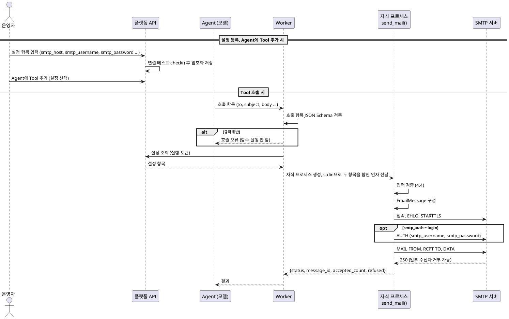

# 메일 발송 Tool 설계

| 항목      | 값                                                                   |
| --------- | -------------------------------------------------------------------- |
| 작성일    | 2026-10-14                                                           |
| 관련 문서 | `docs/interface.md`, `docs/follow-ups.md`, `docs/Tool-Dev-Guides.md` |

## 1. 개요

### 1.1. 목적

Agent가 Tool로 호출해 메일을 발송하는 Python 함수를 만든다.
Tool은 특정 메일 서비스에 묶이지 않는 범용 SMTP 클라이언트로 동작한다.
메일 서버 연결 정보, 계정정보는 툴 사용 등록과정에서 등록하고, 모델은 호출할 때 수신자·제목·본문만 넘긴다.

### 1.2. 범위

| 구분 | 내용                                                             |
| ---- | ---------------------------------------------------------------- |
| 포함 | SMTP 발송, 비밀번호 로그인(SMTP AUTH)                            |
| 포함 | 사내 무인증 릴레이 발송 (로그인 없음, `smtp_auth=none`)          |
| 포함 | 텍스트 또는 HTML 본문, 수신자(To/Cc/Bcc) 지정                    |
| 포함 | 입력 검증, 민감정보를 뺀 오류 응답                               |
| 제외 | 첨부 파일                                                        |
| 제외 | OAuth2 로그인(XOAUTH2), HTTP API 방식(Graph, Gmail API, ESP API) |
| 제외 | 예약 발송, 대량 발송, 템플릿 렌더링, 발송 이력 저장              |

### 1.3. 전제와 제약

**실행 환경 (2026-10-14 확인, 2026-10-19 갱신).**

- 사내 무인증 메일 릴레이가 있다(2026-10-19 확인, 2.3). 처음에는 릴레이가 없다고 보고 고려 대상에서 뺐다.
  k8s 샌드박스의 송신 IP를 릴레이가 허용하는지는 확인 필요(8장).
- Tool은 k8s 샌드박스 컨테이너 안에서 실행되며 외부 네트워크 통신이 가능.
  (Governance 아키텍처의 설계 상 승인된 목적지만 허용하는 것이므로 목적지 등록을 전제로 한다)
- 메일 전송을 위한 자격(비밀번호)과 관련하여 제한하고 있으나 예외로 허용한다. 사내 릴레이를 쓰면 자격이 필요 없다.
- 메일 서버, 계정, 발신자는 설정으로 등록해 재사용한다. 발신 주소는 `smtp_username`으로 고정한다(로그인하면 로그인 계정).
  수신자·제목·본문은 호출 시 모델이 입력한다.
- 샌드박스는 warm pool로 미리 띄워 둔다. 설정값은 Pod 생성 시점이 아니라 Tool 호출 시점에 전달하는 방식을 제안한다.
- 현재 플랫폼은 Tool 입력 규격을 `input_schema` 하나만 받고, 설정 등록·조회 기능이 없다(Governance API 문서 §8).
  위의 설정·호출 항목 분리와 호출 시점 전달은 플랫폼에 제안할 기능이다.
- 기록에 남는 민감정보의 마스킹은 1차 구현 뒤 후속 과제로 처리한다(`docs/follow-ups.md`).

**가이드 제약.** 가이드에서 이 Tool 설계에 영향을 주는 항목만 추렸다.

| 제약                                           | 설계 영향                                       |
| ---------------------------------------------- | ----------------------------------------------- |
| Python 3.11, `python:3.11-slim`, uv            | 이미지에 MTA·`sendmail` 바이너리 없음           |
| 셸 실행 금지                                   | `sendmail` 호출 불가, 순수 Python 전송만 가능   |
| 호출마다 새 자식 프로세스, 상태 유지 금지      | 커넥션 풀 불가, 중복 발송 방지 불가             |
| 입력은 JSON Schema 키워드 인자, 출력은 JSON 값 | 결과는 반환값으로만 전달                        |
| 외부 네트워크 기본 차단, host:port 신고        | 사용할 SMTP 서버를 등록 시 신고                 |
| 오류 메시지가 모델에 전달될 수 있음            | 비밀번호·계정·서버 응답 원문을 오류에 넣지 않음 |
| 자격이 필요한 기능 금지 (이번 릴리스)          | 메일 발송 자격은 예외로 허용 (2026-10-14 결정)  |

## 2. 메일 발송 방식 조사

조사 기준일은 2026-10-14이다. 대괄호 번호는 9장 참고 자료 번호다.
공식 문서로 확인하지 못하고 2차 출처에만 근거한 항목은 "확인 필요"로 표시했다.

### 2.1. 비교 요약

| 방식                      | 자격                    | 엔드포인트                              | 메시지 한도                  | 도입 여부                | 2026-10 상태                     |
| ------------------------- | ----------------------- | --------------------------------------- | ---------------------------- | ------------------------ | -------------------------------- |
| 사내 무인증 릴레이        | 없음 (IP 허용 추정)     | 사내 릴레이:25                          | 30MB (`SIZE` 광고)           | 채택 (`smtp_auth=none`)  | 2026-10-19 실측                  |
| M365 SMTP relay connector | 없음 (고정 IP/인증서)   | 테넌트 MX:25                            | 확인 필요                    | 부적합 (고정 IP)         | 지원 [1]                         |
| Workspace SMTP relay      | 없음 (IP 허용)          | `smtp-relay.gmail.com:587`              | 확인 필요                    | 부적합 (고정 IP)         | 지원 [24]                        |
| M365 Direct Send          | 없음                    | 테넌트 MX:25                            | 확인 필요                    | 부적합 (내부 수신자만)   | 차단 추세 [1][7]                 |
| Google 제한 SMTP          | 없음 (IP 허용)          | `aspmx.l.google.com:25`                 | 확인 필요                    | 부적합 (Google 수신자만) | 지원 [20]                        |
| M365 SMTP AUTH            | ID/PW 또는 OAuth2       | `smtp.office365.com:587`                | 35MB (최대 150MB)            | 채택 (비밀번호)          | Basic 2026-12 말 기본 비활성 [3] |
| M365 HVE                  | 계정 PW 또는 OAuth2     | `smtp.hve.mx.microsoft:587`             | 10MB, 50명/통                | 채택 (내부 수신자만)     | GA, 종량제 [10]                  |
| Gmail SMTP                | 앱 비밀번호 또는 OAuth2 | `smtp.gmail.com:465/587`                | 25MB                         | 채택 (앱 비밀번호)       | 비밀번호 인증 종료 [21]          |
| 국내 기업 메일 SMTP       | 계정 PW 또는 앱 PW      | 서비스별 (2.4 참조)                     | 확인 필요                    | 채택                     | 서비스별                         |
| AWS SES                   | IAM (API), SMTP 자격    | `email(-smtp).{region}.amazonaws.com`   | 40MB                         | 채택 (SMTP)              | 지원 [32]                        |
| SendGrid                  | API Key                 | `api.sendgrid.com`, `smtp.sendgrid.net` | 30MB 미만                    | 채택 (SMTP)              | 무료 플랜 종료 [41]              |
| Mailgun                   | API Key, SMTP 자격      | `api.mailgun.net`, `smtp.mailgun.org`   | 25MB                         | 채택 (SMTP)              | 지원 [42]                        |
| Microsoft Graph sendMail  | OAuth2                  | `graph.microsoft.com:443`               | 3MB 미만 (업로드 세션 150MB) | 차기                     | 지원 [11][12]                    |
| Gmail API                 | OAuth2                  | `gmail.googleapis.com:443`              | 확인 필요                    | 차기                     | 2026-05 쿼터 변경 [27]           |
| EWS                       | OAuth2                  | -                                       | -                            | 제외                     | 2027-04-01 전면 retirement [15]  |
| ACS Email                 | Entra 앱                | `smtp.azurecomm.net:587`                | 10MB                         | 제외                     | retired 대상 [17]                |
| MX 직접 발송              | 없음                    | 수신측 MX:25 (가변)                     | 수신측 설정                  | 제외                     | -                                |
| 로컬 sendmail             | 없음                    | 로컬 바이너리                           | -                            | 제외                     | -                                |

- **도입 여부**
  "채택"은 범용 SMTP 클라이언트에 호스트·포트·계정(무인증 릴레이는 발신 주소)을 입력하면 바로 쓸 수 있는 방식이다.
  "차기"는 OAuth2나 HTTP API가 필요해 이번 범위에서 뺀 방식이다.
  "부적합"은 k8s 송신 IP 조건을 맞출 수 없거나 수신자가 제한돼 쓰지 못하는 방식이다(2.3).
  "제외"는 실행 환경과 구조적으로 맞지 않는 방식이다(2.6).

### 2.2. SMTP 공통 옵션

| 포트 | 용도                        | 보안 방식                    | 비고                                                  |
| ---- | --------------------------- | ---------------------------- | ----------------------------------------------------- |
| 25   | MTA 간 전달, 무인증 릴레이  | 평문 접속 후 STARTTLS (선택) | 클라우드에서 아웃바운드 차단이 흔함                   |
| 587  | 클라이언트 제출(submission) | STARTTLS                     | 가장 범용적                                           |
| 465  | 클라이언트 제출             | 접속 즉시 TLS                | RFC 8314 권장 [52], `smtp.office365.com`은 미지원 [1] |

SMTP 방식은 공통으로 다음 옵션을 갖는다. Python에서는 표준 라이브러리 `smtplib` + `email`로 모두 구현할 수 있다 [49].

- 호스트, 포트
- 보안 방식: STARTTLS(`SMTP.starttls()`), 접속 즉시 TLS(`SMTP_SSL`), 평문
- 인증: 없음, `login()`(CRAM-MD5·PLAIN·LOGIN 중 서버가 지원하는 것), XOAUTH2(`auth("XOAUTH2", ...)`로 직접 구현)
- 타임아웃: `smtplib.SMTP(timeout=)`, 소켓 작업 단위로 적용
- EHLO 이름: `local_hostname`, 기본값은 `socket.getfqdn()`
- envelope 발신자(MAIL FROM)와 헤더 `From`

**클라우드 25번 포트.** GCP는 VPC 외부로 나가는 25번을 차단하며 Workspace SMTP relay도 예외가 아니다 [30].
AWS EC2는 25번을 기본 throttle하고 해제 요청이 필요하다 [33]. Azure는 대부분의 구독에서 차단한다 [53].
k8s 샌드박스에서도 외부 25번은 막혀 있을 가능성이 높으므로 587 또는 465를 쓴다.
사내 릴레이는 25번만 확인했으므로, 샌드박스에서 사내 릴레이 25번으로 나갈 수 있는지 확인해야 한다(8장 5번).

### 2.3. 무인증 SMTP 릴레이

자격 대신 송신 IP(또는 인증서)로 발송 권한을 판단하는 방식이다. 모두 `smtplib`만으로 구현할 수 있다.
공통 전제는 송신 IP가 고정이고 다른 조직과 공유되지 않는다는 점이다.
공유 NAT IP를 허용하면 같은 IP를 쓰는 모든 주체에게 발송 권한이 열린다 [1][24].

| 방식                      | 필수 옵션                                              | 수신자 범위              |
| ------------------------- | ------------------------------------------------------ | ------------------------ |
| 사내 무인증 릴레이        | 호스트, 포트, 보안 방식, 릴레이에 송신 IP 등록         | 릴레이 정책에 따름       |
| M365 SMTP relay connector | 테넌트 MX, 포트 25, inbound connector (IP 또는 인증서) | 내부·외부                |
| Workspace SMTP relay      | `smtp-relay.gmail.com:587`, Admin 콘솔에 IP 등록       | 내부·외부                |
| M365 Direct Send          | 테넌트 MX, 포트 25                                     | 테넌트 내부만            |
| Google 제한 SMTP          | `aspmx.l.google.com:25`, Admin 콘솔에 IP 등록          | Gmail·Workspace 사용자만 |

**사내 무인증 릴레이 실측 (2026-10-19, 로컬 PC).** 처음에는 사내 릴레이가 없다고 보았으나(2026-10-14), 다시 확인해 보니 있었다.
호스트는 사내 접속 정보이므로 문서에 적지 않고 운영 설정으로 관리한다.

- 25번 포트에서 STARTTLS를 지원한다. TLS 1.2이고, 사내 도메인 와일드카드 인증서가 시스템 CA로 검증된다.
- TLS 전환 전후 모두 AUTH를 광고하지 않는다. 메시지 크기 상한은 `SIZE 31457280`(30MB)으로 광고한다.
- 사내 도메인 발신 주소로 외부 Gmail 수신자에게 배달됐다. Tool을 거친 발송도 같다(`follow-ups.md` F-04).
- 수신자 응답에 `auth=1`이 붙는다. 자격 없이 송신 IP로 허용한 것으로 추정하며, 허용 기준은 확인 필요(8장).
- 서버가 `CHARSET=EUC-KR`을 광고한다. Tool은 한글을 UTF-8로 인코딩해 보내며(4.5), Gmail에서 한글이 정상 표시됐다.
- 외부로 중계할 때 envelope 발신자(`Return-Path`)를 빈 값(`<>`)으로 바꾸고, Tool 송신 IP를 담은 헤더를 추가한다(Gmail 수신 헤더).

**k8s 환경에서의 판단.** 사내 릴레이는 채택하되(`smtp_auth=none`), 샌드박스 송신 IP를 릴레이가 허용하는 것이 전제다.
k8s Pod의 외부 송신 IP는 보통 노드 IP나 NAT 게이트웨이 IP로 바뀌고 같은 클러스터의 다른 워크로드와 공유된다.
릴레이가 그 IP를 허용하면 같은 IP를 쓰는 모든 워크로드가 사내 도메인으로 메일을 보낼 수 있다. 허용 범위는 메일 관리자와 정한다.
M365 SMTP relay connector와 Workspace SMTP relay는 외부 서비스가 고정·비공유 IP를 요구하므로 계속 부적합으로 본다.

**M365 SMTP relay connector.** 테넌트 MX(`<domain>-com.mail.protection.outlook.com:25`)로 보내고,
Exchange Online inbound connector가 고정 공인 IP 또는 accepted domain이 들어간 TLS 인증서로 발신 조직을 식별한다 [1].
외부 수신자에게도 보낼 수 있다. Microsoft 문서는 Azure 같은 서드파티 호스팅 서비스에서는 이 방식을 쓸 수 없다고 명시한다 [1].

**Workspace SMTP relay.** Admin 콘솔에 등록한 IP 범위에서 `smtp-relay.gmail.com`에 접속하면 자격 없이 발송할 수 있다 [24].
한도는 사용자당 하루 10,000통, SMTP 트랜잭션당 수신자 100명이다. SMTP AUTH를 함께 쓰는 설정도 가능하다(TLS 필수).

**M365 Direct Send.** 자격 없이 테넌트 MX로 보내지만 테넌트 내부 수신자만 받을 수 있다 [1].
관리자가 `Set-OrganizationConfig -RejectDirectSend $true`를 켜면 550 5.7.68로 거부된다 [7].
Microsoft는 Direct Send를 기본 비활성화하는 옵션을 준비 중이라고 밝혔다 [1]. 신규 테넌트 기본 차단 여부는 2차 출처 [9]에만 있어 확인 필요.

**Google 제한 SMTP.** `aspmx.l.google.com:25`로 무인증 발송하지만 Gmail·Workspace 사용자에게만 배달된다 [20].

### 2.4. 인증 SMTP

| 방식           | 엔드포인트                                  | 자격                                 | 발송 한도                           |
| -------------- | ------------------------------------------- | ------------------------------------ | ----------------------------------- |
| M365 SMTP AUTH | `smtp.office365.com:587` STARTTLS           | 사서함 ID/PW 또는 OAuth2 (XOAUTH2)   | 30통/분, 10,000 수신자/일 [1][6]    |
| M365 HVE       | `smtp.hve.mx.microsoft:587`                 | HVE 계정 PW 또는 OAuth2              | 내부 수신자만, 50명/통, 10MB [10]   |
| Gmail SMTP     | `smtp.gmail.com:465` SSL, 587 STARTTLS      | 앱 비밀번호 또는 OAuth2 (XOAUTH2)    | Workspace 2,000통/일, 100명/통 [23] |
| AWS SES SMTP   | `email-smtp.{region}.amazonaws.com:587/465` | SES 전용 SMTP 자격                   | 50명/통, 40MB [32]                  |
| 네이버웍스     | `smtp.worksmobile.com:465/587`              | 외부 앱 비밀번호                     | 확인 필요 [45]                      |
| 하이웍스       | `smtps.hiworks.com:465`                     | 계정 PW (2단계 인증 시 메일 전용 PW) | 확인 필요 [46][47]                  |
| 다우오피스     | `outbound.daouoffice.com:25/465`            | 계정 PW                              | 확인 필요 [48]                      |

**Gmail SMTP.** 계정 비밀번호 로그인(less secure apps)은 2025년에 종료됐다.
종료일은 2025-03-14 [21], Workspace 2025-05-01 [20]로 문서마다 다르다. 지금은 앱 비밀번호 또는 OAuth2로만 로그인할 수 있다.
2단계 인증은 앱 비밀번호를 만들기 위한 조건이다. 발송할 때마다 휴대폰 인증을 하지 않으며, 앱 비밀번호로 로그인하면 추가 인증 없이 발송된다.
앱 비밀번호는 2단계 인증 계정에서만 만들 수 있다. Workspace 관리자가 막았거나 고급 보호 프로그램 계정이면 메뉴가 보이지 않을 수 있다 [22].
Google 계정 비밀번호를 바꾸면 앱 비밀번호는 폐기된다 [22]. Google은 앱 비밀번호 사용을 권장하지 않는다.
데이터센터 IP(k8s 클러스터)에서 처음 로그인할 때 보안 알림이나 차단이 생기는지는 실측 필요.

**M365 SMTP AUTH.** 인증한 사서함 주소로만 발신할 수 있고, 다른 주소는 Send As 권한이 없으면 5.7.60으로 거부된다 [1].
2020년 1월 이후 생성된 조직은 SMTP AUTH가 기본으로 꺼져 있고, Security Defaults가 켜져 있으면 쓸 수 없다 [2].
Basic 인증은 2026-01-27 발표 기준으로 기존 테넌트에서 2026년 12월 말 기본 비활성화된다(관리자가 다시 켤 수 있음).
최종 제거일은 2027년 하반기에 발표될 예정이다 [3]. Microsoft 원문 [4]은 직접 확인하지 못해 확인 필요.
비활성화 이후 M365 계정을 쓰려면 XOAUTH2가 필요하다(3.4). OAuth2 client credentials 구성은 [5]를 따른다.

**M365 HVE.** 내부 수신자 전용 대량 발송 서비스이며 수신자 1명당 $0.000042의 종량제다 [10].
HVE 계정은 `SmtpClientAuthenticationDisabled` 설정과 무관하게 인증할 수 있다. Basic 인증 폐지 일정은 확인 필요.

**AWS SES SMTP.** 샌드박스 상태에서는 검증된 주소로만, 24시간 200통, 초당 1통까지 보낼 수 있다 [36].
운영 전환 후에도 From·Return-Path에 쓰는 identity는 검증해야 한다.

**국내 기업 메일.** 세 서비스 모두 계정 단위 자격이 필요하고 관리자가 외부 SMTP 사용을 허용해야 한다.
하이웍스는 POP3/SMTP가 기본으로 꺼져 있고 접속 국가 제한이 있다 [46][47]. 클러스터가 해외 리전이면 막힐 수 있다.
메일 발송 REST API 제공 여부는 공식 문서를 찾지 못해 확인 필요.

**XOAUTH2 구현.** `smtplib.login()`은 XOAUTH2를 지원하지 않으므로 `smtplib.SMTP.auth("XOAUTH2", authobject)`로 직접 구현한다 [49].
비동기 라이브러리 `aiosmtplib`는 5.1.0부터 XOAUTH2를 지원한다 [50][51].

### 2.5. HTTP API

| 방식            | 엔드포인트                                | 자격                  | 메시지 한도                  |
| --------------- | ----------------------------------------- | --------------------- | ---------------------------- |
| Microsoft Graph | `POST /v1.0/users/{id}/sendMail`          | OAuth2 (`Mail.Send`)  | 3MB 미만 단일 요청 [12]      |
| Gmail API       | `POST /gmail/v1/users/{id}/messages/send` | OAuth2 (`gmail.send`) | 확인 필요                    |
| AWS SES API v2  | `POST /v2/email/outbound-emails`          | IAM SigV4             | 40MB, 50명/통 [32]           |
| SendGrid        | `POST /v3/mail/send`                      | API Key (Bearer)      | 30MB 미만, 1,000명/요청 [38] |
| Mailgun         | `POST /v3/{domain}/messages`              | API Key (HTTP Basic)  | 25MB, 배치 1,000명 [42][43]  |

| 방식            | 신고할 네트워크 목적지                                     |
| --------------- | ---------------------------------------------------------- |
| Microsoft Graph | `login.microsoftonline.com:443`, `graph.microsoft.com:443` |
| Gmail API       | `oauth2.googleapis.com:443`, `gmail.googleapis.com:443`    |
| AWS SES API v2  | `email.{region}.amazonaws.com:443`                         |
| SendGrid        | `api.sendgrid.com:443` (EU는 `api.eu.sendgrid.com`)        |
| Mailgun         | `api.mailgun.net:443` (EU는 `api.eu.mailgun.net`)          |

**Microsoft Graph.** 응답 202 Accepted는 접수만 뜻하고 배달 완료를 뜻하지 않는다 [11].
3MB 이상 첨부는 업로드 세션이 필요하고, 이때 `Mail.ReadWrite` 권한과 `outlook.office.com:443` 신고가 추가된다 [12].
앱 권한의 사서함 범위는 RBAC for Applications로 제한한다 [14]. 속도 제한은 앱·사서함 조합당 10분에 10,000요청, 동시 4요청이다 [13].
client secret 방식은 `httpx`만으로 구현할 수 있고, 인증서 방식은 JWT 서명 라이브러리가 필요하다.

**Gmail API.** send 1회에 100 units, 사용자당 분당 6,000 units(2026-05-01 이후 생성 프로젝트), 메시지당 수신자 500명이다 [27].
서비스 계정 domain-wide delegation은 Workspace 전용이고 JWT RS256 서명이 필요해 `cryptography` 등 추가 패키지가 있어야 한다.
최대 메시지 크기 35MB는 2차 출처 [29]에만 있어 확인 필요.

**AWS SES API v2.** SigV4 서명은 이론상 표준 라이브러리 `hmac`·`hashlib`로 구현할 수 있다.
다만 서명 로직을 직접 재구현하면 검증 부담이 크므로, 도입 시에는 `botocore` 등 공식 SDK 사용을 기본으로 검토한다.

**SendGrid.** 발신자 검증(Sender Identity)이 필수이고 Domain Authentication을 권장한다 [40].
무료 플랜은 2025-05에 폐지됐고 신규 가입자는 60일 체험만 받는다 [41].

**Mailgun.** API·SMTP 서버 IP가 예고 없이 바뀔 수 있다 [44]. 플랫폼 네트워크 허용 목록이 IP 기준이면 문제가 된다.

### 2.6. 제외 방식

| 방식               | 제외 이유                                                                    |
| ------------------ | ---------------------------------------------------------------------------- |
| 로컬 sendmail, MTA | 셸 실행 금지, `python:3.11-slim`에 바이너리 없음                             |
| MX 직접 발송       | 수신자마다 목적지가 바뀌어 host:port 사전 신고 불가, Tool에서 DKIM 서명 불가 |
| EWS                | 2026-10-01 retirement 적용 시작, 2027-04-01 전면 retirement [15]             |
| ACS Email          | retired 대상, 2028-09-30까지만 지원, 신규 온보딩 비권장 [17]                 |

### 2.7. 발신 도메인 인증

- Gmail 발신자 요구사항(2024-02-01 시행): 모든 발신자는 SPF 또는 DKIM, 정·역방향 DNS, TLS, 스팸률 0.3% 미만을 지켜야 한다 [31].
  하루 5,000통 이상이면 SPF·DKIM·DMARC를 모두 갖추고 From을 정렬하며 원클릭 수신거부를 제공해야 한다.
- Outlook.com: 2025-05-05부터 하루 5,000통 이상 발송자에게 SPF·DKIM·DMARC를 요구한다. 2차 출처 [54]에만 있어 확인 필요.
- 인증 SMTP로 메일 서비스에 제출하면 SPF·DKIM은 메일 서비스의 도메인 설정을 따른다. 이 Tool은 DKIM 서명을 하지 않는다.
- 사내 릴레이를 거친 메일은 릴레이가 사내 도메인으로 DKIM 서명한다. Gmail 수신 결과는 SPF none, DKIM pass, DMARC pass였다.
  DMARC는 DKIM으로 통과했다. SPF none은 릴레이가 envelope 발신자를 빈 값으로 바꿔
  릴레이 호스트명(HELO)으로 평가됐기 때문이다(8장 17번, `follow-ups.md` F-04).

## 3. 방식 선정

### 3.1. 선정 기준

1. k8s 샌드박스에서 동작한다. 사내 릴레이를 쓸 수 있으면 자격 없이 보낸다.
2. 특정 메일 서비스에 묶이지 않는다. 설정값만 바꿔 여러 서비스를 쓸 수 있다.
3. 외부 패키지 없이 구현할 수 있다. 이미지 의존성과 공급망 위험을 늘리지 않는다.
4. 2026-10 기준 지원 상태가 안정적이다.

### 3.2. 결정

**범용 SMTP 클라이언트 + 비밀번호 로그인(SMTP AUTH) 또는 사내 무인증 릴레이**를 표준 라이브러리 `smtplib`로 구현한다.
로그인 여부는 설정 항목 `smtp_auth`로 고른다. 메일 서버·계정·발신자는 운영자가 입력하는 설정 항목으로, 수신자·제목·본문은 모델이 호출 시 입력하는 호출 항목으로 나눈다.

| 날짜       | 결정                                                                        | 근거                                                              |
| ---------- | --------------------------------------------------------------------------- | ----------------------------------------------------------------- |
| 2026-10-14 | 메일 계정 로그인 방식 채택                                                  | 사내 릴레이 없음, k8s 송신 IP로는 IP 허용 방식 불가               |
| 2026-10-14 | 메일 발송 자격(비밀번호)은 가이드 10장 예외로 허용                          | 자격 없이 발송할 경로가 없음                                      |
| 2026-10-14 | 설정 항목과 호출 항목 분리                                                  | 고정 정보는 운영자가 입력, 모델은 메일 내용만 결정                |
| 2026-10-14 | 메일 서비스는 정하지 않음                                                   | 범용 클라이언트로 설계, 서비스별 설정값은 `interface.md` 7장      |
| 2026-10-14 | 기록의 민감정보 마스킹은 후속 과제로 처리                                   | 1차 구현 뒤 방안 결정, `follow-ups.md` F-01                       |
| 2026-10-14 | 설정 항목을 연결(서버·계정)과 Agent 설정(발신자)으로 분리, 연결 테스트 추가 | 연결 재사용, 저장 시 오입력 확인 (`tool-설정-전달-조사.md` 3.3)   |
| 2026-10-14 | 샌드박스 warm pool 사용, 설정값은 Tool 호출 시점에 전달                     | Pod 생성 시점 주입은 warm pool과 함께 쓸 수 없음 (조사 문서 2.3)  |
| 2026-10-15 | 발신자를 설정 항목으로 이동, 발신 주소는 로그인 계정으로 고정               | 계정과 다른 주소로 보내는 위장 차단, 10-14 분리 결정을 바꿈 (3.3) |
| 2026-10-15 | 로그인 필수, 무인증과 `smtp_security=none` 삭제                             | 발신 주소를 계정에서 가져오므로 계정 없는 설정은 쓸 수 없음       |
| 2026-10-15 | 설정 묶음을 뜻하던 용어 "연결"을 "설정"으로 변경                            | 서버 접속 뜻의 "연결"(연결 끊김, `CONNECTION_FAILED`)과 겹침      |
| 2026-10-19 | 사내 무인증 릴레이 지원 (`smtp_auth=none`), 10-15 로그인 필수 결정을 바꿈   | 사내 릴레이 확인 (25번, STARTTLS, AUTH 없음, 실측) (2.3)          |
| 2026-10-19 | 무인증에서도 발신 주소는 `smtp_username`으로 고정                           | 발신 주소 출처를 하나로 유지, F-09 게이트웨이 설계 유지 (3.3)     |
| 2026-10-19 | 평문(`smtp_security=none`)은 계속 두지 않음                                 | 사내 릴레이가 STARTTLS 지원 (실측), 메일 내용 보호 (4.3)          |

비밀번호 로그인은 Gmail(앱 비밀번호), 국내 기업 메일, SES·SendGrid·Mailgun SMTP 등 대부분 서비스가 지원하고 `smtplib`만으로 구현된다.
OAuth2는 토큰 발급 흐름이 서비스마다 달라 범용 설정으로 받기 어렵고, 호출 간 토큰을 캐시할 수 없어 호출마다 토큰을 새로 받아야 한다.
그래서 이번 범위에서 뺀다(`follow-ups.md` F-06). M365 계정은 Basic 인증이 비활성화되는 2026년 12월 말 이후로는 쓸 수 없게 될 수 있다.

사내 릴레이를 쓰면 비밀번호가 없어 3.4의 비밀번호 노출 경로가 생기지 않는다.
대신 발송 권한이 송신 IP에 묶이고, 발신 주소는 운영자 설정과 릴레이의 발신자 정책으로만 통제된다(3.4).

### 3.3. 설정 항목과 호출 항목

**설정 항목.** 운영자가 입력하며 모델에는 보이지 않는다.

- 메일 서버(`smtp_host`, `smtp_port`, `smtp_security`), 로그인 방식(`smtp_auth`), 계정(`smtp_username`, `smtp_password`),
  발신자 표시 이름(`from_name`).
- 이름을 붙여 한 번 등록하고 여러 Agent가 재사용한다. 저장할 때 연결 테스트(4.8)를 실행한다.
- Agent에 Tool을 붙일 때는 등록한 설정을 고른다. Agent별로 따로 입력하는 항목은 없다.

**발신 주소는 `smtp_username`으로 고정한다.** 발신 주소를 따로 받지 않고 `smtp_username`을 From과 envelope 발신자(MAIL FROM)에 쓴다.
계정과 다른 주소로 보내는 위장을 입력 단계에서 막기 위해서다. 계정 외 주소는 메일 서비스에서도 거부되거나 계정 주소로 바뀐다(4.3).
Dify 공식 email 플러그인도 발신 주소를 Agent별 입력이 아니라 여러 곳에서 재사용하는 provider 자격에 둔다(`tool-설정-전달-조사.md` 2.1).
처음에는 Agent마다 표시 이름·별칭 주소를 다르게 두려고 발신자를 Agent 설정에 뒀으나(2026-10-14), 2026-10-15에 설정 항목으로 옮겼다.
Agent마다 표시 이름을 다르게 쓰려면 같은 계정으로 설정을 따로 등록한다.

**무인증 릴레이.** `smtp_auth=none`이면 로그인하지 않고 `smtp_username`을 발신 주소로만 쓴다(2026-10-19 결정).
발신 주소 필드(`from_address`)를 따로 두지 않은 이유는 발신 주소 출처를 하나로 유지하기 위해서다.
F-09 게이트웨이도 로그인 계정을 발신 주소로 쓰므로 그 설계를 바꾸지 않아도 된다.
이때 발신 주소를 검증하는 것은 릴레이의 발신자 정책뿐이다. 계정 로그인과 달리 메일 서비스가 From을 거부하거나 바꾸지 않을 수 있다.
그래서 운영자가 정한 `smtp_username`을 모델이 바꾸지 못하게 하는 F-02 요구사항 3이 더 중요해진다.

**호출 항목.** 모델이 Tool을 호출할 때 입력한다. `to`, `cc`, `bcc`, `subject`, `body`, `body_format`이 해당한다.

Tool 함수는 두 항목을 합친 값을 키워드 인자로 받는다. 합치는 일은 플랫폼이 하므로, Tool 코드는 값이 어디서 왔는지와 무관하게 같다.
항목 구분은 함수가 아니라 등록하는 스키마로 표현한다(`interface.md` 3.3, 3.4).

**모델 비노출이 핵심.** 설정 항목이 모델에 전달되는 Tool 스키마와 대화 기록에서 빠져야 비밀번호가 모델 컨텍스트를 거치지 않는다.
또 모델이 호출 인자로 설정 항목(예: `smtp_host`)을 넘기면 거부해야 설정값을 바꿔치기하지 못한다.
같은 문제를 이미 자리 잡은 도구들은 인자를 "모델이 채우는 것"과 "설정·코드가 채우는 것"으로 나눠 푼다.
참고 사례는 `follow-ups.md` F-02와 `tool-설정-전달-조사.md` 2.1에 정리했다.
현재 플랫폼은 `input_schema`를 그대로 모델에 전달하므로(API 문서 §8.1), 설정 항목을 숨기는 기능은 아직 없다.

**전달 방식 (제안).** 샌드박스를 warm pool로 미리 띄워 두므로 설정값을 Pod 생성 시점(env, Secret 볼륨, Vault Injector)에 넣을 수 없다.
Worker가 Tool 호출 시점에 실행 단위 토큰으로 설정 조회 API에서 해당 Tool의 설정만 받아, 자식 프로세스에 stdin으로 넘기는 방식을 제안한다.
argv와 환경 변수로는 넘기지 않는다. 설정 조회 API는 아직 없다. 상세는 `tool-설정-전달-조사.md` 3.4, 3.5를 따른다.

### 3.4. 보안 위험

**가이드 10장.** 메일 발송 자격은 예외로 허용했다(2026-10-14 결정).

**비밀번호 노출 경로.** 설정 항목으로 분리하면 비밀번호가 모델 컨텍스트를 거치지 않는다.
단, 플랫폼이 설정 항목을 모델에 보여주지 않을 때만 성립한다(F-02). 그 밖에 남는 노출 경로는 다음과 같다.

- 설정 저장소와 설정 화면·조회 API 응답(F-03)
- Tool 호출 기록과 트레이스: 플랫폼이 설정값을 합친 뒤의 인자를 기록하면 비밀번호가 남는다(F-01)
- Worker·자식 프로세스 로그와 예외 메시지(F-01)
- 샌드박스 안: 1단계에서는 Tool 코드가 비밀번호 원문을 받는다. 같은 UID 프로세스 사이의 노출은 F-10,
  비밀번호를 샌드박스에 두지 않는 메일 게이트웨이는 F-09에서 다룬다.

이 경로의 보호는 1차 구현 뒤 후속 과제로 처리한다. 그 전까지는 발송 전용 계정과 앱 비밀번호로 피해 범위를 줄이고, 기록 열람 권한을 제한한다.

**무인증 릴레이.** `smtp_auth=none`이면 비밀번호가 없으므로 위 노출 경로는 해당하지 않는다. 대신 다음 위험이 생긴다.

- 발송 권한이 송신 IP에 묶인다. 같은 송신 IP를 공유하는 워크로드도 릴레이로 보낼 수 있다(2.3).
- 모델이 `smtp_username`을 바꿀 수 있으면 사내 주소로 위장해 보낼 수 있다(F-02 요구사항 3).
- 계정 단위 일일 발송 한도가 없을 수 있다. 발송량 제한은 릴레이 정책에 달려 있다(F-05, 확인 필요).

## 4. 상세 설계

### 4.1. 구성요소

```text
mail-tool/
├── tools/
│   └── send_mail.py      # Tool 모듈 (send_mail: 발송, check: 연결 테스트)
├── tests/
│   ├── conftest.py       # 로컬 SMTP 서버(aiosmtpd), 테스트 CA(trustme) fixture
│   ├── support.py        # 테스트 공용 값과 서버 핸들러
│   └── test_send_mail.py
├── scripts/
│   ├── gmail_integration.py  # Gmail 실서비스 시험 (F-04, 실제 발송)
│   └── relay_integration.py  # 사내 무인증 릴레이 시험 (F-04, 실제 발송)
├── pyproject.toml        # 개발 전용 의존성 그룹(dev)과 pytest 설정
├── docs/
│   ├── design.md
│   ├── interface.md
│   ├── follow-ups.md
│   ├── tool-설정-전달-조사.md
│   └── Tool-Dev-Guides.md
└── .conda/               # 로컬 개발 환경 (Python 3.11)
```

가이드 2장에 따라 Tool은 모듈 하나로 구성하고 외부 패키지는 쓰지 않는다(`smtplib`, `ssl`, `email`만 사용).
`tools/` 경로는 가안이다. Governance API 문서 §8은 공통 Python Tool 코드를 `generic-agent` 저장소 `default_tools`에 둔다고 정했다.
다만 공통 Python Tool은 Registry에 등록하지 않고 Snapshot과 상관없이 모든 Agent에 노출된다(`overview.md` 실행 단계 4).
설정과 자격이 필요한 이 Tool을 모든 Agent에 노출하면 안 되므로, 등록형 `builtin` Tool로 낼 수 있는지와 코드 위치는 확인 필요(8장).

| 함수                     | 역할                                                                                     |
| ------------------------ | ---------------------------------------------------------------------------------------- |
| `send_mail()`            | 진입점. 검증, 메시지 구성, 전송, 결과 반환 순서로 호출                                   |
| `check()`                | 연결 테스트 진입점. 접속·TLS·로그인까지만 확인 (4.8)                                     |
| `_validate_connection()` | 설정 항목 규칙 검증, 계정을 발신 주소로 파싱 (`CONFIG_ERROR`, 4.4)                       |
| `_validate_call()`       | 호출 항목 규칙 검증 (`INVALID_INPUT`, 4.4)                                               |
| `_parse_address()`       | 주소 파싱. `local@domain` ASCII 주소만 받음 (4.4)                                        |
| `_build_message()`       | `EmailMessage` 구성 (4.5)                                                                |
| `_connect()`             | 1~3단계 접속·EHLO·STARTTLS·로그인(`smtp_auth=login`일 때), 예외를 오류 코드로 변환 (4.6) |
| `_login()`               | `smtplib.login()`과 같은 순서로 인증하되, 거부 직후 연결이 끊겨도 거부 응답을 보존 (4.6) |
| `_send()`                | 4~6단계 전송·결과 구성·종료, 예외를 오류 코드로 변환 (4.6)                               |
| `MailToolError`          | `[코드] 설명` 메시지와 `code` 속성을 갖는 예외                                           |

진입점은 동기 함수(`def`)로 만든다. `smtplib`이 동기 API이고, 호출마다 프로세스가 새로 떠서 비동기로 얻는 이점이 없다.
SMTP 소켓 타임아웃(10초)과 총 수신자 상한(20명)은 코드 상수로 둔다. 발송에 필요한 정보가 아니라 Tool의 안전 한도이기 때문이다.

### 4.2. 처리 흐름

아래는 `tool-설정-전달-조사.md` 3.4의 권장 흐름을 이 Tool에 적용한 것이다.
설정 등록과 선택, 설정 조회는 플랫폼에 아직 없는 단계다(1.3).



### 4.3. 입력 구성

필드, 타입, 입력 시점은 `interface.md` 3.1, 3.2가 원본이다. 이 절은 값의 범위를 그렇게 정한 이유만 적는다.

**포트 제한.** 설정 항목은 운영자가 정하지만, 오입력과 내부망 서비스 접속을 막기 위해 SMTP 포트만 허용한다.
2525는 SendGrid·Mailgun의 대체 포트이자 로컬 테스트용 포트다.

**보안 방식.** `starttls`는 서버가 STARTTLS를 지원하지 않으면 오류로 끝내며 평문으로 강등하지 않는다.
TLS 인증서는 `ssl.create_default_context()`로 시스템 CA 기준 검증한다.
평문 방식은 두지 않는다. 평문이면 로그인할 때는 비밀번호가, 무인증 릴레이에서도 메일 내용이 그대로 전송되기 때문이다.
사내 릴레이는 STARTTLS를 지원한다(2026-10-19 실측). STARTTLS가 없는 릴레이가 생기면 그때 다시 정한다.

**로그인 방식.** `smtp_auth`는 `login`(기본)과 `none`이다. `login`이면 비밀번호가 필수이고, `none`이면 비밀번호를 넣을 수 없다.
`none`에 넣은 비밀번호는 쓰이지 않는다. 로그인하는 줄 아는 오설정을 저장 시점에 알리고, 쓰지 않는 비밀번호가 저장·기록에 남지 않게 거부한다.
비밀번호 유무로 방식을 정하지 않고 필드를 따로 둔 이유는 비밀번호 누락을 무인증 설정으로 잘못 해석하지 않기 위해서다.
그렇게 하면 Gmail 같은 서버에서 비밀번호 누락이 `CONFIG_ERROR`가 아니라 발송 단계의 인증 요구 거부(530)로 늦게 드러난다.

**발신 주소 필수.** 발신 주소를 `smtp_username`에서 가져오므로 이 값은 두 방식 모두 필수이고 `local@domain` 형식이어야 한다.
그래서 계정이 메일 주소가 아닌 서비스는 쓸 수 없다. AWS SES(서비스가 발급한 SMTP 사용자 이름)와 SendGrid(`apikey`)가 해당한다.

**발신자.** M365는 Send As 권한 없이 다른 주소로 보내면 5.7.60으로 거부한다 [1].
Gmail은 인증 계정이나 등록된 별칭이 아닌 From을 인증 계정 주소로 바꿔 보낸다(2026-10-14 실측, F-04). 오류는 나지 않는다.
어느 쪽이든 계정 외 주소는 쓸모가 없으므로 발신 주소를 계정으로 고정한다(3.3).

### 4.4. 입력 검증

검증은 두 단계로 한다.

1. 플랫폼: 등록한 JSON Schema로 타입, 길이, 개수, enum, 패턴을 검증한다. 규격 위반이면 함수가 실행되지 않는다(가이드 5장).
   현재 플랫폼이 검증하는 것은 호출 항목 스키마(`input_schema`)뿐이다. 설정 스키마의 검증은 설정 등록 기능이 생길 때 플랫폼이 맡아야 한다.
2. 함수: 스키마로 표현할 수 없는 규칙을 검증한다. 위반하면 접속을 시도하지 않는다. 규칙 목록은 `interface.md` 3.6이 원본이다.

함수 검증은 설정 항목 위반을 `CONFIG_ERROR`, 호출 항목 위반을 `INVALID_INPUT`으로 구분한다.
모델이 고칠 수 있는 오류인지 알려 주기 위해서다. 설정 항목 오류는 모델이 고칠 수 없다.

**비밀번호 포함 검사.** 제목·본문에 `smtp_password` 값이 그대로 들어 있으면 거부하는 규칙은 보조 수단이다.
설정 항목이 모델에 노출되지 않으면 실효가 낮지만, F-02가 끝나기 전까지는 유지한다.
단순 문자열 포함 검사라 인코딩이나 분할로 우회할 수 있다. `smtp_auth=none`이면 비밀번호가 없으므로 검사하지 않는다.

**주소 파싱.** 주소는 `email.headerregistry.Address(addr_spec=...)`로 파싱한다.
잘못된 주소에서 파서가 던지는 예외는 세 계열이다(Python 3.11.17 실측).
`ValueError` 계열(`InvalidHeaderDefect`, `NonASCIILocalPartDefect` 포함), `HeaderParseError`(`ValueError` 아님),
그리고 `kim@`·빈 문자열처럼 도메인이 비었을 때의 `IndexError` 다. 셋을 함께 잡는다.
`kim @example.com`, `kim@example.com (x)` 는 공백·주석이 빠진 값으로 파싱에 성공하므로, 파싱 결과가 원문과 같을 때만 받는다.
주소는 `local@domain` 형식만 받는다. 표시 이름(`홍길동 <a@example.com>`)과 비ASCII 주소(SMTPUTF8)는 받지 않는다.
CR/LF가 들어간 헤더는 `EmailMessage`도 `ValueError`로 거부하지만(실측), 오류 코드를 구분하기 위해 먼저 검사한다.

JSON Schema의 `format: email`은 jsonschema에서 FormatChecker를 켜야 검증된다. 플랫폼 적용 여부가 확인되지 않아 함수에서 다시 검증한다.

### 4.5. 메시지 구성

| 헤더             | 값                                       | 이유                                        |
| ---------------- | ---------------------------------------- | ------------------------------------------- |
| `From`           | `from_name <smtp_username>`              | `from_name`이 없으면 주소만                 |
| `To`, `Cc`       | 입력값                                   | -                                           |
| `Bcc`            | 헤더에 넣지 않음                         | envelope 수신자 목록에만 포함               |
| `Subject`        | 입력값                                   | 비ASCII는 RFC 2047로 자동 인코딩 (실측)     |
| `Date`           | `email.utils.formatdate(localtime=True)` | -                                           |
| `Message-ID`     | `make_msgid(domain=<발신 도메인>)`       | 기본값 `socket.getfqdn()`은 Pod 이름을 노출 |
| `Auto-Submitted` | `auto-generated`                         | RFC 3834. 자동 응답 루프 방지               |

본문은 `body_format`이 `text`이면 `set_content(body)`, `html`이면 `set_content(body, subtype="html")`로 넣는다.
기본 정책(`policy.default`)은 줄이 짧은 한글 본문을 `8bit`로 인코딩한다(실측). `smtplib`은 8BITMIME 지원 여부를 보고 바꿔 주지 않는다.
그래서 메시지 정책을 `cte_type="7bit"`로 두어 비ASCII 본문이 `charset="utf-8"`, base64(또는 quoted-printable)로 인코딩되게 한다.

EHLO 이름(`local_hostname`)은 발신 도메인으로 지정한다. 기본값 `socket.getfqdn()`은 k8s Pod 이름을 보내고 DNS 역조회로 지연될 수 있다.

### 4.6. 전송과 오류 처리

`_connect()`가 1~3단계를, `_send()`가 4~6단계를 다음 순서로 수행한다.

1. `ssl`이면 `SMTP_SSL`, 그 외에는 `SMTP`로 접속한다. 타임아웃과 `local_hostname`을 지정하고 EHLO를 바로 보낸다.
2. `starttls`이면 `starttls(context=ssl.create_default_context())`를 호출하고 EHLO를 다시 보낸다.
3. `smtp_auth`가 `login`이면 `smtp_username`, `smtp_password`로 로그인한다(`_login()`). 인증 방식은 서버가 지원하는 것 중에서 고른다.
   `none`이면 이 단계를 건너뛴다.
4. `send_message(msg, to_addrs=to + cc + bcc)`로 전송한다.
5. 일부 수신자가 거부되면 오류가 아니라 성공으로 반환하고, 거부된 주소를 `refused`에 담는다.
6. 전송 후 `quit()`에서 나는 오류는 무시한다. 메일은 이미 접수됐기 때문이다.

이미 발송된 메일을 오류로 보고하면 Agent가 재시도해 중복 발송한다. 5번과 6번은 이를 막기 위한 규칙이다.

오류 코드 목록과 Agent 대응은 `interface.md` 5.1이 원본이다. 코드는 실패한 단계로 정한다.

- 접속 전 검증: 설정 항목 위반은 `CONFIG_ERROR`, 호출 항목 위반은 `INVALID_INPUT`
- 1단계와 2단계(접속, EHLO, STARTTLS, 타임아웃, 인증서 검증): `CONNECTION_FAILED`
  EHLO를 1단계에서 직접 보내는 이유는, `login()` 안에서 EHLO가 실패하면 `AUTH_FAILED`로 잘못 분류되기 때문이다.
- 3단계(`login()`): SMTP 응답으로 거부되면 `AUTH_FAILED`. 서버가 AUTH를 지원하지 않거나 맞는 인증 방식이 없는 경우도 포함한다.
  무인증 릴레이에 `smtp_auth=login`을 설정하면 이 경우에 해당한다(2026-10-19 실측).
  로그인 도중 연결이 끊기거나 타임아웃이면 `CONNECTION_FAILED`다. 아직 보낸 것이 없어 재시도해도 안전하기 때문이다.
  `SMTPServerDisconnected`는 `SMTPException`의 하위 클래스이므로 응답 오류와 따로 구분한다.
  **거부 직후 끊김(2026-10-14 Gmail 실측).** Gmail 은 틀린 비밀번호에 `535 5.7.8`로 응답한 직후 연결을 끊는다.
  `smtplib.login()`은 한 인증 방식이 거부되면 다음 방식(PLAIN 다음 LOGIN)을 시도하므로, 끊긴 연결에서 `SMTPServerDisconnected`가 나고 535가 버려진다.
  그대로 두면 틀린 비밀번호가 재시도 가능한 `CONNECTION_FAILED`로 보고된다. 그래서 `_login()`이 같은 순서로 시도하되,
  거부 응답 뒤의 끊김은 그 거부(`AUTH_FAILED`)로 보고한다. 거부 없이 끊기면 그대로 `CONNECTION_FAILED`다.
  다음 방식으로 넘어가는 재시도는 유지한다. 광고만 하고 실제로는 지원하지 않는 방식이 있는 서버를 위한 `smtplib`의 동작이다.
- 4단계(`send_message()`): SMTP 응답 코드로 거부되면 `SEND_REJECTED`, 진행 중 연결이 끊기거나 타임아웃이면 `DELIVERY_UNKNOWN`
  무인증 릴레이가 송신 IP를 허용하지 않거나, 인증을 요구하는 서버에 `smtp_auth=none`으로 보내면 이 단계에서 거부된다.
  응답 코드는 서버마다 다르다(`interface.md` 5.2).

**단계로 분류하는 이유.** `smtplib`의 예외는 모두 `OSError`의 하위 클래스이고(실측), `SMTPNotSupportedError` 하나가
STARTTLS 미지원과 AUTH 미지원 양쪽에서 나온다. 그래서 예외 타입이 아니라 어느 단계에서 났는지로 코드를 정한다.
`send_message()` 단계에서는 `SMTPResponseException`·`SMTPRecipientsRefused`를 먼저 잡아 `SEND_REJECTED`로 분류하고,
나머지 `OSError`(`SMTPServerDisconnected`, 소켓 타임아웃 등)는 보수적으로 `DELIVERY_UNKNOWN`으로 분류한다.
`send_message()`는 MAIL FROM, RCPT TO, DATA를 한 번에 수행하므로 DATA 전후를 밖에서 구분할 수 없기 때문이다.

**오류 메시지.** 예외 메시지는 `[코드] 한국어 설명 (SMTP 535 5.7.8)` 형식으로 만든다.
SMTP 응답 코드와 확장 상태 코드(RFC 3463)만 넣고 서버 응답 원문, 비밀번호, 계정, 호스트는 넣지 않는다.
확장 상태 코드만으로도 원인을 구분할 수 있다(예: Gmail `5.7.9`는 앱 비밀번호 필요). 응답 코드별 의미는 `interface.md` 5.2에 정리했다.
원래 예외는 `raise ... from None`으로 체인을 끊어 함께 전달되지 않게 한다. 플랫폼이 모델에 traceback까지 전달하는지는 확인 필요.

**타임아웃.** `smtplib` 타임아웃은 소켓 작업마다 적용되므로 전체 소요 시간은 이 값보다 길 수 있다.
등록 시 `timeout_seconds`는 소켓 타임아웃의 3배인 30초를 권장한다.
플랫폼 시간 초과로 프로세스가 강제 종료되면 발송 여부를 알 수 없으므로 Agent는 `DELIVERY_UNKNOWN`과 같이 다뤄야 한다.

### 4.7. 보안

| 위협                                      | Tool 대응                                                                | 플랫폼·운영 대응                                                                  |
| ----------------------------------------- | ------------------------------------------------------------------------ | --------------------------------------------------------------------------------- |
| 비밀번호가 모델 컨텍스트에 노출           | 해당 없음                                                                | 설정 항목을 모델 스키마에서 제외 (F-02)                                           |
| 비밀번호가 기록·트레이스에 남음           | 결과·오류에 비밀번호를 넣지 않음                                         | 기록 마스킹 (F-01), 설정 저장 보호 (F-03)                                         |
| 모델이 설정값을 바꿔치기                  | 해당 없음                                                                | 모델이 넘긴 설정 항목 거부 (F-02)                                                 |
| 샌드박스 안 다른 프로세스가 비밀값 열람   | 해당 없음                                                                | 호출 시점 stdin 전달, Worker non-dumpable, Tool 실행 분리 (F-10)                  |
| 프롬프트 인젝션으로 비밀번호 유출         | 제목·본문에 비밀번호가 있으면 거부 (보조)                                | 설정 항목 모델 비노출 (F-02)                                                      |
| 프롬프트 인젝션으로 임의 수신자에게 발송  | 총 수신자 20명 상한                                                      | 수신자 통제 (F-05), 계정 발송 한도                                                |
| 내부망 서비스 접속                        | 포트 4종만 허용                                                          | 서버 주소는 운영자 설정, k8s NetworkPolicy로 외부 465·587과 사내 릴레이 25만 허용 |
| 평문 구간에서 비밀번호 노출               | 평문 방식 없음, STARTTLS 강등 없음, 인증서 검증                          | -                                                                                 |
| 발신자 위장                               | 발신 주소는 `smtp_username`으로 고정 (3.3)                               | 메일 서비스의 발신자 제약, 사내 릴레이의 발신자 정책                              |
| 송신 IP를 공유하는 워크로드의 릴레이 사용 | 해당 없음                                                                | 릴레이 허용 IP 범위 최소화, NetworkPolicy (2.3)                                   |
| 헤더 인젝션                               | CR/LF 포함 헤더 거부 (`EmailMessage`도 거부, 실측)                       | -                                                                                 |
| 내부 정보 노출                            | 응답 원문·호스트 제외, 예외 체인 차단, Message-ID·EHLO에 Pod 이름 미사용 | 사내 릴레이의 송신 IP 헤더 제거 (8장 18번)                                        |

**발송 전용 계정.** 개인 메일 계정이나 관리자 계정의 비밀번호를 넣지 않는다.
노출되더라도 피해가 메일 발송으로 한정되는 발송 전용 계정을 만들고, 가능하면 앱 비밀번호를 쓴다.
앱 비밀번호는 계정 비밀번호와 별개로 폐기·재발급할 수 있어 노출 시 대응이 쉽다.

### 4.8. 연결 테스트

`check()`는 설정 항목만 받아, 메일을 보내지 않고 접속이 되는지 확인한다. 시그니처는 `interface.md` 2.2가 원본이다.
플랫폼이 설정을 저장할 때와 호스트·비밀번호를 바꿀 때 호출하는 것을 제안한다.
Dify `_validate_credentials`, Airbyte `check`, n8n credential test와 같은 역할이다(`tool-설정-전달-조사.md` 2.1).

1. 발송과 같은 `_validate_connection()`으로 설정 항목을 검증한다. 계정 형식 오류 같은 설정 오류를 저장 시점에 알 수 있다.
2. 발송과 같은 `_connect()`로 1~3단계(접속, STARTTLS, 로그인)를 수행한다. `smtp_auth=none`이면 로그인 없이 STARTTLS까지만 확인한다.
   EHLO 이름도 발송과 같이 계정 도메인을 쓴다. 기본값 `socket.getfqdn()`은 Pod 이름을 보내기 때문이다.
3. `quit()`으로 끝내고 `{"status": "ok"}`를 반환한다. `quit()` 오류는 발송과 같이 무시한다.

실패하면 `CONFIG_ERROR`, `CONNECTION_FAILED`, `AUTH_FAILED` 중 하나를 4.6과 같은 메시지 형식으로 던진다.

**무인증 릴레이의 한계.** 릴레이가 송신 IP를 허용하는지는 수신자를 지정하는 RCPT TO 단계에서 정해진다.
연결 테스트는 메일을 보내지 않으므로 이를 확인하지 못하고, 허용되지 않은 송신 IP에서도 `ok`를 반환한다.
송신 IP 허용 여부는 첫 발송의 `SEND_REJECTED`로 드러나므로, 설정을 등록한 뒤 시험 발송으로 확인한다.
Tool 코드이므로 샌드박스에서 실행해야 하며, 네트워크 목적지도 발송과 같다.
그러나 Sandbox는 Job 단위로만 할당되고 인바운드 포트를 열지 않아(Governance `architecture.md` §2.2), 설정 저장 시점에 실행할 경로가 없다.
`tool_def`에 연결 테스트 진입점을 담을 열도 없다. 둘 다 확인 필요(8장).

## 5. 장점과 한계

**장점.**

- 계정 로그인과 사내 무인증 릴레이를 설정 하나(`smtp_auth`)로 고른다. 사내 릴레이를 쓰면 비밀번호가 필요 없다.
- 특정 메일 서비스에 묶이지 않는다. 설정값만 바꿔 Gmail, 국내 기업 메일, ESP SMTP를 쓸 수 있다.
- 모델은 메일 내용(수신자·제목·본문)만 정한다. 서버·계정·발신자는 운영자가 정한다.
- 발신 주소가 `smtp_username`으로 고정된다. 로그인하면 계정과 다른 주소로 보내는 위장이 불가능하다.
- 플랫폼이 설정 항목을 모델에 보여주지 않으면 비밀번호가 모델 컨텍스트를 거치지 않는다.
- 설정을 한 번 등록하면 여러 Agent가 재사용하고, 저장 시 연결 테스트로 오입력을 바로 알 수 있다.
- 플랫폼이 호출 시점 전달을 구현하면 warm pool과 함께 쓸 수 있고, 비밀번호를 바꾸면 다음 호출부터 반영된다.
- 외부 패키지가 없어 이미지 변경과 공급망 위험이 없다.

**한계.**

- 현재 플랫폼은 `input_schema` 하나만 받으므로, 지금 등록하면 설정 항목을 호출 항목과 합쳐야 하고 모델에 노출된다(F-02).
- 기록 마스킹과 설정 저장 보호가 후속 과제로 남아 있다(F-01~F-03). 그 전까지는 기록에 비밀번호가 남을 수 있다.
- 1단계에서는 Tool 코드가 비밀번호 원문을 받는다. Tool 코드나 의존성이 침해되면 노출된다(F-09, F-10).
- 수신 도메인을 Tool에서 제한하지 않는다(F-05).
- OAuth2 전용 서비스는 쓸 수 없다. Basic 인증 비활성화 이후의 M365가 여기에 해당한다(F-06).
- 계정이 메일 주소가 아닌 서비스(AWS SES, SendGrid)는 쓸 수 없다. 별칭 주소로도 보낼 수 없다(4.3).
- Agent마다 표시 이름을 다르게 쓰려면 같은 계정으로 설정을 따로 등록해야 한다.
- 첨부 파일을 보낼 수 없다(F-07).
- 메일 서버가 접수했는지까지만 알 수 있다. 최종 배달과 반송은 확인하지 못한다.
- 호출 간 상태가 없어 중복 발송을 막을 수 없고(F-08), 발송량 제한도 Tool이 집행할 수 없다.
  계정의 발송 한도(사내 릴레이는 릴레이 정책)가 실질적인 제한이다.
- 사내 무인증 릴레이는 송신 IP로 허용하는 것으로 보여, 샌드박스 송신 IP 허용과 공유 IP 문제에 묶인다(2.3).
  연결 테스트로는 릴레이 허용 여부를 확인할 수 없다(4.8).

## 6. 운영 고려사항

- 등록과 버전: 등록 항목은 `interface.md` 2장을 따른다. 코드를 바꾸면 `TOOL_VERSION`과 등록 버전을 함께 올린다(가이드 6장).
- 설정: 설정 항목을 등록하고(저장 시 연결 테스트 실행), Agent에 Tool을 붙일 때 등록한 설정을 고른다.
  서비스별 설정값은 `interface.md` 7장을 따른다.
- 네트워크: 실제 사용할 SMTP 서버(예: `smtp.gmail.com:587`)를 목적지로 신고한다.
  현재 SandboxTemplate은 송신 전체를 허용(`egress: [{}]`)하므로 가이드 8장 신고 절차는 강제되지 않는 것으로 보인다(확인 필요).
  k8s NetworkPolicy로 샌드박스 egress를 SMTP 제출 포트(465, 587)와 사내 릴레이 25번으로 좁히는 것을 권장한다.
- 사내 릴레이: 메일 관리자에게 샌드박스 송신 IP 허용을 요청하고, 그 IP를 공유하는 워크로드 범위와 발신자 정책·발송량 한도를 확인한다.
  설정을 등록한 뒤 시험 발송으로 허용 여부를 확인한다(4.8).
- 계정: 발송 전용 계정과 앱 비밀번호를 쓰고 교체 주기를 정한다. 계정의 일일 발송 한도가 실질적인 발송량 제한이 된다.
- 기록: F-01이 끝나기 전까지 Tool 호출 기록·트레이스 열람 권한을 제한한다.
- 추적: Tool은 결과를 반환값으로만 남긴다(가이드 5장). 결과의 `message_id`로 Agent 실행 기록과 메일 서버 기록을 연결한다.

## 7. 테스트 계획

가이드 12장의 "정상 입력, 규격 위반 입력, 예외 상황" 기준으로 구성한다. 도구는 pytest 9.1(가이드 0장)이다.

| 구분        | 케이스                                                             | 기대 결과                                       |
| ----------- | ------------------------------------------------------------------ | ----------------------------------------------- |
| 정상        | 텍스트 본문, 계정 로그인, STARTTLS(587)                            | `status=sent`, `message_id` 반환                |
| 정상        | 접속 즉시 TLS(465)                                                 | `status=sent`                                   |
| 정상        | HTML 본문, To/Cc/Bcc, 한글 제목·발신자 이름                        | `Bcc` 헤더 없음, RFC 2047 인코딩                |
| 정상        | 일부 수신자 거부                                                   | `status=sent`, `refused`에 해당 주소            |
| 설정 위반   | 계정이 주소 형식이 아님, 비ASCII 계정, 빈 비밀번호                 | `CONFIG_ERROR`, 접속 시도 없음                  |
| 설정 위반   | `from_name`에 CR/LF                                                | `CONFIG_ERROR`                                  |
| 설정 위반   | 허용되지 않은 포트, 알 수 없는 보안 방식(`none` 포함)              | `CONFIG_ERROR`, 접속 시도 없음                  |
| 호출 위반   | 주소 형식 오류, 표시 이름 포함, 비ASCII 주소                       | `INVALID_INPUT`                                 |
| 호출 위반   | 본문에 비밀번호 포함                                               | `INVALID_INPUT`, 메시지에 비밀번호 없음         |
| 호출 위반   | 제목에 CR/LF, 공백뿐인 제목, 총 수신자 21명                        | `INVALID_INPUT`                                 |
| 예외        | 접속 불가, STARTTLS 미지원, 인증서 검증 실패                       | `CONNECTION_FAILED`                             |
| 예외        | 비밀번호 불일치, 서버 AUTH 미지원                                  | `AUTH_FAILED`                                   |
| 예외        | 로그인 중 타임아웃                                                 | `CONNECTION_FAILED`                             |
| 예외        | 로그인 거부 직후 서버가 연결을 끊음 (Gmail 동작)                   | `AUTH_FAILED`, `(SMTP 535 5.7.8)`               |
| 정상        | 앞 인증 방식은 거부, 다음 방식은 성공                              | `status=sent`                                   |
| 정상        | 무인증 릴레이 (`smtp_auth=none`, AUTH 없는 서버)                   | `status=sent`, MAIL FROM·From이 `smtp_username` |
| 설정 위반   | 알 수 없는 `smtp_auth`, `none`에 비밀번호, `login`에 비밀번호 없음 | `CONFIG_ERROR`, 접속 시도 없음                  |
| 예외        | 무인증 릴레이에서 STARTTLS 미지원                                  | `CONNECTION_FAILED`, 평문 강등 없음             |
| 예외        | 발신자 거부, 전체 수신자 거부                                      | `SEND_REJECTED`                                 |
| 예외        | `send_message()` 중 연결 끊김                                      | `DELIVERY_UNKNOWN`                              |
| 예외        | 전송 성공 후 `quit()` 실패                                         | `status=sent`                                   |
| 연결 테스트 | 정상 접속과 로그인                                                 | `status=ok`, 메일 발송 없음, EHLO에 계정 도메인 |
| 연결 테스트 | 계정 형식 오류                                                     | `CONFIG_ERROR`, 접속 시도 없음                  |
| 연결 테스트 | 비밀번호 불일치, 접속 불가                                         | `AUTH_FAILED`, `CONNECTION_FAILED`              |
| 연결 테스트 | 무인증 릴레이 (`smtp_auth=none`)                                   | `status=ok`, 로그인 없음, 메일 발송 없음        |

모든 오류 케이스에서 예외 메시지에 비밀번호·계정·호스트가 없고, 원래 예외가 함께 전달되지 않는지 공통으로 검사한다.
설정 위반·호출 위반은 서버 없이 실행하며, `smtplib.SMTP` 생성을 실패시키는 가짜로 바꿔 접속 시도가 없는지도 확인한다.
나머지는 로컬 SMTP 서버로 실제 SMTP 흐름(EHLO, STARTTLS, AUTH, MIME 메시지)을 확인한다.
서버는 `aiosmtpd`, 테스트 인증서는 `trustme`로 만든다. 둘 다 개발 전용이며 `pyproject.toml`의 `dev` 그룹에 버전을 고정했다.
테스트 CA는 `SSL_CERT_FILE` 환경 변수로 신뢰시키므로, Tool 코드의 `ssl.create_default_context()`를 바꾸지 않는다.
서버로 만들기 어려운 로그인 중 타임아웃과 발송 뒤 `quit()` 실패는 `monkeypatch`로 만든다. 실제 메일 서비스 검증은 F-04로 진행한다.

## 8. 확인 필요 사항

현황은 Governance 문서와 Sandbox 매니페스트로 확인한 내용이다(2026-10-14).

| 번호 | 항목                                                                                     | 확인 대상   | 현황                                                                              |
| ---- | ---------------------------------------------------------------------------------------- | ----------- | --------------------------------------------------------------------------------- |
| 1    | 설정·호출 스키마와 `check` 진입점의 등록 형식 (제안: 조사 문서 3.3)                      | 플랫폼      | `tool_def`는 `input_schema` 하나만 받는다. 확장 협의 필요                         |
| 2    | 설정 항목이 모델 스키마·대화 기록에서 빠지는지                                           | 플랫폼      | 빠지지 않는다. `input_schema`가 그대로 모델에 전달된다 (F-02)                     |
| 3    | 실행 할당 경로, 자식 프로세스 생성 방식과 실행 UID, 실행 토큰 체계 (조사 문서 6장 1~3번) | 플랫폼      | 일부 해소. Downward API 파일, uid 10001, Job 범위 토큰                            |
| 4    | 샌드박스에서 가이드 8장 목적지 신고가 강제되는지                                         | 플랫폼      | 현재 `egress: [{}]`라 강제되지 않는 것으로 보인다                                 |
| 5    | k8s 샌드박스의 외부 25번 포트 개방 여부 (사내 릴레이 포함)                               | 플랫폼      | NetworkPolicy는 전체 허용. 클러스터 밖 차단 여부는 미확인                         |
| 6    | 예외를 모델에 전달할 때 traceback 포함 여부                                              | 플랫폼      | 미확인                                                                            |
| 7    | `timeout_seconds` 기본값 (가이드 9장 미정)                                               | 플랫폼      | 해소. `tool_def` 필수 열이라 등록 때 30초를 지정한다                              |
| 8    | JSON Schema `format` 검증 적용 여부                                                      | 플랫폼      | 미확인                                                                            |
| 9    | Tool 코드 저장소·폴더 경로 (가이드: 따로 안내)                                           | 플랫폼      | 일부 해소. 공통 Tool 은 `generic-agent` `default_tools`. 등록형 여부 미확인 (4.1) |
| 10   | 실제 사용할 메일 서비스와 발송 전용 계정                                                 | 기획        | 미정                                                                              |
| 11   | Gmail 개인 계정 일일 발송 한도                                                           | 조사 보완   | 미확인                                                                            |
| 12   | M365 SMTP AUTH 폐지 일정, Direct Send 신규 테넌트 기본값 (2차 출처)                      | 조사 보완   | 미확인                                                                            |
| 13   | 버전 표기: `TOOL_VERSION = "1.0.0"`과 Registry 정수 문자열 버전                          | 플랫폼      | 가이드와 `storage.md` §9.6이 다르다                                               |
| 14   | 설정 저장 시 `check()`를 실행할 Sandbox 경로                                             | 플랫폼      | Sandbox는 Job 단위 할당, 인바운드 없음 (4.8)                                      |
| 15   | 사내 릴레이 허용 기준(송신 IP 여부, 응답의 `auth=1` 의미)과 샌드박스 송신 IP 허용        | 메일 관리자 | 미확인. 로컬 PC에서는 허용됨 (2026-10-19)                                         |
| 16   | 사내 릴레이 발신자 정책(허용 도메인), 외부 수신자·발송량 제한                            | 메일 관리자 | 미확인                                                                            |
| 17   | 릴레이의 빈 envelope 발신자(`<>`): SPF·반송 영향, 원래 발신자 유지 가능 여부             | 메일 관리자 | 원인 확인, 조치 미정 (2.7)                                                        |
| 18   | 릴레이가 추가하는 송신 IP 헤더(`X-RECEIVED-IP` 등)의 외부 노출                           | 메일 관리자 | 미확인 (4.7)                                                                      |

1~3번의 결과에 따라 `follow-ups.md` F-02, F-03, F-10의 범위가 정해진다.

## 9. 참고 자료

번호는 조사 과정의 출처 번호를 그대로 썼다. 본문에서 인용하지 않은 번호도 조사 근거로 남긴다.

- [1] https://learn.microsoft.com/en-us/exchange/mail-flow-best-practices/how-to-set-up-a-multifunction-device-or-application-to-send-email-using-microsoft-365-or-office-365
- [2] https://learn.microsoft.com/en-us/exchange/clients-and-mobile-in-exchange-online/authenticated-client-smtp-submission
- [3] https://office365itpros.com/2026/01/29/smtp-auth-basic-retirement/ (2차 출처)
- [4] https://techcommunity.microsoft.com/blog/exchange/exchange-online-to-retire-basic-auth-for-client-submission-smtp-auth/4114750 (열람 실패)
- [5] https://learn.microsoft.com/en-us/exchange/client-developer/legacy-protocols/how-to-authenticate-an-imap-pop-smtp-application-by-using-oauth
- [6] https://learn.microsoft.com/en-us/office365/servicedescriptions/exchange-online-service-description/exchange-online-limits
- [7] https://office365itpros.com/2025/04/30/reject-send-exo/ (2차 출처)
- [8] https://techcommunity.microsoft.com/blog/exchange/introducing-more-control-over-direct-send-in-exchange-online/4408790 (열람 실패)
- [9] https://allitservices.com.au/attackers-are-spoofing-your-own-staff-through-microsoft-365-direct-send-what-australian-businesses-should-do-now/ (2차 출처)
- [10] https://learn.microsoft.com/en-us/exchange/mail-flow-best-practices/high-volume-mails-m365
- [11] https://learn.microsoft.com/en-us/graph/api/user-sendmail?view=graph-rest-1.0
- [12] https://learn.microsoft.com/en-us/graph/outlook-large-attachments
- [13] https://learn.microsoft.com/en-us/graph/throttling-limits
- [14] https://learn.microsoft.com/en-us/exchange/permissions-exo/application-rbac
- [15] https://mc.merill.net/message/MC1447678
- [16] https://mc.merill.net/message/MC1485116 (미러 사이트)
- [17] https://learn.microsoft.com/en-us/azure/communication-services/acs-retirement-and-breaking-changes-guide
- [18] https://learn.microsoft.com/en-us/azure/communication-services/concepts/service-limits
- [19] https://learn.microsoft.com/en-us/azure/communication-services/quickstarts/email/send-email-smtp/smtp-authentication
- [20] https://knowledge.workspace.google.com/admin/gmail/send-email-from-a-printer-scanner-or-app
- [21] https://knowledge.workspace.google.com/admin/sync/transition-from-less-secure-apps-to-oauth
- [22] https://support.google.com/accounts/answer/185833
- [23] https://knowledge.workspace.google.com/admin/gmail/gmail-sending-limits-in-google-workspace
- [24] https://knowledge.workspace.google.com/admin/gmail/advanced/route-outgoing-smtp-relay-messages-through-google
- [25] https://developers.google.com/workspace/gmail/imap/xoauth2-protocol
- [26] https://developers.google.com/workspace/gmail/api/reference/rest/v1/users.messages/send
- [27] https://developers.google.com/workspace/gmail/api/reference/quota
- [28] https://developers.google.com/workspace/gmail/api/guides/uploads
- [29] https://cli.nylas.com/guides/gmail-api-send-raw-mime (2차 출처)
- [30] https://docs.cloud.google.com/compute/docs/tutorials/sending-mail
- [31] https://support.google.com/a/answer/81126
- [32] https://docs.aws.amazon.com/ses/latest/dg/quotas.html
- [33] https://docs.aws.amazon.com/ses/latest/dg/smtp-connect.html
- [34] https://docs.aws.amazon.com/ses/latest/APIReference-V2/API_SendEmail.html
- [35] https://docs.aws.amazon.com/general/latest/gr/ses.html
- [36] https://docs.aws.amazon.com/ses/latest/dg/request-production-access.html
- [37] https://www.twilio.com/docs/sendgrid/api-reference/mail-send/mail-send
- [38] https://docs.sendgrid.com/api-reference/mail-send/limitations
- [39] https://www.twilio.com/docs/sendgrid/for-developers/sending-email/integrating-with-the-smtp-api
- [40] https://www.twilio.com/docs/sendgrid/ui/sending-email/sender-verification
- [41] https://www.twilio.com/en-us/changelog/sendgrid-free-plan
- [42] https://documentation.mailgun.com/docs/mailgun/user-manual/sending-messages/send-http
- [43] https://documentation.mailgun.com/docs/mailgun/user-manual/sending-messages/batch-sending
- [44] https://documentation.mailgun.com/docs/mailgun/user-manual/sending-messages/send-smtp
- [45] https://help.worksmobile.com/ko/use-guides/mail/settings/pop3-imap-smtp/
- [46] https://www.gabia.com/gabia_notice/view.php?seq_no=34701
- [47] https://biz-solution.hiworks.com/faq/detail/4180/16620
- [48] https://daouoffice.com/cloud_guide/mail/outlook_mail_imap.pdf
- [49] https://docs.python.org/3.11/library/smtplib.html
- [50] https://pypi.org/project/aiosmtplib/
- [51] https://aiosmtplib.readthedocs.io/en/stable/changelog.html
- [52] https://datatracker.ietf.org/doc/html/rfc8314
- [53] https://learn.microsoft.com/en-us/azure/virtual-network/troubleshoot-outbound-smtp-connectivity
- [54] https://support.easydmarc.com/knowledge-base/outlooks-new-email-authentication-requirements-for-high-volume-senders-effective-may-2025 (2차 출처)
- [55] https://redsift.com/blog/gmails-enforcement-ramps-up-what-bulk-senders-need-to-know (2차 출처)
