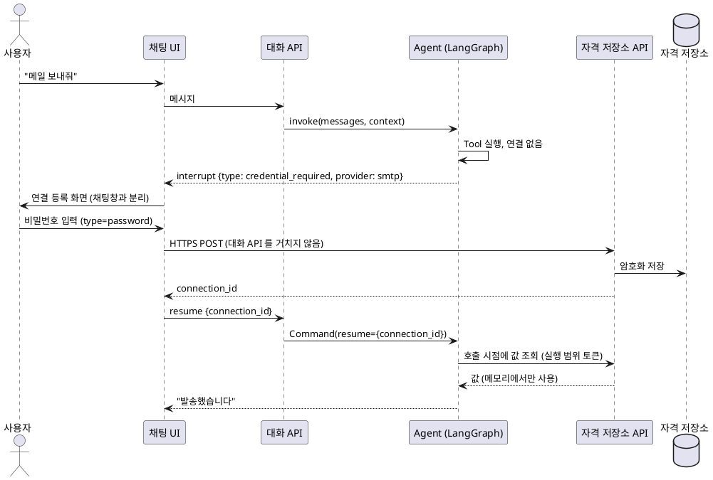

# 비밀번호 노출 방지 보안지침

| 항목             | 값                                                                                   |
| ---------------- | ------------------------------------------------------------------------------------ |
| 문서 상태        | 초안                                                                                 |
| 작성일           | 2026-10-15                                                                           |
| 대상             | LangChain·LangGraph 로 Agent·Tool 을 만드는 개발자, 채팅 UI 개발자                   |
| 검증 버전        | langchain 1.4.6, langchain-core 1.6.10, langgraph 1.2.15, langgraph-checkpoint 4.3.0 |
| 검증 버전 (기록) | langsmith 0.14.8, langgraph-checkpoint-postgres (소스 확인만)                        |

## 1. 개요

### 1.1. 목적

채팅형 Agent 에서 비밀번호가 채팅 화면, 대화 기록, LLM 공급자, checkpoint, 트레이스, 로그에 남지 않도록 개발 기준을 정한다.
이 문서의 "비밀번호"는 비밀번호, 앱 비밀번호, API Key, 접근 토큰처럼 인증에 쓰는 값 전체를 뜻한다.

### 1.2. 전제

- Agent 는 LangChain `create_agent` 또는 LangGraph `StateGraph` 로 만들고, checkpointer 로 대화를 저장한다.
- 트레이스는 LangSmith 또는 LangChain 콜백 기반 수집기로 남긴다.
- 2장의 동작은 위 검증 버전에서 실제로 실행해 관찰한 결과다. 프레임워크 내부 구현이므로 버전이 바뀌면 9장 방법으로 다시 확인한다.
- 사용자가 채팅 입력창에 비밀번호를 직접 입력하는 경우는 이 문서의 범위에서 제외한다.

### 1.3. 핵심 원칙

1. 비밀번호는 채팅으로 받지 않는다. 채팅과 분리된 전용 입력 경로에서 받는다.
2. 모델 컨텍스트(메시지, 시스템 프롬프트, Tool 스키마, Tool 결과)에는 비밀번호 대신 참조 ID 만 넣는다.
3. Tool 에는 `ToolRuntime.context` 로 전달한다. Tool 인자, graph state, `configurable`, `interrupt` 로 넘기지 않는다.
4. Tool 결과, 오류, 로그, 트레이스에 비밀번호를 남기지 않는다. 기록 계층에서 한 번 더 가린다.
5. 노출이 확인되면 기록을 지우는 데서 끝내지 않고 비밀번호를 교체한다.

## 2. 노출 경로

### 2.1. 경로 목록

| 번호 | 경로                                           | 남는 곳                                   |
| ---- | ---------------------------------------------- | ----------------------------------------- |
| 1    | 모델 응답                                      | 채팅 화면, 스트리밍 이벤트, state         |
| 2    | 모델이 채운 Tool 인자                          | `AIMessage.tool_calls`, state, 트레이스   |
| 3    | Tool 결과·오류                                 | `ToolMessage`, 모델 입력, state, 트레이스 |
| 4    | `config["configurable"]`, `config["metadata"]` | checkpoint metadata, 트레이스 metadata    |
| 5    | `interrupt` 재개 값                            | checkpoint pending writes, 트레이스       |
| 6    | 애플리케이션 로그                              | 로그 저장소, LLM 프록시 로그              |
| 7    | 스트리밍 이벤트                                | 프런트엔드, 중계 서버 로그                |

**경로 1 상세.** 모델은 앞선 메시지나 Tool 결과에 있던 값을 응답에서 되풀이할 수 있다. 시스템 프롬프트로 금지해도 보장되지 않는다.

**경로 2 상세.** 비밀번호를 Tool 함수의 일반 매개변수로 정의하면 모델이 값을 채워야 한다.
그러려면 값이 모델 컨텍스트에 있어야 하고, 채운 값은 `tool_calls` 로 state 와 트레이스에 남는다.

### 2.2. 실행 결과

가짜 모델로 `create_agent` 를 실행하고, 경로별로 넣은 비밀번호 문자열이 어디에 남는지 문자열 검색으로 확인했다.
checkpoint 는 `InMemorySaver` 의 저장소 전체, 트레이스는 `LangChainTracer` 가 만든 run 전체를 검색했다.

| 전달 방식                         | 모델 입력 | checkpoint         | 트레이스          |
| --------------------------------- | --------- | ------------------ | ----------------- |
| `ToolRuntime.context`             | X         | X                  | X                 |
| `configurable` 키 `pwd`           | X         | O (metadata)       | O (metadata)      |
| `configurable` 키 `smtp_password` | X         | O (metadata)       | O (metadata)      |
| `interrupt` 재개 값               | X         | O (pending writes) | O                 |
| Tool 결과 + `wrap_tool_call` 치환 | X         | X                  | O (Tool run 출력) |

**configurable 상세.** LangGraph 는 `configurable` 과 `metadata` 의 str·int·float·bool 값을 모든 checkpoint 의 metadata 에 복사한다.
키 이름으로 거르지 않으므로 이름에 `password` 를 넣어도 저장된다(`langgraph/checkpoint/base` 의 `get_checkpoint_metadata`).
langchain-core 는 같은 값을 LangSmith 트레이스 metadata 로 상속시키며, 제외하는 키는 `api_key` 하나다.
Postgres checkpointer 는 metadata 를 `metadata JSONB` 컬럼에 저장하며, 이 값은 `EncryptedSerializer` 암호화 대상이 아니다.
langchain-core 소스 주석도 "context 객체를 쓰라(트레이스되지 않음)"고 안내한다(`langchain_core/runnables/config.py`).

**context 상세.** `create_agent(context_schema=...)` 로 선언하고 `invoke(..., context=...)` 로 넘긴 값은 모델 Tool 스키마, checkpoint, 트레이스 어디에도 나타나지 않았다.
Tool 에서는 `runtime: ToolRuntime` 매개변수로 읽는다. 이 매개변수는 모델에 보이는 Tool 스키마에서 빠진다(관찰 결과 `to` 만 노출).

**interrupt 상세.** `Command(resume=값)` 의 값은 checkpoint pending writes 로 저장되고 트레이스 입력에도 남는다.

**Tool 결과 치환 상세.** `wrap_tool_call` 미들웨어로 `ToolMessage` 를 치환하면 state 와 모델 입력에는 원문이 남지 않았다.
그러나 Tool 자체 run 은 미들웨어가 치환하기 전에 끝나므로, 트레이스의 `send_mail` run 출력에는 원문이 남았다.

## 3. 설계 지침: 비밀번호를 채팅 밖에서 받기

### 3.1. 입력 경로 분리

1. OAuth 같은 위임 인증을 지원하는 서비스는 OAuth 를 쓴다. 이 경우 비밀번호를 받을 필요가 없다.
2. 비밀번호가 꼭 필요하면 채팅과 분리된 연결 등록 화면에서 받는다. 값은 자격 저장소 API 로 바로 보내고 대화 API 를 거치지 않는다.
3. Agent, 메시지, state 는 `connection_id` 같은 참조만 다룬다.

자격이 없을 때 실행을 멈추고 등록을 받는 흐름이다. `interrupt` 에는 "자격 필요" 신호만 담고, 재개 값은 `connection_id` 로 한정한다.



### 3.2. 채팅 UI 요구사항

- 비밀번호 입력란은 채팅 입력창과 분리하고 `type="password"`, `autocomplete="new-password"` 로 둔다.
- 입력값은 자격 저장소 API 로만 보낸다. 대화 메시지, 채팅 이력, `interrupt` 재개 값에 넣지 않는다.
- 저장한 값은 다시 보여주지 않는다(write-only). 조회 응답은 가림값으로 바꾼다.
- 채팅 이력 표시, 알림(메일·푸시), 대화 내보내기, 공유 링크가 원문을 다시 노출하지 않는지 확인한다.

### 3.3. 시스템 프롬프트

- "비밀번호·API Key 를 채팅으로 요청하지 말고 연결 등록 화면을 안내하라"는 지시를 넣는다.
- 프롬프트는 보안 통제가 아니다. 모델이 지시를 따르지 않아도 3.1, 4장의 통제로 막혀야 한다.

## 4. 구현 지침

### 4.1. Tool 에 비밀번호 전달

- 비밀번호를 Tool 함수의 일반 매개변수로 정의하지 않는다(2.1 경로 2).
- `context_schema` 로 실행 컨텍스트를 선언하고, Tool 은 `runtime: ToolRuntime` 으로 읽는다.
- context 에는 값 대신 조회 객체(resolver)와 참조 ID 를 둔다. Tool 이 호출 시점에 조회하고, 쓴 뒤 보관하지 않는다.
- 값은 Pydantic `SecretStr` 로 감싸 `repr`·로그에 원문이 찍히지 않게 하고, 실제로 쓰는 지점에서만 `get_secret_value()` 를 부른다.
- Tool 안에서 `runtime.state`, `runtime.store` 에 비밀번호를 쓰지 않는다. 둘 다 저장된다.

```python
from dataclasses import dataclass
from typing import Protocol

from langchain.agents import create_agent
from langchain.tools import ToolRuntime, tool
from pydantic import SecretStr


class SecretResolver(Protocol):
    def get(self, connection_id: str) -> SecretStr: ...
    def issued_values(self) -> set[str]: ...  # 이번 실행에서 내준 값. 4.5 치환에 쓴다


@dataclass
class AgentContext:
    user_id: str
    smtp_connection_id: str  # 참조 ID. 비밀번호 값이 아니다
    secrets: SecretResolver


@tool
def send_mail(to: str, subject: str, body: str, runtime: ToolRuntime) -> str:
    """메일을 보낸다."""
    ctx: AgentContext = runtime.context
    password = ctx.secrets.get(ctx.smtp_connection_id)
    smtp_send(to, subject, body, password.get_secret_value())
    return "발송 완료"  # 비밀번호·계정·서버 응답 원문을 넣지 않는다


agent = create_agent(model, tools=[send_mail], context_schema=AgentContext, checkpointer=checkpointer)
agent.invoke(
    {"messages": [{"role": "user", "content": user_text}]},
    config={"configurable": {"thread_id": thread_id}},  # 식별자만. 비밀번호 금지
    context=AgentContext(user_id=user_id, smtp_connection_id=connection_id, secrets=resolver),
)
```

`create_agent` 없이 `StateGraph` 를 직접 쓰면 `StateGraph(State, context_schema=AgentContext)` 로 선언한다.
노드는 `runtime: Runtime[AgentContext]` 매개변수로 같은 값을 읽는다(`langgraph.runtime.Runtime`).

`InjectedToolArg` 는 값을 Tool 호출 인자에 끼워 넣는 방식이다. 끼워 넣는 위치에 따라 state 에 남을 수 있으므로 새 코드는 `ToolRuntime` 을 쓴다.
langchain-core 1.0.2 이상은 `InjectedToolArg`·`ToolRuntime` 인자를 `on_tool_start` 트레이스 입력에서 뺀다. 다른 기록 경로에는 이 필터가 없다.

### 4.2. config 사용 제한

- `configurable` 에는 `thread_id`, 사용자 ID 같은 식별자만 둔다. 비밀번호·토큰·세션 쿠키를 넣지 않는다.
- `config["metadata"]`, `tags` 에도 넣지 않는다. `metadata` 도 checkpoint metadata 로 복사된다.
- 키 이름을 바꾸는 것으로는 피할 수 없다. checkpoint metadata 복사는 이름으로 거르지 않는다(2.2).

### 4.3. State, Store, Checkpoint

- state 스키마에 비밀번호 필드를 두지 않는다. state 는 매 step checkpoint 로 저장되고 `get_state_history()` 로 조회된다.
- 장기 메모리(`store`)에 비밀번호를 저장하지 않는다.
- checkpointer 에는 `EncryptedSerializer` 를 적용한다. 키는 `LANGGRAPH_AES_KEY` 환경 변수(16·24·32 바이트) 또는 `key=` 인자로 준다.
- 암호화는 state 본문(blob, writes)만 대상이다. checkpoint metadata 는 평문으로 남는다(실행 확인).
- 암호화는 유출 시 피해를 줄이는 수단이다. 비밀번호를 state 에 넣어도 된다는 근거가 아니다.

```python
from langgraph.checkpoint.postgres import PostgresSaver
from langgraph.checkpoint.serde.encrypted import EncryptedSerializer

serde = EncryptedSerializer.from_pycryptodome_aes()  # LANGGRAPH_AES_KEY 사용. pycryptodome 필요
checkpointer = PostgresSaver(conn, serde=serde)  # from_conn_string() 은 serde 인자를 받지 않는다
```

### 4.4. 모델 출력과 스트리밍

- `PIIMiddleware(apply_to_output=True)` 는 `after_model` 에서 AI 메시지를 치환하고, 스트리밍 이벤트 치환기도 함께 설치한다.
  소스 설명상 대상은 텍스트 delta, Tool 호출 인자 chunk, `tools` 채널 이벤트, `values` 스냅샷이다(`astream_events(version="v3")`).
  스트리밍 치환은 소스 기준이며 실행으로 확인하지 않았다(8장 6번).
- `astream_events` 나 `stream_mode="messages"` 출력을 프런트엔드로 그대로 중계하지 않는다. 화면에 필요한 이벤트만 골라 보낸다.
- 중계 서버가 이벤트 원문을 로그로 남기지 않는지 확인한다.

### 4.5. Tool 결과와 오류

- Tool 반환값에 비밀번호, 계정, 외부 서버 응답 원문을 넣지 않는다.
- 예외 메시지에도 넣지 않는다. 외부 라이브러리 예외는 코드화된 오류로 바꾸고 `raise ... from None` 으로 원래 체인을 끊는다.
- 외부 서버 오류 응답이 요청 헤더나 인증 값을 되울리는 경우가 있다. 원문을 결과에 옮기지 말고 표준 상태 코드만 붙인다.
- `create_agent` 기본 설정은 Tool 인자 검증 오류(`ToolInvocationError`) 메시지만 모델에 돌려주고, 나머지 예외는 다시 던진다.
  `ToolNode(handle_tool_errors=True)` 처럼 예외를 `ToolMessage` 로 바꾸는 설정을 쓰면 예외 메시지가 모델과 state 에 들어간다.

값 기반 치환 미들웨어로 Tool 이 놓친 값을 state 에 들어가기 전에 가린다. resolver 가 이번 실행에서 내준 값을 치환 목록으로 쓴다.

```python
from langchain.agents.middleware import wrap_tool_call
from langchain_core.messages import ToolMessage


@wrap_tool_call
def mask_issued_secrets(request, handler):
    result = handler(request)
    if isinstance(result, ToolMessage):
        text = str(result.content)
        for value in request.runtime.context.secrets.issued_values():
            text = text.replace(value, "[REDACTED]")
        result.content = text
    return result
```

이 미들웨어는 state 와 모델 입력만 보호한다. Tool 자체 트레이스 run 에는 치환 전 값이 남으므로(2.2) 4.6 의 트레이스 마스킹이 함께 필요하다.

### 4.6. 트레이스와 로그

LangSmith 클라이언트는 입력, 출력, metadata 를 숨기거나 치환하는 옵션을 제공한다(`langsmith/client.py`).

| 설정                                                        | 동작                                                       |
| ----------------------------------------------------------- | ---------------------------------------------------------- |
| `LANGSMITH_HIDE_INPUTS=true`                                | 모든 run 입력을 숨긴다                                     |
| `LANGSMITH_HIDE_OUTPUTS=true`                               | 모든 run 출력을 숨긴다                                     |
| `LANGSMITH_HIDE_METADATA=true`                              | 모든 run metadata 를 숨긴다                                |
| `Client(hide_inputs=fn, hide_outputs=fn, hide_metadata=fn)` | 함수로 필요한 부분만 치환한다                              |
| `Client(anonymizer=create_anonymizer(...))`                 | 정규식 규칙으로 문자열을 치환한다 (`langsmith.anonymizer`) |

**트레이스 설정 상세.** 전부 숨기면 디버깅이 어려우므로 함수나 anonymizer 로 비밀값만 치환하는 방식을 권장한다.
치환 규칙은 resolver 가 이번 실행에서 내준 값을 찾아 바꾸는 값 기반 치환을 기본으로 한다.
LangSmith 외 수집기(OpenTelemetry 등)를 쓰면 같은 수준의 치환을 수집기에서 구현한다.

**로그 상세.** `print(state)`, `logger.info(messages)` 처럼 state·메시지 전체를 찍는 코드를 운영 경로에 두지 않는다.
`create_agent(debug=True)` 와 `langchain_core.globals.set_debug(True)` 는 운영에서 끈다.
LLM 프록시(LiteLLM 등)의 요청·응답 로그도 같은 기준으로 점검한다.

### 4.7. Human-in-the-loop

- `interrupt` 재개 값으로 비밀번호를 받지 않는다. 재개 값은 checkpoint 에 저장된다(2.2). 3.1 흐름처럼 `connection_id` 만 받는다.
- `HumanInTheLoopMiddleware` 의 `edit` 결정은 사용자가 Tool 인자를 고칠 수 있게 한다. 고친 값도 state 에 남으므로 승인 화면에 비밀번호 입력란을 두지 않는다.

## 5. 사고 대응

비밀번호가 채팅이나 기록에 노출된 것을 확인하면 다음 순서로 처리한다.

1. 해당 비밀번호를 즉시 교체하거나 폐기한다. LLM 공급자로 전송된 데이터는 회수할 수 없으므로 교체가 가장 우선이다.
2. 해당 대화 스레드의 checkpoint 를 삭제한다(`checkpointer.delete_thread(thread_id)`). 특정 step 만 지우는 방법은 쓰지 않는다.
3. 트레이스 저장소에서 해당 트레이스를 삭제한다.
4. 애플리케이션 로그, LLM 프록시 로그, 채팅 이력 저장소에서 원문을 찾아 삭제하거나 보존 기간을 확인한다.
5. 노출 경로와 원인을 기록하고, 해당 경로의 통제(3장, 4장)를 보강한다.

## 6. 체크리스트

개발과 코드 리뷰에서 확인한다.

- [ ] 비밀번호를 Tool 함수의 일반 매개변수로 정의하지 않았다.
- [ ] state 스키마와 `store` 에 비밀번호를 저장하지 않는다.
- [ ] `configurable`, `metadata`, `tags` 에 비밀번호가 없다.
- [ ] Tool 은 `ToolRuntime.context` 의 resolver 로 호출 시점에 값을 조회한다.
- [ ] Tool 결과와 예외 메시지에 비밀번호, 계정, 외부 서버 응답 원문이 없다.
- [ ] `interrupt` 재개 값과 HITL `edit` 로 비밀번호를 받지 않는다.
- [ ] 비밀번호는 채팅과 분리된 등록 화면에서 자격 저장소 API 로 직접 받는다.
- [ ] 시스템 프롬프트가 비밀번호를 채팅으로 요청하지 않도록 지시한다.
- [ ] checkpointer 에 `EncryptedSerializer` 를 적용했다.
- [ ] 트레이스 수집기에 비밀값 치환을 설정했다.
- [ ] 운영 환경에서 debug 출력과 state 전체 로그가 꺼져 있다.
- [ ] 테스트용 비밀번호로 실행한 뒤 checkpoint, 트레이스, 로그를 검색해 원문이 없음을 확인했다(9장).

## 7. 한계와 운영 고려사항

- LLM 공급자의 데이터 보존·학습 사용 여부는 계약 조건에 따라 다르다. 사용하는 공급자별로 확인한다.
- 2.2 의 동작은 프레임워크 내부 구현이다. LangChain·LangGraph 를 올릴 때마다 9장 방법으로 다시 확인한다.
- context 의 값은 프로세스 메모리에 있다. 같은 프로세스·같은 UID 의 다른 코드가 읽을 수 있는 위협은 `Tool-Dev-Guides.md` 7.4 를 따른다.

## 8. 확인 필요 사항

1. 플랫폼 Worker 가 Tool 설정값을 `ToolRuntime.context` 로 주입하는지, 일반 인자로 합치는지(`Tool-Dev-Guides.md` 7장, `follow-ups.md` F-02).
2. 플랫폼 기준 버전(langchain-core 1.6.5)에서 2.2 결과가 같은지.
3. 운영 트레이스 수집기 종류(LangSmith 여부)와 트레이스 보존 기간.
4. 운영 checkpointer 종류와 metadata 저장 방식, 스레드 보존 기간.
5. LLM 공급자와 LLM 프록시의 요청 로그 보존 정책.
6. `PIIMiddleware` 스트리밍 치환(4.4)은 소스 설명 기준이다. 실제 스트리밍 출력으로 확인이 필요하다.

## 9. 재현 방법

2.2 결과를 다시 확인하는 방법이다. 외부 API 없이 가짜 모델로 실행한다.

1. `GenericFakeChatModel` 을 상속해 `bind_tools()` 가 자기 자신을 돌려주게 하고, `_generate()` 에서 받은 메시지를 모은다.
2. 경로마다 다른 테스트 문자열(예: `CtxPw-5512`)을 넣고 `create_agent(..., checkpointer=InMemorySaver())` 로 실행한다.
3. `LangChainTracer` 를 상속해 `_end_trace()` 에서 run 을 모은다. `client` 에는 `MagicMock()` 을 넣어 전송을 막는다.
   `copy_with_metadata_defaults()` 가 새 인스턴스를 만들므로 모은 run 은 모듈 변수에 둔다.
4. 테스트 문자열을 다음 위치에서 검색한다.

```python
def found_in_checkpoint(saver, value: str) -> bool:
    return any(value in repr(x) for x in (saver.storage, saver.writes, saver.blobs))


for snap in agent.get_state_history(config):
    print(snap.metadata.get("step"), value in repr(snap.values), value in repr(snap.metadata))
```

## 10. 참고 자료

- `langchain_core/runnables/config.py` — `_get_langsmith_inheritable_metadata_from_config`, `CONFIGURABLE_TO_TRACING_METADATA_EXCLUDED_KEYS`
- `langgraph/checkpoint/base/__init__.py` — `get_checkpoint_metadata`, `delete_thread`
- `langgraph/checkpoint/postgres/base.py` — `metadata JSONB` 컬럼 정의
- `langgraph/checkpoint/serde/encrypted.py` — `EncryptedSerializer.from_pycryptodome_aes`
- `langchain/agents/middleware/pii.py` — `PIIMiddleware` 전략과 적용 범위
- `langgraph/prebuilt/tool_node.py` — `_default_handle_tool_errors`, `ToolCallRequest`
- `langsmith/client.py` — `hide_inputs`, `hide_outputs`, `hide_metadata`, `anonymizer`
- [`Tool-Dev-Guides.md`](Tool-Dev-Guides.md) 7장 설정과 비밀값
- [`tool-설정-전달-조사.md`](tool-설정-전달-조사.md) 3장 권장안
- [`follow-ups.md`](follow-ups.md) F-01 기록의 민감정보 마스킹
