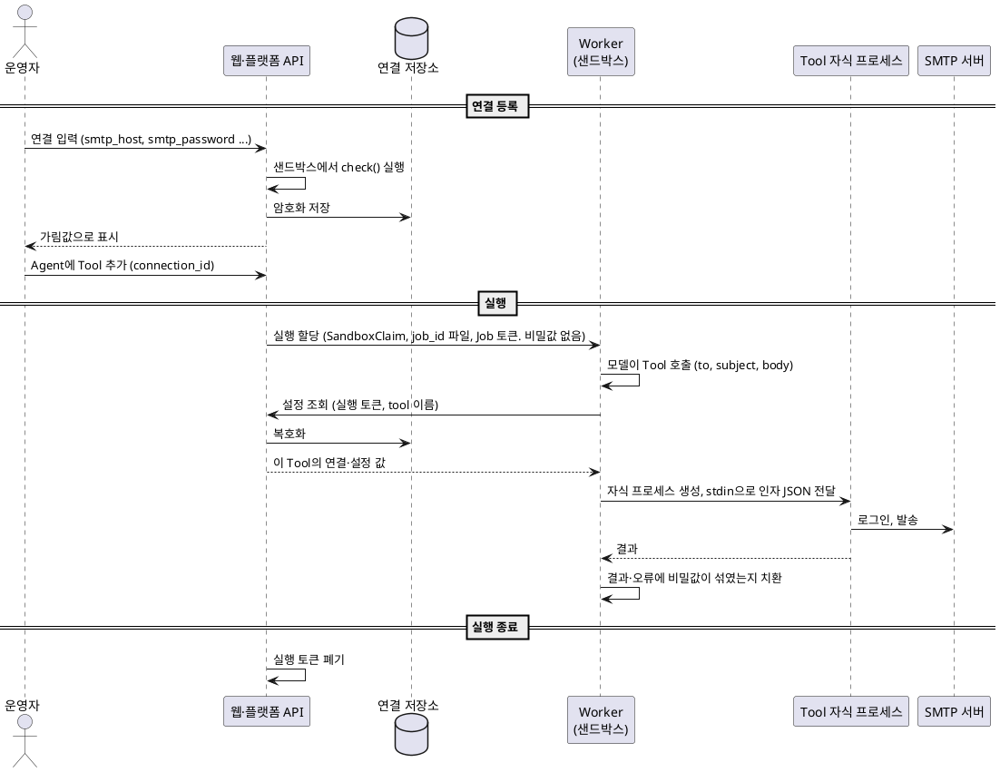

# Tool 설정·비밀값 전달 방식 조사

| 항목      | 값                             |
| --------- | ------------------------------ |
| 문서 상태 | 조사 결과, 기존 문서 반영 완료 |
| 작성일    | 2026-10-14                     |

## 1. 개요

### 1.1. 목적

웹에서 Agent에 Tool을 붙이고 입력한 설정값(비밀번호 포함)을 k8s 샌드박스 컨테이너의 Tool 실행까지 어떻게 전달할지,
편의성과 보안성 기준으로 조사하고 권장안을 정한다. 메일 발송 Tool을 예로 들지만 자격이 필요한 Tool 전반에 적용된다.

### 1.2. 전제

- 사용자가 웹에서 Agent에 Tool을 선택하고 Tool에 필요한 설정을 입력한다(가정).
- Agent 실행은 k8s 샌드박스 컨테이너에서 한다. 컨테이너 안의 Worker가 Tool 호출마다 자식 프로세스를 띄운다(가이드 1장).
- 자식 프로세스에는 Worker의 자격(토큰, MQ·Redis 접속 정보)을 넘기지 않는다(가이드 1장).
- MVP는 단일 테넌트다(Governance `overview.md` 범위 밖 항목). 다만 여러 사용자·Agent의 실행이 같은 클러스터와 warm pool을 공유한다.
- 샌드박스는 warm pool로 미리 띄워 둔다(2026-10-14 결정). 따라서 Pod 생성 시점에 값을 넣는 수단
  (Pod env, Vault Injector, CSI, agent-sandbox claim env)은 쓰지 않는다.

### 1.3. 평가 기준

| 구분   | 기준                                                                                          |
| ------ | --------------------------------------------------------------------------------------------- |
| 편의성 | 한 번 입력해 여러 Agent에서 재사용, 저장 시 연결 확인, 값 교체 시 재배포·재시작 불필요        |
| 보안성 | 모델 비노출, 샌드박스 안 노출 범위, 저장소·기록 노출, 실행 간 격리 (멀티테넌시는 MVP 범위 밖) |
| 구조   | warm pool 호환, 구현·운영 부담                                                                |

## 2. 조사 결과

조사 기준일은 2026-10-14이다. 대괄호 번호는 7장 참고 자료 번호다. 공식 문서 외에 소스로 확인한 내용은 "소스 기준"으로 표시했다.

### 2.1. 등록 형식 관례

조사한 플랫폼은 모두 "연결·자격 설정"과 "모델이 채우는 입력"을 따로 선언한다. 설정 스키마와 호출 스키마를 나눈 현재 안은 관례와 맞다.

| 사례                  | 설정과 모델 입력의 분리                    | 민감 항목 표시                      | 연결 테스트                            |
| --------------------- | ------------------------------------------ | ----------------------------------- | -------------------------------------- |
| Dify [7]              | provider 자격 / `form: form` / `form: llm` | `type: secret-input`                | `_validate_credentials` (추가·수정 시) |
| n8n [9]               | credential / 노드 매개변수, `$fromAI()`    | `typeOptions.password: true`        | `test`, 저장 직후 자동 실행            |
| Airbyte [8]           | spec 전체가 설정 (모델 입력 없음)          | `airbyte_secret: true`              | `check` (설정 단계)                    |
| Arcade [10]           | `input` / `requirements.secrets`           | `requires_secrets`                  | 확인 필요                              |
| MCP [17]              | 클라이언트 `env`·`headers` / `inputSchema` | `password`, `sensitive`, `isSecret` | 표준 없음                              |
| LangChain [12]        | `args_schema` / `ToolRuntime.context`      | 없음 (`SecretStr` 사용)             | 없음                                   |
| JSON Schema 계열 [18] | 해당 없음                                  | `writeOnly`, `format: password`     | 없음                                   |

**가장 가까운 사례.** Dify 공식 email 플러그인은 SMTP 서버·포트·암호화·계정·비밀번호·발신 주소를 provider 자격에 두고,
수신자·참조·숨은 참조·제목·본문을 `form: llm`(모델 입력)으로 둔다 [7]. 현재 설계의 항목 구분과 거의 같다.
n8n은 SMTP 자격(호스트·포트·계정·비밀번호)만 credential에 두고 발신 주소는 노드 매개변수에 둔다 [9].

**`writeOnly`만으로는 부족하다.** `writeOnly`는 주석일 뿐 검증 키워드가 아니다.
스키마 기반 폼 렌더러(react-jsonschema-form, JSON Forms)는 `writeOnly`가 아니라 `format: password`를 보고 입력란을 가린다(소스 기준) [18].
Pydantic `SecretStr`은 `{"type": "string", "format": "password", "writeOnly": true}`를 함께 출력한다.

**저장 후 조회·수정 관례 (소스 기준).** 저장된 비밀값은 조회 응답에서 가림값으로 바꾸고, 수정 화면에서 가림값을 그대로 보내면 기존 값을 유지한다.

| 사례        | 조회 응답                  | 값을 바꾸지 않고 저장할 때                        |
| ----------- | -------------------------- | ------------------------------------------------- |
| Dify [7]    | 앞 2자·뒤 2자만 남기고 `*` | 프런트엔드가 `[__HIDDEN__]`을 보내면 기존 값 유지 |
| Airbyte [8] | `**********`               | 가림값을 그대로 보내면 기존 값 유지               |
| n8n [9]     | `__n8n_BLANK_VALUE_<uuid>` | 서버가 기존 값과 병합                             |

**비밀값을 모델이나 대화로 받지 않는다.** MCP 명세(2025-11-25)는 서버가 form 모드 elicitation으로 비밀번호·API Key를 요청하는 것을 금지하고,
대역 외 URL 모드로만 받도록 한다 [17]. Composio도 자격 입력을 자체 호스팅 화면으로만 받는다 [11].

### 2.2. 실행 환경 전달 방식 유형

| 유형                          | 대표 사례                                          | Tool 코드가 원문을 보는지 | 장점                                  | 단점                             |
| ----------------------------- | -------------------------------------------------- | ------------------------- | ------------------------------------- | -------------------------------- |
| A. 배포·세션 단위 env         | LangSmith Deployment, Modal, Copilot [16]          | 봄 (자식 프로세스도 상속) | 단순, 모든 SDK와 호환                 | 사용자별 값 불가, 교체 시 재시작 |
| B. 호출 단위 페이로드         | Dify, Arcade [7][10]                               | 봄, 모델은 못 봄          | 사용자별 값, 즉시 교체, 프로토콜 무관 | Tool 코드 침해 시 노출           |
| C. 참조 저장 + 실행 직전 주입 | Airbyte [8]                                        | 봄                        | 저장소에는 참조만                     | 실행 중 교체 불가                |
| D. egress 프록시 치환         | Claude vaults, E2B, Daytona, Deno, Vercel [13][14] | 못 봄 (placeholder)       | 프롬프트 인젝션 유출 차단             | HTTP(S) 원문 전송만 지원         |
| E. 프로토콜 전용 프록시       | Claude Code GitHub 프록시 [13]                     | 못 봄 (범위 제한 토큰)    | 요청 내용 검증까지 가능               | 프로토콜마다 구현                |
| F. 플랫폼 측 실행             | Composio Proxy Execute [11]                        | 못 봄                     | 샌드박스에 비밀값 없음                | 비밀값이 플랫폼에 집중           |

**Dify 주의점 (소스 기준).** Dify는 호출마다 자격을 복호화해 plugin daemon에 평문으로 넘기며,
복호화한 자격을 Redis에 평문 JSON으로 24시간 캐시한다(`tool_credentials:<tenant_id>:...`) [7]. 따라하지 않을 부분이다.

**egress 프록시 치환의 한계.** 조사한 제품들은 HTTP(S) 요청에 비밀값을 원문 그대로 넣는 경우만 지원한다.
서명 계산(SigV4 등)이나 토큰 교환이 필요한 클라이언트는 지원하지 않는다고 명시한다 [13].
SMTP AUTH 주입을 지원하는 제품은 찾지 못했다(확인 필요). SMTP에 적용하려면 E·F 유형처럼 프로토콜 전용 중계가 필요하다(3.6).

**OpenAI Codex 클라우드.** 비밀값은 setup 단계에만 제공되고 agent 단계 시작 전에 제거된다 [15]. 설치·빌드용 비밀값을 보호하는 방식이라 Tool 호출에는 쓸 수 없다.

### 2.3. k8s 전달 수단

| 수단                                  | 비밀값이 남는 곳                                   | warm pool              | 교체 반영                 | 운영 부담 |
| ------------------------------------- | -------------------------------------------------- | ---------------------- | ------------------------- | --------- |
| Pod env (`secretKeyRef`)              | etcd, containerd 메타데이터, 모든 프로세스 environ | 불가                   | 재시작                    | 낮음      |
| Secret 볼륨                           | etcd, 노드 tmpfs, 마운트 파일                      | 조건부 (지연 1분 이상) | 자동 (지연 있음)          | 낮음~중간 |
| 실행 중 조회 (단기 토큰 + 플랫폼 API) | 플랫폼 DB, Worker·자식 메모리                      | 가능                   | 즉시                      | 중간      |
| Vault Injector, CSI                   | Vault, tmpfs 또는 노드                             | Pod 생성 시 고정       | Injector 자동, CSI 미지원 | 높음      |
| External Secrets Operator             | etcd (Secret 볼륨과 같음)                          | Secret 볼륨과 같음     | 주기 동기화               | 중간~높음 |
| 샌드박스 밖 게이트웨이                | 게이트웨이 (플랫폼 DB)                             | 가능                   | 즉시                      | 중간~높음 |

**Pod env.** containerd는 env를 OCI spec에 넣어 영구 디스크의 메타데이터 DB에 저장한다(소스 기준) [5].
Pod 생성 후에는 env를 바꿀 수 없다 [2]. 실행 단위 비밀값을 Pod 생성 시점에 넣으면 warm pool을 쓸 수 없다.

**agent-sandbox (소스 기준).** kubernetes-sigs/agent-sandbox v1.0.6의 `SandboxClaim.spec.env`는 평문 `Value`로만 주입되고,
env를 지정하면 컨트롤러가 warm pool을 건너뛰고 새 Pod를 만든다 [1].
메인테이너는 실행 단위 권한 관리를 CRD 범위 밖으로 보고(issue #1580, 2026-09-09), 다음을 권한다 [1].

- 장기 자격은 컨테이너에 넣지 않고, egress sidecar나 tool proxy가 동적으로 주입한다.
- 단기 토큰은 `sandboxd`의 프로세스 단위 env로 넘겨 Pod에 영구 저장되지 않게 한다.
- 샌드박스를 재사용하지 않고 warm pool에서 매번 새 인스턴스를 할당한다.

위 동작은 v1.0.6 소스로 확인했다. 개발 Cluster에 설치된 버전은 v1.0.4이므로(Governance `deploy/README.md`) 같은 동작인지 확인 필요.

**External Secrets Operator.** 컨트롤러가 클러스터 전역 Secret 읽기·쓰기 권한을 갖고, 공유 저장소를 쓰면 키 단위 네임스페이스 제한이 없다 [6].
실행 단위 전달 용도로는 맞지 않는다.

### 2.4. 샌드박스 안의 노출

같은 컨테이너에서 같은 UID로 도는 Tool 자식 프로세스는 Worker를 상대로 다음을 할 수 있다 [3].

| 대상                                      | 같은 UID 자식 프로세스의 접근 | 조건                                                         |
| ----------------------------------------- | ----------------------------- | ------------------------------------------------------------ |
| Worker의 `/proc/<pid>/environ`            | 읽기 가능                     | Worker가 dumpable(기본값)이면 허용. Yama 설정과 무관         |
| Worker의 `/proc/<pid>/mem`                | 차단                          | Yama `ptrace_scope=1`이면 자손이 아닌 프로세스의 attach 거부 |
| Worker가 읽는 파일 (Secret 볼륨, SA 토큰) | 읽기 가능                     | 파일 권한은 같은 UID를 막지 못함                             |
| 모든 프로세스의 `/proc/<pid>/cmdline`     | 읽기 가능                     | 접근 검사 없음                                               |

**가이드 원칙에 미치는 영향.** "자식 프로세스에 Worker 자격을 넘기지 않는다"는 원칙은 env를 넘기지 않는 것만으로는 지켜지지 않는다.
Worker의 environ과 Worker가 읽는 파일이 같은 UID에 열려 있기 때문이다. gVisor·Kata도 같은 컨테이너 안의 이 동작은 바꾸지 않는다 [3].
현재 Worker는 MVP 한정 예외로 Event Broker 쓰기 계정과 LiteLLM 호출 키를 환경 변수로 받는다(Governance `exceptions.md`).
따라서 이 경로는 가정이 아니라 지금 열려 있는 경로다.

**Worker가 자식 프로세스에 값을 넘기는 경로.**

| 경로         | 노출                                                                        |
| ------------ | --------------------------------------------------------------------------- |
| argv         | `ps`, `/proc/<pid>/cmdline`으로 컨테이너 안 모든 프로세스에 노출. 사용 금지 |
| 환경 변수    | 자식의 environ에 실행 내내 남고, 손자 프로세스에 상속됨                     |
| stdin 파이프 | `/proc`에 정적으로 남지 않음. 자식이 읽은 뒤에는 메모리에만 있음            |

stdin 파이프도 자식이 읽기 전에 같은 UID가 `/proc/<pid>/fd/0`으로 가로챌 여지가 있는지는 실험으로 확인해야 한다.

## 3. 권장안

### 3.1. 요약

1. 등록 형식: Tool 정의를 "연결(Connection) 스키마 + Agent별 설정 스키마 + 호출 스키마 + 연결 테스트 함수"로 구성한다.
2. 저장: 웹 입력은 서버에서 즉시 암호화하고 write-only로 다룬다. Agent 설정·메시지·LangGraph state에는 `connection_id` 참조만 둔다.
3. 전달: 비밀값을 Pod에 미리 넣지 않는다. Worker가 Tool 호출 시점에 실행 단위 토큰으로 설정 조회 API에서 받아 자식 프로세스의 stdin으로만 넘긴다.
4. 샌드박스 안: Worker를 non-dumpable로 만들고, Tool 실행을 별도 UID나 별도 컨테이너로 분리하는 것을 검토한다.
5. SMTP 2단계: 비밀번호가 샌드박스에 들어가지 않도록 샌드박스 밖 메일 게이트웨이를 둔다(3.6).

1~4는 B·C 유형(2.2)과 실행 중 조회(2.3)를 조합한 것으로, Dify·Arcade·Airbyte의 구조에 같은 컨테이너 안 노출 대책을 더했다.
warm pool과 호환되고 값을 바꾸면 다음 호출부터 반영된다.

### 3.2. 구성요소

| 구성요소           | 역할                                                                          |
| ------------------ | ----------------------------------------------------------------------------- |
| Tool 정의          | 연결 스키마, Agent별 설정 스키마, 호출 스키마, 연결 테스트 함수               |
| 연결 저장소        | 자격 암호화 저장, write-only API, 저장 시 연결 테스트                         |
| Agent 설정         | Tool 선택, `connection_id` 참조, Agent별 설정값                               |
| 실행 토큰          | 기존 Job 범위 단기 토큰을 쓴다. 설정 조회 범위만 이 Job·Agent의 Tool로 좁힌다 |
| 설정 조회 API      | 토큰 검증 후 해당 실행·Tool에 필요한 설정만 복호화해 반환                     |
| Worker             | 호출 시점 조회, 자식 프로세스에 stdin으로 전달                                |
| Tool 자식 프로세스 | stdin에서 인자를 읽어 실행하고 결과 반환                                      |

### 3.3. 등록 형식

연결 자격은 여러 Agent가 재사용하는 이름 붙은 연결로, Agent마다 다를 수 있는 값은 Agent별 설정으로 나눈다.
메일 Tool은 발신자도 연결에 두므로(발신 주소 = 연결 계정, `design.md` 3.3, 2026-10-15) Agent별 설정이 없다.
Dify의 provider 자격과 n8n의 credential이 연결에 해당한다. 아래는 형식 예시이며, 실제 등록 형식은 플랫폼이 정한다.
현재 `registry.tool_def`에는 `input_schema` 외에 연결 스키마·Agent별 설정 스키마·연결 테스트 진입점을 담을 열이 없다(Governance `storage.md` §9.3).
따라서 이 형식은 플랫폼에 제안할 확장안이다.

```yaml
name: send_mail
version: 1.0.0                       # 표기 확인 필요: Registry 버전은 정수 문자열 (storage.md §9.6)
impl: tools.send_mail:send_mail      # 호출 진입점 (가이드 3장)
check: tools.send_mail:check         # 연결 테스트 진입점
connection_schema:                   # 연결: 여러 Agent가 재사용
  type: object
  properties:
    smtp_host: { type: string }
    smtp_port: { type: integer, enum: [25, 465, 587, 2525], default: 587 }
    smtp_security: { type: string, enum: [starttls, ssl], default: starttls }
    smtp_auth: { type: string, enum: [login, none], default: login }   # none: 사내 무인증 릴레이
    smtp_username: { type: string, format: email }   # 발신 주소로도 쓴다
    smtp_password: { type: string, format: password, writeOnly: true }   # smtp_auth=login 일 때 필수
    from_name: { type: string }
  required: [smtp_host, smtp_username]
# config_schema:                     # Agent별 설정. 메일 Tool은 없음
input_schema:                        # 모델이 채우는 호출 항목
  type: object
  properties:
    to: { type: array, items: { type: string } }
    subject: { type: string }
    body: { type: string }
  required: [to, subject, body]
  additionalProperties: false
```

Tool 함수는 연결·호출 스키마를 합친 값을 키워드 인자로 받으므로 `send_mail()` 시그니처는 바뀌지 않는다.
`check()`는 메일을 보내지 않고 접속·STARTTLS·로그인까지만 확인한다. 연결을 저장할 때와 호스트나 비밀번호를 바꿀 때 실행한다.
`check()`도 Tool 코드이므로 샌드박스에서 실행해야 한다.

### 3.4. 처리 흐름



**실행 할당.** Governance 아키텍처 기준으로 Worker는 SandboxClaim annotation이 Downward API로 투영한 `/etc/podinfo/job-id` 파일에서 `job_id`를 받는다.
Worker가 소비하는 Command Queue는 없고, Sandbox가 갖는 자격은 Job 범위 단기 토큰 하나다(`architecture.md` §2.1, §2.2).
외부 계약은 `job_id`를 기준으로 하며 `run_id`는 두지 않는다(`storage.md`).

**연결 테스트 실행 경로.** Sandbox는 Job 단위로만 할당되고 인바운드 포트를 열지 않는다.
연결을 저장하는 시점에 `check()`를 Sandbox에서 실행할 경로가 지금은 없으므로 확인 필요.

### 3.5. 샌드박스 안 규칙

**Worker → 자식 프로세스.**

- 설정값은 stdin(또는 전용 파이프)으로 해당 Tool 호출에 필요한 것만 JSON으로 넘긴다. argv와 env로는 넘기지 않는다.
- `subprocess`의 `env=`에는 필요한 최소 변수(예: 임시 디렉터리 경로)만 넣는다. Worker의 환경을 상속하지 않는다.
- `close_fds=True`(기본값)를 유지한다. `multiprocessing`의 `fork`는 Worker 메모리를 복제하므로 쓰지 않는다 [4].
- 호출이 끝나면 자식 프로세스 그룹을 종료해 백그라운드 프로세스가 남지 않게 한다.

**Worker 보호.**

- Worker 자신의 자격은 env로 받지 않는다. 프로세스 안에서 지워도 `/proc/<pid>/environ`에는 초기값이 남는다 [3].
  현재는 MVP 한정 예외로 env로 받고 있으므로, 예외를 해소할 때 함께 적용한다.
- Worker는 시작 직후 `prctl(PR_SET_DUMPABLE, 0)`을 호출해 같은 UID의 `/proc` 접근을 막는다 [3]. Python 표준 라이브러리에는 래퍼가 없어 ctypes로 호출해야 하는지 확인 필요.
- 실행 토큰의 조회 범위는 "이 실행, 이 Agent에 붙은 Tool"로 좁힌다. 같은 UID의 Tool이 토큰을 읽어도 다른 실행의 값을 받을 수 없게 한다.

**분리 검토.** 같은 UID 문제를 근본적으로 없애려면 Tool 실행을 다른 UID나 다른 컨테이너로 분리해야 한다.

- 다른 UID: Worker가 자식 프로세스를 다른 사용자로 띄우려면 setuid 권한이 필요해, 비root 실행 원칙과 부딪힌다.
- 다른 컨테이너: 같은 Pod에 Tool 실행 컨테이너를 따로 두고 소켓으로 호출한다. `shareProcessNamespace`는 쓰지 않는다 [2].

두 방안 모두 가이드 1장의 실행 구조에 영향을 주므로 플랫폼과 협의가 필요하다.

### 3.6. SMTP 2단계: 샌드박스 밖 메일 게이트웨이

비밀번호를 샌드박스에 전혀 두지 않으려면, 플랫폼이 샌드박스 밖에 메일 게이트웨이를 두고 Tool은 게이트웨이로만 보낸다.
agent-sandbox 메인테이너가 권하는 tool proxy 방식이고 [1], Claude Code의 GitHub 프록시 [13], agent-sandbox `nono` 예제의 phantom 토큰과 같은 구조다.

```text
Tool ──SMTP AUTH(사용자=연결 계정, 비밀번호=실행 토큰)──▶ 메일 게이트웨이 ──SMTP AUTH(실제 계정)──▶ 메일 서비스
                                                         │
                                                         └─ 토큰 검증, connection_id로 실제 자격 조회
```

**제안.** 게이트웨이가 SMTP를 그대로 받으면 Tool 코드는 바뀌지 않는다. 연결 설정만 게이트웨이 주소와 실행 토큰으로 바꾼다.
Tool은 로그인 계정을 발신 주소로 쓰므로, 계정은 실제 연결 계정을 그대로 두고 비밀번호 자리에만 실행 토큰을 넣는다.
게이트웨이는 토큰을 검증하고, 실행에 연결된 실제 계정으로 상위 서버에 인증해 중계한다.
Postfix는 발신자별 SASL 자격으로 상위 서버에 중계하는 기능을 문서화하고 있다 [19].
다만 Tool이 보낸 토큰을 검증하는 부분은 직접 구현해야 하고, SMTP 주입을 이렇게 구성한 공개 사례는 찾지 못했다(확인 필요).

| 구분 | 내용                                                                            |
| ---- | ------------------------------------------------------------------------------- |
| 장점 | 비밀번호가 샌드박스·Pod·etcd에 없음, 프롬프트 인젝션으로 유출 불가, 즉시 교체   |
| 장점 | 수신자 통제(F-05)·발송량 제한·감사를 한곳에서 처리                              |
| 한계 | 게이트웨이 구축과 고가용성 운영, 게이트웨이가 모든 자격을 가진 고가치 대상이 됨 |
| 한계 | SMTP 전용. HTTP API형 Tool은 egress 프록시 치환(2.2 D) 같은 별도 수단이 필요    |

## 4. 장점과 한계

**장점.**

- warm pool과 호환된다. 비밀값을 Pod 생성 시점에 넣지 않는다.
- 값을 바꾸면 다음 호출부터 반영된다. 재배포·재시작이 필요 없다.
- 연결을 한 번 등록하면 여러 Agent가 재사용하고, 저장 시 연결 테스트로 오입력을 바로 알 수 있다.
- 비밀값이 모델, Pod spec, etcd, 메시지 큐, LangGraph state에 남지 않는다.

**한계.**

- 1단계(3.1의 1~4)에서는 Tool 코드가 비밀번호 원문을 본다. Tool 코드나 의존성이 침해되면 노출된다.
- 같은 UID 문제는 Worker non-dumpable과 토큰 범위 제한으로 줄일 뿐, UID·컨테이너 분리 없이는 없어지지 않는다.
- 설정 조회 API를 새로 만들어야 한다. 실행 토큰은 기존 Job 범위 토큰을 쓸 수 있는지 확인 필요.

## 5. 운영 고려사항

- 암호화: 연결 저장소는 envelope 암호화(KMS 또는 Vault transit)를 쓰고, 키 교체 절차를 정한다.
- 캐시: 복호화한 값을 Redis 등에 캐시하지 않는다(Dify 사례, 2.2).
- 참조만 전달: Agent 설정, 메시지 큐, LangGraph state·checkpoint·context에는 `connection_id`만 둔다. context가 실행 기록에 남는지는 확인 필요 [12].
- k8s: 샌드박스 ServiceAccount에 Secret 읽기와 Pod 생성 권한을 주지 않는다(Pod를 만들 수 있으면 같은 네임스페이스의 Secret을 읽을 수 있다) [2].
  현재 SandboxTemplate은 `automountServiceAccountToken: false`가 적용돼 있다. Secret을 쓰는 경우 etcd 암호화(KMS v2)를 켠다 [2].
- 네트워크: 현재 SandboxTemplate의 NetworkPolicy는 `egress: [{}]`로 송신 전체를 허용한다.
  Governance `architecture.md` §2.2 대로 승인 목적지만 허용하도록 좁히고, 설정 조회 API와 Tool 목적지(예: SMTP 465·587)를 여기에 포함한다.
- 권한: 연결은 "사용만 가능"과 "조회·수정 가능" 권한을 나눈다. n8n은 공유받은 사용자가 자격 상세를 보거나 고칠 수 없게 한다 [9].
- 감사: 연결 등록·변경, 설정 조회 API 호출을 값 없이 기록한다.
- 기록 마스킹: 결과·오류·로그에 섞인 비밀값은 값 기반으로 치환한다(`follow-ups.md` F-01).

## 6. 확인 필요 사항

warm pool 사용 여부는 "사용"으로 정해졌다(2026-10-14). 현황은 Governance 문서와 Sandbox 매니페스트로 확인한 내용이다.

| 번호 | 항목                                                            | 영향                     | 현황                                                                       |
| ---- | --------------------------------------------------------------- | ------------------------ | -------------------------------------------------------------------------- |
| 1    | Worker가 실행을 할당받는 경로                                   | 실행 토큰 전달 방법 결정 | 해소. Downward API 파일 `/etc/podinfo/job-id`, Command Queue 없음 (3.4)    |
| 2    | Worker의 자식 프로세스 생성 방식과 실행 UID                     | 3.5 규칙 적용 범위       | 일부 해소. 컨테이너는 uid 10001 하나. 자식 프로세스 UID 분리 여부는 미확인 |
| 3    | 실행 단위 토큰 발급 체계가 이미 있는지                          | 새로 만들어야 하는 범위  | 일부 해소. Job 범위 단기 토큰이 있다. 발급 주체와 조회 범위 제한은 미확인  |
| 4    | LangGraph context·state가 실행 기록·트레이스에 남는지           | 참조만 둘지, 값도 둘지   | 미확인                                                                     |
| 5    | stdin 파이프를 `/proc/<pid>/fd/0`으로 가로챌 수 있는지          | 실험으로 검증            | 미확인                                                                     |
| 6    | 노드 배포판의 Yama 기본값, 컨테이너 `/proc`의 hidepid 적용 여부 | 같은 UID 노출 범위       | 미확인                                                                     |
| 7    | SMTP 게이트웨이 구성 사례와 토큰 검증 구현 방법                 | 3.6 구현 가능성          | 미확인                                                                     |
| 8    | 연결 저장 시 `check()`를 실행할 Sandbox 경로                    | 연결 테스트 가능 여부    | 미확인. Sandbox는 Job 단위 할당, 인바운드 없음 (3.4)                       |

## 7. 참고 자료

- [1] kubernetes-sigs/agent-sandbox (v1.0.6)
  https://github.com/kubernetes-sigs/agent-sandbox/blob/main/extensions/controllers/sandboxclaim_controller.go
  https://github.com/kubernetes-sigs/agent-sandbox/issues/1580
  https://github.com/kubernetes-sigs/agent-sandbox/tree/main/examples/nono-sandbox
  https://github.com/kubernetes-sigs/agent-sandbox/tree/main/examples/containarium-execution-scoped-token
- [2] Kubernetes 공식 문서
  https://kubernetes.io/docs/concepts/configuration/secret/
  https://kubernetes.io/docs/concepts/security/secrets-good-practices/
  https://kubernetes.io/docs/concepts/storage/projected-volumes/
  https://kubernetes.io/docs/concepts/workloads/pods/#pod-update-and-replacement
  https://kubernetes.io/docs/tasks/administer-cluster/encrypt-data/
  https://kubernetes.io/docs/tasks/configure-pod-container/share-process-namespace/
- [3] Linux man page, 커널 소스
  https://man7.org/linux/man-pages/man5/proc_pid_environ.5.html
  https://man7.org/linux/man-pages/man2/ptrace.2.html
  https://man7.org/linux/man-pages/man2/PR_SET_DUMPABLE.2const.html
  https://github.com/torvalds/linux/blob/master/security/yama/yama_lsm.c
- [4] Python `subprocess`, `multiprocessing`
  https://docs.python.org/3/library/subprocess.html
  https://docs.python.org/3/library/multiprocessing.html#contexts-and-start-methods
- [5] containerd
  https://github.com/containerd/containerd/blob/main/internal/cri/server/container_create.go
- [6] Vault, Secrets Store CSI Driver, External Secrets Operator
  https://developer.hashicorp.com/vault/docs/deploy/kubernetes/injector-csi
  https://secrets-store-csi-driver.sigs.k8s.io/concepts
  https://external-secrets.io/latest/guides/multi-tenancy/
- [7] Dify
  https://docs.dify.ai/en/develop-plugin/dev-guides-and-walkthroughs/tool-plugin
  https://github.com/langgenius/dify-official-plugins/tree/main/tools/email
  https://github.com/langgenius/dify/blob/main/api/core/helper/provider_encryption.py
  https://github.com/langgenius/dify/blob/main/api/core/helper/provider_cache.py
- [8] Airbyte
  https://docs.airbyte.com/platform/understanding-airbyte/secrets
  https://docs.airbyte.com/platform/connector-development/connector-specification-reference
  https://github.com/airbytehq/airbyte-platform/blob/main/airbyte-config/config-secrets/src/main/kotlin/secrets/JsonSecretsProcessor.kt
- [9] n8n
  https://docs.n8n.io/integrations/creating-nodes/build/reference/credentials-files/
  https://docs.n8n.io/credentials/credential-sharing/
  https://docs.n8n.io/advanced-ai/examples/using-the-fromai-function/
- [10] Arcade.dev
  https://docs.arcade.dev/home/build-tools/create-a-tool-with-secrets
  https://github.com/ArcadeAI/arcade-mcp/blob/main/libs/arcade-core/arcade_core/schema.py
- [11] Composio
  https://docs.composio.dev/docs/authentication
  https://docs.composio.dev/docs/security/token-custody
- [12] LangChain
  https://docs.langchain.com/oss/python/langchain/tools
  https://docs.langchain.com/oss/python/langchain/runtime
- [13] Anthropic
  https://code.claude.com/docs/en/claude-code-on-the-web
  https://www.anthropic.com/engineering/claude-code-sandboxing
  https://platform.claude.com/docs/en/managed-agents/vaults
- [14] 샌드박스 서비스
  https://docs.e2b.dev/secrets
  https://www.daytona.io/docs/en/python-sdk/sync/secret
  https://docs.deno.com/sandbox/security/
  https://vercel.com/docs/vercel-sandbox/concepts/firewall
  https://developers.cloudflare.com/sandbox/guides/outbound-traffic/
- [15] OpenAI Codex 클라우드 환경
  https://learn.chatgpt.com/docs/environments/cloud-environment
- [16] GitHub Copilot cloud agent
  https://docs.github.com/en/copilot/how-tos/copilot-on-github/customize-copilot/customize-cloud-agent/configure-secrets-and-variables
- [17] MCP
  https://modelcontextprotocol.io/specification/2025-11-25/client/elicitation
  https://github.com/modelcontextprotocol/mcpb/blob/main/MANIFEST.md
- [18] JSON Schema, OpenAPI, 폼 렌더러
  https://json-schema.org/draft-07/json-schema-validation
  https://swagger.io/docs/specification/v3_0/data-models/data-types/
  https://github.com/rjsf-team/react-jsonschema-form/blob/main/packages/utils/src/resolveDefaultWidget.ts
- [19] Postfix
  https://www.postfix.org/SASL_README.html
